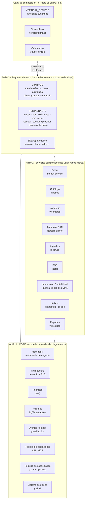
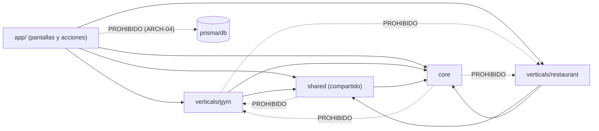
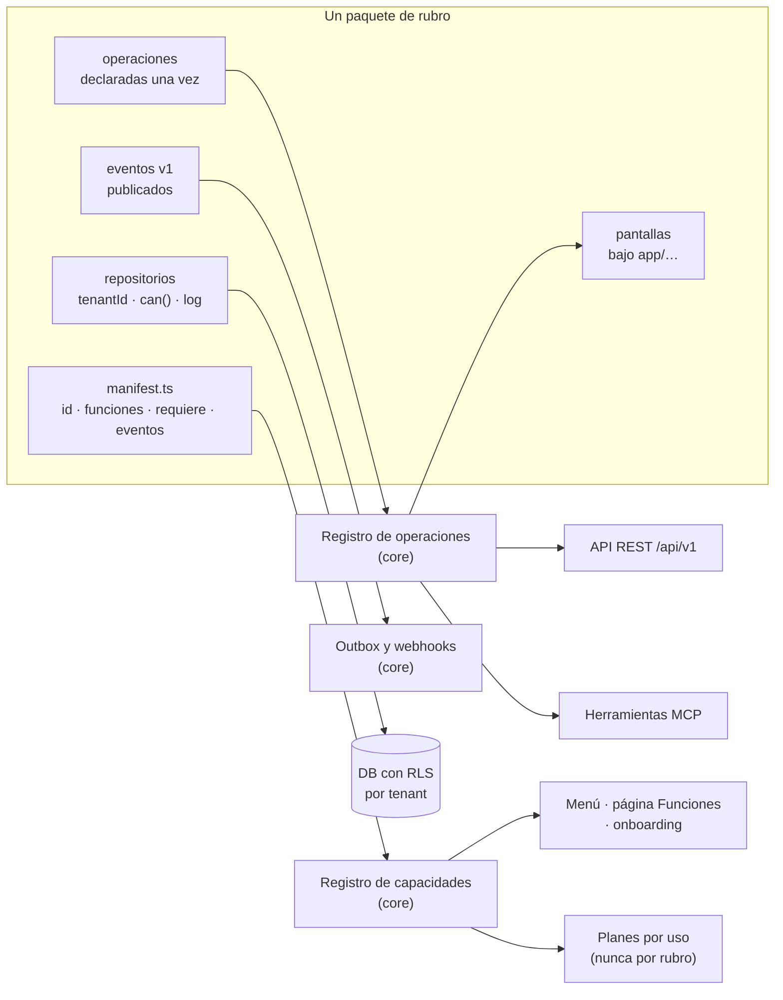
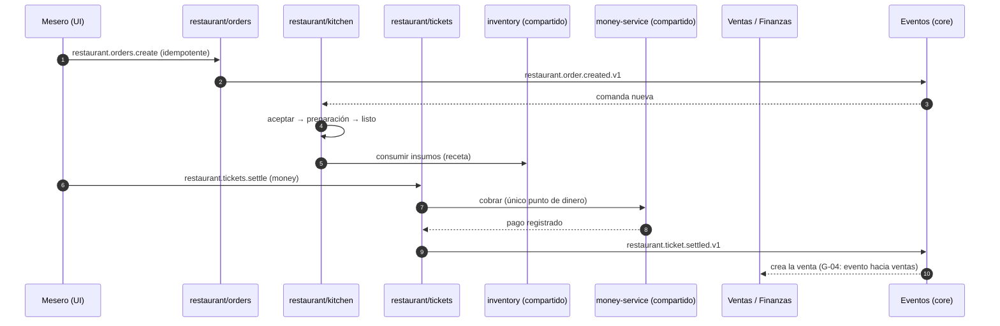
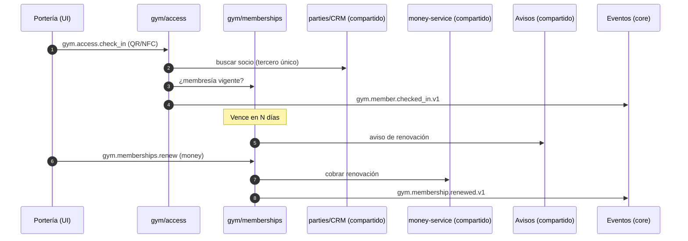
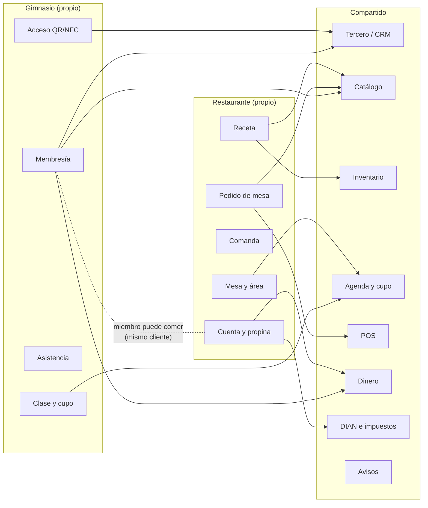
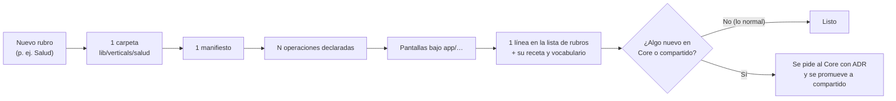

# Arquitectura: Core, compartido y paquetes de rubro

> **Estado: propuesta para revisar.** No se movió ni se escribió código. Parte
> de lo que el repositorio ya tiene (verificado el 2026-10-30) y de las reglas
> vigentes: [`../distribucion-por-rubro.md`](../distribucion-por-rubro.md),
> [`../arquitectura-v2/`](../arquitectura-v2/README.md) (B, C, D, G) y los ADR
> 0001–0006. Dónde hay una decisión por tomar, está marcada **[D-n]**.

## 1. Qué se quiere resolver

Hoy el foco son **dos rubros: Restaurante y Gimnasio**. Se necesita:

1. Separar con claridad **lo compartido (Core)** de **lo propio de cada rubro**.
2. Que sumar un tercer rubro (o una función nueva de un rubro) **no obligue a
   tocar el Core** ni a otro rubro.
3. Que la frontera no sea una convención, sino algo que **el CI haga cumplir**.
4. No romper la regla de producto: *un solo sistema, el rubro es un perfil, nada
   se vende por separado* (`distribucion-por-rubro.md`).

## 2. Estado actual (lo verificado)

| Hallazgo | Evidencia | Consecuencia |
|---|---|---|
| El código del gimnasio está **mezclado con el compartido** en `lib/business/` | `gym-db.ts`, `gym.ts`, `memberships-db.ts`, `museum-db.ts` conviven con `money-service.ts`, `customers-db.ts`, `permissions.ts` | No se ve dónde termina el Core y empieza el rubro |
| Construcción **sí** tiene su carpeta | `lib/construction/` (APU, bitácora, informes) | Es el precedente a seguir |
| Las funciones se declaran **una vez** en un registro | `lib/capabilities/registry.ts` (`kind: "base" \| "specialized"`) | Ya existe el punto de ensamblaje; falta saber **a quién pertenece** cada una |
| Las operaciones se declaran una vez (API + MCP + eventos) | `lib/operations/` (`module`, `permission`, `risk`, `emits`) | El rubro nuevo entra por aquí, sin canal propio |
| El rubro es solo un perfil | `VERTICAL_RECIPES` en `lib/admin/catalogs.ts` | Se conserva tal cual |
| Hay **una regla de frontera**: `app/` no importa la base | `eslint.config.mjs` (ARCH-04) | Es el modelo para las nuevas reglas |
| El contrato de datos es **un solo archivo** | `prisma/contract.prisma`: 3.408 líneas, 118 modelos | Crece sin dueño; ver §7 |
| Restaurante **casi no existe**: usa POS, inventario y compras generales | `D-checklist-restaurante.md` (RST-3…RST-10 sin hacer) | Se construye **ya con la frontera puesta** |

La tensión a resolver: la regla vigente dice *«el rubro no es una frontera»* (un
gimnasio puede usar obras y un restaurante, membresías). **No se contradice** si
se distingue entre dos fronteras distintas:

| Frontera | ¿Existe? | Qué significa |
|---|---|---|
| **De producto** (qué puede usar un cliente) | **No.** Se mantiene | Cualquier negocio enciende cualquier función; nada se oculta por rubro |
| **De código** (quién puede importar a quién) | **Sí.** Es lo nuevo | Un paquete de rubro depende del Core; el Core nunca depende de un rubro |

## 3. Modelo de tres anillos



**Qué entra en cada anillo** (criterio de `B-core-y-compartidas.md`, afinado):

| Anillo | Prueba para estar aquí | Ejemplos |
|---|---|---|
| **1 · Core** | Sin esto **ningún** negocio funciona y **no puede** saber qué rubro existe | Identidad, tenant, `can()`, auditoría, eventos, registro de operaciones y de capacidades, planes |
| **2 · Compartido** | **Dos o más** rubros lo usan, o es regla de dinero/ley que no se duplica | `money-service`, catálogo, inventario, terceros, POS, impuestos, DIAN, avisos, agenda |
| **3 · Rubro** | Solo tiene sentido para ese oficio **hoy**. Se puede encender en otro negocio, pero no se escribió pensando en él | Membresía, acceso con QR/NFC, mesa, comanda, receta, impoconsumo |

Regla de promoción: algo sube del anillo 3 al 2 **cuando un segundo rubro lo
pide de verdad** (no antes). Ejemplo ya presente: las **reservas**. El gimnasio
las usa para clases y el restaurante para mesas → la agenda y el cupo son
compartidos; «clase» y «mesa» son del rubro.

## 4. Regla de dependencias (lo que se hace cumplir)



Reglas, de la más a la menos estricta:

| # | Regla | Cómo se hace cumplir |
|---|---|---|
| F1 | **Core y compartido no importan de un rubro** | Regla `no-restricted-imports` por carpeta + prueba en `lib/` que recorre los imports |
| F2 | **Un rubro no importa de otro rubro** | Igual. Si Restaurante necesita algo de Gimnasio, **se promueve a compartido** o se pide por evento |
| F3 | **Un rubro solo toca la base por sus repositorios** con `tenantId`, `can()` y `logTenantAction` | Ya vigente (ARCH-04); se amplía a `verticals/` |
| F4 | **Dinero**: solo `money-service` mueve plata | Ya vigente; el rubro emite el evento y ventas lo recoge |
| F5 | **Comunicación entre anillos y rubros: eventos y puertos**, no llamadas directas | Contrato de eventos versionados (`restaurante.ticket.settled.v1`) |
| F6 | **Cada operación de rubro se declara una vez** en el registro de operaciones | Definición de «hecho» de `integracion-api-mcp-webhooks.md` |
| F7 | **No hay `if (vertical === "x")` en componentes ni en compartido** | Ya vigente; se agrega una prueba que lo busca |

## 5. Estructura de carpetas propuesta

Se propone **no mover el Core ni lo compartido** ahora (el riesgo de un
renombrado masivo no compensa). Se hace en tres pasos de bajo riesgo:

1. **Los rubros nuevos nacen en su carpeta** (`lib/verticals/restaurant/`).
2. **El gimnasio sale de `lib/business/`** a `lib/verticals/gym/` (son ~370
   líneas de repositorio, `gym.ts` y `memberships.ts`; pocos importadores).
3. **El Core y lo compartido se clasifican con un manifiesto**
   (`layers.json`) en vez de moverse; las reglas F1–F7 lo leen. La mudanza
   física, si se quiere, es una decisión posterior **[D-1]**.

```
lib/
├── (Core y compartido: se quedan donde están, clasificados en layers.json)
│   ├── tenant/ operations/ events/ capabilities/ plans/ permisos… ← CORE
│   └── business/ (money, customers…) inventory/ purchasing/ pos/
│       parties/ tax/ accounting/ einvoice/ payments/ …          ← COMPARTIDO
│
├── verticals/                         ← ANILLO 3 (nuevo)
│   ├── README.md                      ← la regla F1–F7 y cómo sumar un rubro
│   ├── gym/
│   │   ├── manifest.ts                ← id, funciones que aporta, dependencias, eventos
│   │   ├── memberships/               ← alta, renovación, congelar (hoy memberships-db.ts)
│   │   ├── access/                    ← QR/NFC, check-in (hoy gym-db.ts)
│   │   ├── attendance/
│   │   ├── classes/                   ← cupos por clase (GYM-8)
│   │   ├── operations/                ← operaciones declaradas (API+MCP+eventos)
│   │   ├── events.ts                  ← gym.member.checked_in.v1 …
│   │   └── terms.ts                   ← vocabulario del rubro
│   └── restaurant/
│       ├── manifest.ts
│       ├── tables/                    ← mesas, áreas, QR inmutable (RST-4)
│       ├── orders/                    ← pedido de mesa y estados (RST-3, G-04)
│       ├── kitchen/                   ← comandas y pantalla de cocina (RST-5)
│       ├── recipes/                   ← recetas e insumos (RST-6)
│       ├── tickets/                   ← cuenta, división, propina, impoconsumo (RST-8)
│       ├── reservations/              ← reserva ligada a mesa (RST-7)
│       ├── operations/
│       ├── events.ts                  ← restaurant.ticket.settled.v1 …
│       └── terms.ts
│
├── construction/                      ← ya es un rubro; se le aplica la misma regla después
└── museum… (hoy en business/museum-db.ts; mudar en una fase posterior)

app/[tenant]/(app)/
├── (pantallas compartidas)            ← crm, finance, inventory, pos, bookings…
├── gym/…  o  memberships/ checkin/    ← pantallas del gimnasio
└── restaurant/                        ← mesas, comandera, cocina, cuenta
    ├── tables/  orders/  kitchen/  recipes/  tickets/  reservations/
```

> Las rutas actuales del gimnasio (`/memberships`, `/checkin`) **no cambian de
> URL** al mover su código: se mantiene la ruta y solo cambia de dónde importa.
> Las del restaurante nacen bajo `/restaurant/…` **[D-2]**.

## 6. El manifiesto de rubro: la pieza que lo hace escalable

Cada rubro declara **una vez** qué aporta, igual que ya se hace con
`capabilities/registry.ts`. El Core lee los manifiestos; **no conoce** a los
rubros por nombre.



Contenido mínimo propuesto del manifiesto (esquema, no código final):

| Campo | Para qué | Ejemplo Restaurante |
|---|---|---|
| `id` | Dueño de sus funciones | `restaurant` |
| `capabilities[]` | Funciones que aporta al registro | `restaurant_tables`, `restaurant_kitchen`, `restaurant_recipes`, `restaurant_tickets` |
| `requires[]` | Funciones compartidas que **explican** su dependencia | `inventory`, `pos`, `payments`, `taxes` |
| `provides.events[]` | Contratos de eventos (versionados) | `restaurant.ticket.settled.v1` |
| `consumes.events[]` | Eventos del Core/compartido que escucha | `inventory.stock.low.v1` |
| `permissions[]` | Permisos nuevos para `can()` | `restaurant.tables.manage`, `restaurant.kitchen.operate` |
| `profile` | Receta sugerida del rubro | funciones encendidas al inicio + vocabulario |
| `ownsModels[]` | Modelos de datos que le pertenecen | `RestaurantTable`, `KitchenTicket`, `Recipe` |

Esto reemplaza dos cosas dispersas hoy: `kind: "specialized"` (que solo agrupa) y
la receta suelta en `catalogs.ts`. **Agregar un rubro = una carpeta + un
manifiesto + una línea en la lista de rubros.** El Core no se edita.

## 7. Datos: cómo no seguir creciendo en un solo archivo

| Tema | Situación | Propuesta |
|---|---|---|
| Un contrato de 3.408 líneas / 118 modelos | Cada rubro agrega modelos al mismo archivo | **Dueño por modelo**: secciones con cabecera por anillo (`// ── CORE`, `// ── COMPARTIDO`, `// ── RUBRO: restaurant`) y lista `ownsModels` en el manifiesto; una prueba verifica que cada modelo tiene dueño |
| ¿Se puede partir en varios archivos? | **No lo verifiqué**: no hallé la referencia de Prisma 8 en el repo | Comprobar en la documentación de Prisma 8 antes de proponerlo **[D-3]**. Mientras tanto, secciones y la prueba de dueño |
| Referencias entre rubro y compartido | Un modelo de rubro apunta a compartidos (p. ej. mesa → sucursal) | Permitido: rubro → compartido. **Prohibido** compartido → rubro (no hay FK desde `Customer` a un modelo de gimnasio) |
| `Customer.accessCode` / `nfcUid` (campos de gimnasio en tabla compartida) | Hallazgo E-02 / decisión G-03 | Dejarlos como **identificadores de acceso** genéricos (los usa también el museo) |
| Campos por rubro en la ficha del cliente | Hoy `customer-fields.ts` mira `vertical === "gym"` (E-03) | Que cada rubro **aporte su conjunto de campos** vía manifiesto, sin `if` |
| Migraciones | Requieren SQL de producción antes del merge (`docs/prod-sql/`) | Se mantiene; la historia de cada rubro lleva su migración propia |
| Aislamiento | `tenantId` + RLS | Todo modelo de rubro lo lleva. **Prueba de aislamiento obligatoria** por modelo nuevo |

## 8. Cómo se conectan los rubros con lo compartido (ejemplos)

### 8.1 Restaurante: de la mesa al dinero



Lo importante: **el rubro nunca escribe ventas ni mueve dinero**; solo pide al
servicio compartido y avisa por evento.

### 8.2 Gimnasio: de la entrada a la renovación



### 8.3 Qué comparten y qué no



El punto de la última línea punteada: **un mismo cliente** puede ser socio de un
gimnasio y comensal (un negocio con cafetería en el gimnasio). Eso funciona
porque el cliente es **un tercero único** del anillo 2, no una copia por rubro.

## 9. Escalabilidad: qué pasa al sumar un tercer rubro



| Criterio de escalabilidad | Cómo se cumple |
|---|---|
| **Rubro nuevo sin tocar el Core** | Manifiesto + carpeta; el registro lee manifiestos |
| **Función nueva sin tocar otro rubro** | Regla F2 (prohibido rubro → rubro) |
| **Equipos en paralelo** | Cada rubro es un dueño de carpeta, modelos y eventos; los conflictos de merge se concentran en el registro |
| **Quitar o aplazar un rubro** | Se apaga su manifiesto; el Core sigue; los datos quedan (como hoy con módulos apagados) |
| **Rendimiento / carga** | Todo modelo con `tenantId` + índice por tenant; búsquedas y listas con límite en servidor (regla ya vigente). Comanda y cocina son el **punto caliente**: tiempo real → se define aparte **[D-5]** |
| **Extracción futura a servicio** | Si un rubro crece, sus eventos versionados y su manifiesto son el contrato para sacarlo. Hoy sigue siendo monolito modular (ADR 0001) |
| **Integraciones externas** | Cada operación ya trae API, MCP y webhooks; proveedores (DIAN, Mercado Pago, delivery) por **puertos y adaptadores** |

## 10. Qué hay que decidir antes de construir

| # | Decisión | Opciones | Recomendación |
|---|---|---|---|
| **D-1** | ¿Mudar físicamente el Core y lo compartido a `lib/core` y `lib/shared`? | Sí, ahora · No, solo clasificar con `layers.json` · Después de los dos rubros | **No ahora.** Clasificar y hacer cumplir; mudar solo si el costo se justifica |
| **D-2** | ¿Rutas del restaurante bajo `/restaurant/…`? ¿Y las del gimnasio se quedan? | Prefijo por rubro · Rutas planas | Restaurante con prefijo; gimnasio **sin cambiar URL** (ya hay enlaces y PWA) |
| **D-3** | ¿Se puede partir `contract.prisma` en varios archivos con Prisma 8? | Verificar · No partir | Verificar en la doc de Prisma 8; mientras, secciones + prueba de dueño |
| **D-4** | G-04: pedido de restaurante **propio con evento a ventas** | Confirmar · Extender `StoreOrder` | Confirmar. Condición para empezar el restaurante |
| **D-5** | Tiempo real para comandera/cocina | Sondeo corto · SSE · WebSocket/servicio externo | Sondeo corto al inicio (cero dependencias), medir y subir. Lo decide una historia propia |
| **D-6** | ¿Quién es dueño de **reservas de mesa**: Agenda compartida o el restaurante? | Compartida (`Booking`) con recurso «mesa» · Propia del restaurante | Compartida: el cupo y el choque de horarios son iguales a las clases del gimnasio |
| **D-7** | Impoconsumo y propina colombianos | Con contador, antes de la fase de cobro | Sí; sin esto no se cierra RST-8 |
| **D-8** | ¿La lista de rubros acepta rubros «solo restaurante y gimnasio» al registrarse? | Mantener los 17 y marcar 2 como prioritarios · Reducir | **Mantener los 17** (ya existen) y que Restaurante y Gimnasio sean los dos **con producto completo** |

## 11. Fases de migración (cada una es una historia `feature/HU-…-NN`)

```mermaid
gantt
  title Orden propuesto (por dependencia, sin fechas comprometidas)
  dateFormat  X
  axisFormat  %s
  section Frontera
  F0 Decidir D-1…D-4 y escribir ADR           :f0, 0, 1
  F1 layers.json + reglas F1–F7 en CI          :f1, after f0, 2
  F2 Manifiesto de rubro en el registro        :f2, after f1, 2
  section Gimnasio
  F3 Mudar gym a lib/verticals/gym (sin cambiar URLs) :f3, after f2, 2
  F4 Campos de ficha por manifiesto (E-03)     :f4, after f3, 1
  section Restaurante
  F5 Mesas (RST-4)                             :f5, after f2, 2
  F6 Pedido de mesa y comandera (RST-3/5)      :f6, after f5, 3
  F7 Cuenta, propina, impoconsumo (RST-8)      :f7, after f6, 2
  F8 Recetas e insumos (RST-6)                 :f8, after f6, 2
  F9 Reservas de mesa (RST-7)                  :f9, after f5, 2
```



| Fase | Entrega | Riesgo | Criterio de «hecho» |
|---|---|---|---|
| **F0** | ADR «Core, compartido y rubros» + respuestas D-1…D-4 | Bajo | ADR aprobado por una persona del equipo |
| **F1** | `layers.json` + regla `no-restricted-imports` + prueba que recorre imports (F1, F2, F7) | Bajo: solo falla si hay violaciones; se arrancan con **lista de excepciones conocida** que baja con el tiempo | CI en rojo si se rompe una regla nueva |
| **F2** | Tipo `VerticalManifest` y lectura desde el registro de capacidades | Medio | Registro y menú idénticos antes y después (prueba) |
| **F3** | Mover `gym-db`, `gym`, `memberships-db`, `memberships` | Medio: pocos importadores (12 archivos hallados) | Pruebas de gimnasio en verde; URLs sin cambio |
| **F4** | Quitar `vertical === "gym"` de `customer-fields.ts` | Bajo | Misma ficha, sin `if` |
| **F5–F9** | Restaurante, ya con la frontera puesta | Según fase | Las del documento 07 de `NexusRestaurant/` |

**Orden clave:** F0–F2 antes de escribir el restaurante, para no construirlo en
`lib/business/` y mudarlo después. F3–F4 (gimnasio) pueden ir en paralelo con F5.

## 12. Riesgos y cómo se mitigan

| Riesgo | Probabilidad | Mitigación |
|---|---|---|
| La frontera queda como convención y se erosiona | Alta si no hay CI | F1: regla y prueba **antes** de las funciones |
| Mover el gimnasio rompe pantallas | Media | F3 en un PR aparte, sin cambios de comportamiento; pruebas de gimnasio e2e |
| Sobre-ingeniería (manifiesto, promoción) con solo dos rubros | Media | Mínimo viable: lo que sirve a dos rubros hoy; **promover solo con segundo uso real** |
| Acoplar restaurante a `StoreOrder` por atajo | Media | D-4 y regla F5 (evento hacia ventas) |
| `contract.prisma` sin dueño crece sin control | Alta | Secciones + prueba de dueño (§7) |
| Cambiar la regla «el rubro no es frontera» sin querer | Baja | §2 deja explícito que la frontera es **de código**, no de producto |
| Comandera en tiempo real encarece o no escala | Media | D-5: empezar simple y medir |
| Contradecir lo ya decidido (`distribucion-por-rubro.md`) | Baja | Este plan **no cambia** esa página; la complementa |

## 13. Qué se actualiza en esta carpeta al aprobarlo

| Archivo | Cambio |
|---|---|
| `XI-Especializacion-por-Vertical/README.md` | Pasa de «1 subcapa (Construcción)» a **paquetes de rubro**: Gimnasio y Restaurante junto a Construcción, cada uno con su README, su manifiesto y su escalera |
| `../arquitectura-v2/G-decisiones-pendientes.md` | G-02 (dónde viven membresías, acceso, mesas, comandas) queda **resuelta por este plan**; G-04 se confirma |
| `../arquitectura-v2/E-registro-inconsistencias.md` | E-02, E-03 y E-04 se enlazan a F3–F4 |
| `docs/nexus-architecture/decisions/` | Nuevo ADR 0007 «Core, compartido y rubros» (el último es 0006) |
| `../distribucion-por-rubro.md` | Una línea que remite a este documento (frontera de producto ≠ frontera de código) |
| `scripts/capas-progreso.mjs` | Revisar que acepte las carpetas nuevas de XI **antes** de crearlas (genera la tabla de progreso) |

## 14. Lo que no sé todavía

- **Cuántos archivos importan hoy de `lib/business/`** compartido vs. del gimnasio: conté 12 que tocan `gym-db`/`memberships-db`/`museum-db`; no medí el resto. F1 lo mide.
- **Si Prisma 8 permite partir el contrato** (D-3).
- **Cuánto cuesta el generador de capas** con carpetas nuevas en XI (revisar `scripts/capas-progreso.mjs`).
- **Quién será revisor humano** del ADR: el equipo marcó como debilidad que las aprobaciones las firma un agente.
- **Reglas fiscales colombianas** del restaurante (D-7): fuera de lo que puedo deducir del código.
