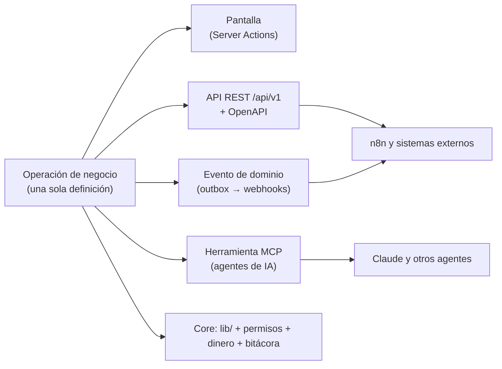

# Integración: API, MCP y webhooks para todo

> **Regla de la guía:** nada de NEXUS existe solo como pantalla. Todo lo que el
> sistema hace lo puede hacer también **otro sistema** (API), un **agente de
> IA** (MCP) o un **flujo de n8n** (webhooks y API). Se define una vez y de ahí
> salen las cuatro superficies.

Este documento es el contrato. Cada subcapa de [`capas/`](capas/README.md)
lleva su propia tabla «Superficie de integración» (recursos, eventos y
herramientas MCP) y una casilla por pieza; aquí están las reglas comunes.
Se apoya en lo ya decidido en [`docs/PENDIENTES.md` §5](../docs/PENDIENTES.md),
en el outbox de [`scaling-path.md` Etapa 2](../docs/nexus-architecture/scaling-path.md)
y en el registro de capacidades (ADR-0003, `lib/capabilities/registry.ts`).

> Estado: **en construcción**. Ya existe el **registro de operaciones**
> (`lib/operations/`: tipos, motor y 6 operaciones de lectura, PR-01). Todavía
> no existen `/api/v1`, el servidor MCP ni el outbox (PR-02 a PR-04). Sí
> existen los repositorios de `lib/` con `tenantId`, `can()`, `money-service` y
> `logTenantAction`, que son lo que la API envuelve, y dos webhooks entrantes
> (`app/api/webhooks/whatsapp`, `email`) de uso interno.

---

## 1. Una definición, cuatro superficies

**Registro de operaciones** (la pieza que lo hace posible, hermana de
`lib/capabilities/registry.ts`). Cada operación se declara una vez:

| Campo | Qué es |
| --- | --- |
| `id` | `customers.create`: estable, es el nombre en API, MCP y eventos |
| `module` | Módulo que debe estar activo (se exige en el servidor, SEC-06) |
| `permission` | Clave de `BUSINESS_PERMISSIONS` (también el alcance de la llave) |
| `input` / `output` | Esquema validado (genera OpenAPI y el esquema de la herramienta MCP) |
| `risk` | `read` · `draft` · `write` · `money` · `destructive` (decide la aprobación, §4.3) |
| `idempotent` | Si exige `Idempotency-Key` |
| `emits` | Eventos que publica al outbox (`customer.created.v1`) |
| `handler` | Llama al repositorio de `lib/`; **nunca** a la base directo |

Lo que salga de ahí (ruta REST, herramienta MCP, documento OpenAPI, catálogo de
eventos, fila en la tabla de cada subcapa, nodo de n8n) se **genera**, no se
escribe a mano. Si una operación no está en el registro, no existe para
integraciones. Una prueba comprueba que cada operación del registro tiene
permiso, módulo, esquema y riesgo.

### Reglas que no se negocian (heredadas de PENDIENTES §5.2)

1. **El negocio y la persona los decide el servidor** (por la llave, el token
   o la sesión), jamás el cliente ni el modelo.
2. **El MCP no tiene reglas propias:** es una capa delgada sobre las mismas
   operaciones. Un segundo backend sería una segunda fuente de errores.
3. **El dinero lo mueve `money-service.ts`.** Ni la API, ni el MCP, ni n8n, ni
   un agente tocan saldos ni credenciales bancarias.
4. **Todo queda en la bitácora** (`logTenantAction`) con el origen: persona,
   llave, agente o automatización.
5. **Las respuestas salen de datos reales**; el modelo redacta, no calcula.
6. **Lo que escribe un tercero es dato, no instrucción** (mensajes de clientes,
   documentos, correos): no cambian el comportamiento del agente.
7. **Hay cupos** por negocio y por llave (peticiones, tokens de IA,
   ejecuciones, mensajes). Nada «ilimitado» sin medir (subcapa X.00).
8. **Lo mínimo necesario:** respuestas y eventos con los campos justos; los
   datos personales solo cuando el permiso y la finalidad lo justifican
   (Ley 1581 de 2012; X.03).

---

## 2. API REST `/api/v1`

| Tema | Decisión |
| --- | --- |
| Estilo | REST sobre JSON, recursos en plural y en inglés (`/customers`, `/payment-links`), documento **OpenAPI 3.1** generado del registro |
| Versionado | En la ruta (`/api/v1`); se agrega, no se cambia. Un cambio incompatible es `/v2`; la anterior se avisa con cabecera `Sunset` y **≥ 12 meses** |
| Autenticación | **Llave por negocio** (`nx_live_…` / `nx_test_…`): solo se guarda su hash; se muestra una vez; tiene alcances, vencimiento, último uso y autor. Después, **OAuth 2.0** (cliente por integración, para el directorio y el marketplace) |
| Alcances | Los permisos de `BUSINESS_PERMISSIONS` como `recurso:acción` (`customers:read`, `payments:create`). Mínimo privilegio por defecto; el rol de la llave nunca supera el de quien la creó |
| Negocio | Lo fija la llave; **no hay** `tenantId` en la ruta ni en el cuerpo |
| Idempotencia | Cabecera `Idempotency-Key` obligatoria en operaciones `write`/`money`; se guarda 24 h la respuesta; la misma llave con otro cuerpo da `422` |
| Paginación | Por cursor (`?cursor=&limit=`, máx. 100), orden estable; sin `offset` en listas grandes |
| Filtros | `?updated_since=` en todos los listados (clave para n8n y sincronizaciones) |
| Errores | RFC 9457 (`application/problem+json`): `type`, `title`, `status`, `detail`, `code` estable, `request_id` |
| Límites | Por llave y por plan; cabeceras `RateLimit-*` y `Retry-After`; cuota mensual medida en X.00 |
| Trazabilidad | `X-Request-Id` en cada respuesta; cada llamada queda en el registro de uso y en la bitácora si escribe |
| Entornos | **Prueba** (`nx_test_`): datos y pasarelas simulados, por negocio; no mueve dinero ni envía mensajes reales |
| Documentación | Interactiva y pública, con ejemplos de flujo de n8n por recurso |
| Contratos | Pruebas de contrato por operación (esquema, permiso, módulo, idempotencia, aislamiento entre negocios) |

---

## 3. Webhooks y eventos

**Salida (NEXUS → n8n y otros):**

1. **Outbox transaccional.** La operación escribe su evento en la misma
   transacción (`OutboxEvent`): no hay evento sin hecho ni hecho sin evento.
2. **Catálogo versionado:** `recurso.acción.v1` (`payment.confirmed.v1`). Se
   agregan campos; no se cambian.
3. **Eventos delgados:** `id`, `type`, `created_at`, `tenant`, `data` mínima y
   el `id` del recurso; el detalle se pide a la API (menos datos personales en
   tránsito, menos versiones que mantener).
4. **Suscripciones** por negocio: URL HTTPS, tipos de evento, secreto propio
   (rotable con periodo de gracia), estado y últimas entregas visibles.
5. **Firma:** `NEXUS-Signature: t=<unix>,v1=<HMAC-SHA256(secreto, t.cuerpo)>`;
   el receptor rechaza si la hora difiere > 5 min (anti-repetición).
6. **Entrega:** al menos una vez, `2xx` en 10 s; reintentos exponenciales (1 min
   → 24 h, ~8 intentos); luego **bandeja de fallidos** con **reenvío manual**;
   el endpoint se desactiva tras N fallos seguidos y se avisa a la persona.
7. **Idempotencia del receptor:** el `id` del evento no cambia entre
   reintentos; el orden no se garantiza entre recursos distintos (sí por
   recurso, cuando importe, con `sequence`).
8. **SSRF:** solo HTTPS, sin IPs privadas ni internas, sin redirecciones a
   ellas, tiempo y tamaño acotados.
9. **Reenvío y consulta:** `GET /events` (el mismo catálogo) para quien no
   pueda recibir webhooks o necesite reconciliar.

**Entrada (proveedores → NEXUS):** `POST /api/webhooks/<proveedor>/<negocio>`
con la firma **verificada con el secreto del proveedor** antes de leer nada;
registro del cuerpo crudo; **idempotente** por el id del proveedor; responde
rápido y procesa en cola; el estado final siempre se confirma consultando al
proveedor cuando mueve dinero.

---

## 4. MCP de NEXUS (agentes de IA)

### 4.1 Servidor

- Servidor **MCP** (transporte HTTP «streamable») en `/api/mcp`, además de un
  modo local por `stdio` para pruebas y desarrollo.
- Autenticación con la **misma llave o token** de la API; el negocio y los
  alcances salen de ahí. Una llave solo ve las herramientas que sus alcances
  permiten.
- **Las herramientas se generan del registro de operaciones**, con el mismo
  esquema de entrada y la misma comprobación de permisos, módulo y cupo.
  Nombres en `snake_case` y verbo primero (`search_customers`,
  `get_receivables_aging`): son los que aparecen en cada subcapa.
- Además de herramientas: **recursos** (documentos de solo lectura: resumen del
  negocio, esquema de métricas, catálogo de eventos) y **prompts** (plantillas
  de tareas frecuentes: «cierre de caja», «cartera vencida»).

### 4.2 Diseño de herramientas

- Pocas, claras y con descripción útil para el modelo; **respuestas mínimas**
  (campos justos, resumen + enlace al detalle).
- Anotaciones MCP honestas: `readOnlyHint`, `destructiveHint`,
  `idempotentHint`.
- Errores con mensaje que el modelo pueda corregir (qué faltó y cómo).
- Salida de datos de terceros marcada como **dato** (separada de instrucciones).
- Medición: cada llamada cuenta para el cupo de la llave y del negocio.

### 4.3 Riesgo y aprobación

| `risk` | Ejemplo | Qué pasa |
| --- | --- | --- |
| `read` | `list_overdue_customers` | Se ejecuta si hay alcance |
| `draft` | `draft_quote`, `draft_post` | Crea un **borrador**; no sale nada al exterior |
| `write` | `create_customer`, `assign_conversation` | Con alcance de escritura; se registra el origen |
| `money` | `create_payment_link`, `refund_payment` | **Propone** (`AgentAction`) y una persona aprueba; el movimiento lo hace `money-service` |
| `destructive` | `void_sale`, `close_period` | **Siempre aprobación humana** + motivo; reversible o auditado |

La aprobación vive en una bandeja del negocio (`AgentAction`: borrador →
aprobada o rechazada → ejecutada). Una llave con permiso explícito puede
saltarse la aprobación **solo** en `write`, nunca en `money` ni `destructive`.
Empezar en **solo lectura** y subir por evidencia (IX.04).

---

## 5. Puertos y adaptadores para proveedores

El dominio **nunca** conoce a un proveedor. Habla con un **puerto**; cada
proveedor es un **adaptador** intercambiable, configurado **por negocio**
(`ExternalConnection`, credenciales cifradas, nunca en texto plano ni en logs).

| Puerto | Proveedores previstos | Subcapas |
| --- | --- | --- |
| Pagos | Nequi, Wompi, Bold, Mercado Pago, PSE, Stripe | V.00, V.01, V.02 |
| Facturación electrónica | DIAN **por proveedor tecnológico** (Alegra, Siigo, Factus, Carvajal, otros) | VII.04, VII.03 |
| Nómina electrónica y seguridad social | Proveedor tecnológico DIAN; operadores PILA | VIII.03 |
| Mensajería | WhatsApp Business (Cloud API), correo (SES / Resend), SMS | III.00, II.05 |
| Modelos de IA | Claude y otros, detrás de un puerto de LLM con cupo y registro | III.01, IX.04 |
| Bancos y conciliación | Extractos (archivo), Open Finance cuando exista | VII.07 |
| Envíos | Servientrega, Coordinadora, Envía | V.04, VI.04 |
| Calendarios | Google Calendar, Microsoft 365 | VI.01, V.05 |
| Firma electrónica | Proveedor autorizado (Certicámara, Olimpia, DocuSign) | VI.03 |
| Almacenamiento | Vercel Blob / S3 | I.07, VI.03 |
| Publicidad y redes | Meta, Google, TikTok | II.02, II.06 |

**Contrato de un adaptador** (igual para todos los puertos):

1. `capabilities`: qué soporta (cobro único, recurrente, QR, reembolso…), para
   que la interfaz solo ofrezca lo que existe.
2. `verifyWebhook(request)` y `normalize(evento)`: convierte el evento del
   proveedor al **evento de dominio** de NEXUS (el resto del sistema no ve la
   forma del proveedor).
3. Claves de idempotencia hacia el proveedor y desde él.
4. Tiempos, reintentos con límite y **corte de circuito** (un proveedor caído
   no tumba la petición ni a los demás negocios).
5. **Modo prueba** (sandbox del proveedor) y datos simulados para `nx_test_`.
6. Pruebas de contrato con respuestas grabadas del proveedor.

**Dinero:** el adaptador de pagos solo **informa** (intención creada, pago
confirmado, fallido, reembolsado); el cambio de estado y los asientos los hace
`money-service`. La conciliación compara lo que dice el proveedor con lo
registrado y deja diferencias a revisión, nunca las «arregla» sola.

### DIAN (Colombia)

> Los detalles normativos cambian: validar con la DIAN y con el proveedor
> tecnológico antes de construir, y revisar al menos cada trimestre.

- NEXUS **no firma ni transmite directamente** al principio: lo hace un
  **proveedor tecnológico habilitado**, detrás del puerto de facturación. Así
  se cumple lo regulado sin reescribirlo (regla de producto de la guía).
- Por negocio: datos fiscales completos (NIT/DV, régimen, responsabilidades),
  **resolución de numeración**, prefijo y rangos, certificado/credenciales del
  proveedor, ambiente de **habilitación** y de **producción**.
- Flujo: documento comercial (V.06) → reglas fiscales (VII.03) → `submit` al
  proveedor → estados `enviada`, `aceptada`, `rechazada` (con motivo legible) →
  **CUFE/CUDE**, XML y PDF guardados → evento `einvoice.accepted` /
  `einvoice.rejected` → reintento o corrección; **notas crédito/débito** y
  **documento soporte** por el mismo puerto; eventos **RADIAN** entrantes.
- Contingencia y reintentos con cola; nunca perder un documento por una caída.
- Retención y consulta de soportes por el plazo legal; exportación para el
  contador (VII.05).
- Todo lo anterior expuesto por API/MCP/eventos: `get_einvoice_status`,
  `list_rejected_einvoices`, `submit_einvoice` (con aprobación), `einvoice.*`.

---

## 6. n8n

- **Nodo comunitario de NEXUS** (`n8n-nodes-nexus`): credencial = llave de API;
  acciones y búsquedas **generadas del OpenAPI**; **disparadores** por webhook
  con verificación de firma y, como respaldo, por consulta (`updated_since`).
- n8n **nunca toca la base**: solo la API y los eventos.
- **Plantillas** de flujo por caso (recordatorio de cartera, bienvenida a un
  cliente nuevo, alerta de stock, conciliación Nequi, resumen diario por
  WhatsApp) en el directorio de integraciones (X.02).
- Instancia propia de NEXUS (controlada, con cupos) o la del cliente (con su
  llave). Las ejecuciones se miden (X.00).
- Un flujo que mueva dinero o envíe mensajes usa las operaciones con
  aprobación o permisos explícitos; no hay atajo.

---

## 7. Escalabilidad

| Tema | Decisión |
| --- | --- |
| Asincronía | Outbox → despachador (cron cada minuto al inicio; cola/worker después). Lo lento sale de la petición |
| Aislamiento | `tenantId` en todo; RLS; cuotas y límites **por negocio** para que uno no degrade a otros (justicia entre negocios) |
| Lecturas | `ETag` y `updated_since`; listas por cursor; consultas con límites de presupuesto |
| Proveedores | Corte de circuito, tiempos y reintentos por proveedor; colas separadas por puerto |
| Versionado | Aditivo; depreciación con aviso; pruebas de contrato en CI; el catálogo de eventos y el OpenAPI viven en el repositorio |
| Observabilidad | `request_id` de punta a punta; métricas por llave, operación y proveedor; estado público de la API (X.02) |
| Costos | Medidores (`UsageCounter`): peticiones, eventos entregados, tokens, mensajes; alimentan planes y cobro por consumo |
| Datos | Retención configurable del registro de llamadas y de entregas; exportación y borrado (X.03) |
| Despliegue | Funciona en serverless hoy; el despachador y los adaptadores no asumen proceso largo para poder moverse a workers |

---

## 8. Seguridad

- Llaves: solo hash; prefijo visible (`nx_live_ab12…`); alcances mínimos;
  vencimiento; rotación con solape; revocación inmediata; opción de lista de
  IP permitidas.
- Secretos de proveedores y de webhooks: cifrados en reposo, fuera de logs y
  de respuestas; rotables.
- Entradas: validación estricta con esquema; tamaño máximo; sin ejecutar nada
  proveniente de datos.
- **Inyección de instrucciones:** el contenido de clientes y documentos llega al
  modelo como dato, nunca con autoridad de herramienta.
- Anti-repetición y anti-SSRF (§3); límites de tasa; detección de abuso por
  llave (X.03).
- Registro inmutable de quién (persona/llave/agente), qué, cuándo y desde
  dónde (I.06).
- Datos personales: minimización, finalidad y consentimiento; solicitudes de
  acceso, corrección y supresión atendibles por API (X.03).

---

## 9. Definición de «hecho» de una capacidad

Una funcionalidad **no está terminada** (no se marca `- [x]`) hasta que
cumple lo que le toca a su nivel. Se refleja en la sección **Integración** de
su subcapa:

| # | Requisito | Nivel mínimo |
| --- | --- | --- |
| 1 | Operación declarada en el registro (módulo, permiso, esquema, riesgo) | N1 |
| 2 | API REST de lectura con paginación, filtros y `updated_since` | N1–N2 |
| 3 | API de escritura con idempotencia, permisos y bitácora | N2 |
| 4 | Herramientas MCP de lectura (misma validación y permisos) | N2 |
| 5 | Eventos de dominio en el outbox y webhooks firmados | N3 |
| 6 | Herramientas MCP de escritura con la aprobación que su riesgo exige | N3–N4 |
| 7 | OpenAPI + ejemplo de flujo en n8n + pruebas de contrato | N3 |
| 8 | Aislamiento entre negocios, cupo y límites probados | N2 |
| 9 | Si hay proveedor externo: puerto, adaptador, modo prueba y webhook verificado | cuando aplique |
| 10 | La pantalla usa la misma operación (no una copia de la lógica) | N1 |

Cualquier subcapa nueva nace con su tabla de superficie y estas casillas
(`node scripts/capas-integracion.mjs --write` las escribe desde
`scripts/capas-integracion.data.mjs`).

---

## 10. Cómo ordenar el trabajo

Hay tres formas de recorrer 70 subcapas × 7 niveles:

| Estrategia | Ventaja | Problema |
| --- | --- | --- |
| **A. Una capa completa de punta a punta** (ej. toda la VII hasta N6) | Foco; una capa «terminada» | Las capas dependen entre sí (facturar necesita documento comercial, tercero único, pagos): se construye sobre supuestos, se dejan huecos y no se vende nada hasta el final |
| **B. N1 de las 70 subcapas** (todo lo básico) | Cobertura amplia; el mapa se ve completo | 241 piezas sueltas sin cadena: nada queda utilizable de punta a punta; el esfuerzo se dispersa y la integración se improvisa 70 veces |
| **C. Columna de integración + cadenas de valor a N1** (recomendada) | Cada paso deja algo **vendible** y **conectable**; la API/MCP/webhooks se construyen una vez y todo lo siguiente las hereda | Exige respetar el orden de las dependencias |

**Recomendación: C.** Es la que ya sigue la ruta de fases de la guía, con una
pieza más al principio:

1. **Columna de integración (Fase 2B, en paralelo a la Fase 2).** Registro de
   operaciones, API `/api/v1` de lectura con llaves y alcances (X.02 N1), outbox
   y webhooks firmados (I.05 N1–N3), servidor MCP de solo lectura (X.02 N2,
   IX.04 N1), bitácora por origen (I.06), cupos básicos (X.00). Se hace **una
   vez**; desde aquí, cada subcapa nueva solo declara su operación.
2. **Cadenas de valor, cada una hasta N1 completo con su superficie:**
   1. *Vender → cobrar → facturar* (I.00, I.01, V.06, VII.02, VII.03, V.03,
      V.00/V.01 con Nequi y una pasarela, VII.04 con un proveedor DIAN).
   2. *Atender y automatizar* (III.00, III.01, VI.08 con n8n, VI.01, II.05).
   3. *Conocer el negocio* (IX.00, IX.01, IX.03, IX.04, IX.05).
   4. *Que te encuentren* (II.00, II.01, II.03, II.04).
   5. *Equipo y contabilidad* (VII.05–07, VIII.00/02/03).
   6. *Operación por rubro* (VI.00–07, V.05, V.04, XI).
3. **Subir de nivel por cadena, no por capa:** cuando una cadena tiene N1,
   se repite a N2 (validación, documentación, límites, MCP de escritura con
   aprobación) y así sucesivamente, priorizando por lo que los clientes pidan.

**Una cadena está «hecha» cuando** todas sus subcapas tienen N1 marcado de
punta a punta (pantalla → servidor → base), cumplen el §9 hasta donde su nivel
lo exige, tienen pruebas y un negocio real la usó.

Esto se refleja en [`README.md`](README.md) §4 (ruta por fases) y en el
progreso, que ahora cuenta aparte la columna **Integración**.
