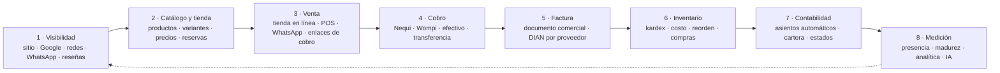
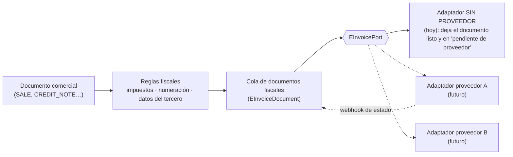

# Destino: un negocio visible, que vende en línea y está conectado por dentro

Este documento dice **a dónde queremos llegar** con la integración de
facturación, contabilidad, POS, inventario y visibilidad. El cómo y el orden
están en [`hoja-de-ruta-implementacion.md`](hoja-de-ruta-implementacion.md); las
reglas de API, MCP y webhooks, en
[`integracion-api-mcp-webhooks.md`](integracion-api-mcp-webhooks.md).

> **La idea en una frase:** que un negocio pueda **ser encontrado**, **vender**
> (en línea y en el mostrador), **cobrar**, **facturar**, **controlar su
> inventario y su contabilidad** y **medir cómo va**, todo con los mismos datos,
> sin copiar nada de un sistema a otro. Primero se trata de que lo vean; cuando
> eso está lleno, se trata de **hacerlo mejor por dentro**.

---

## 1. El ciclo completo

Es un **ciclo**: lo que se mide (qué se vende, qué se busca, qué reseñas
llegan) vuelve a alimentar la visibilidad y el catálogo. El valor está en que
**cada paso es el mismo dato**: el producto que se publica en el sitio es el
que se vende en el POS, el que descuenta del inventario, el que se factura y el
que se contabiliza.

### Un solo hilo de datos

| Hecho | Lo que dispara (todo por eventos del outbox) |
| --- | --- |
| Se publica o cambia un producto | Se actualiza el catálogo del sitio y la tienda; cambia la puntuación de presencia |
| Entra un pedido (tienda, WhatsApp, POS) | Documento comercial `ORDER`/`SALE`; reserva de stock; enlace o intención de pago |
| El pago se **confirma** (`payment.confirmed`) | Documento `SALE` pagado → movimiento de inventario (salida con costo) → asiento contable → factura electrónica en cola → recibo al cliente → evento para n8n |
| La factura es **aceptada** (`einvoice.accepted`) | Se guardan CUFE, XML y PDF; se envía al cliente; queda en cartera/contabilidad con su soporte |
| Se anula o devuelve | Nota crédito (por el mismo puerto fiscal), entrada de inventario, asiento de reverso, motivo en bitácora |
| Baja el stock del mínimo | Evento `stock.below_minimum` → orden de compra sugerida; el producto puede ocultarse de la tienda |
| Llega una reseña o una encuesta | Reputación y presencia; alerta si es negativa |

Ningún paso depende de un humano copiando datos, y **ningún paso crítico
depende de n8n** (ver §6).

---

## 2. Lo que significa «completo» en cada frente

Una definición de producto por frente (no de código): si falta algo de esta
lista, el frente **no** se da por terminado.

### 2.1 Facturación

- **Documento comercial único** (cotización → pedido → factura/venta → nota
  crédito/débito → recibo) con líneas, descuentos, impuestos, estados,
  numeración por tipo y por resolución. *(Ya hay la base: `Invoice` unificado.)*
- **Reglas fiscales colombianas:** IVA por tarifa y excluido/exento, retenciones
  (fuente, ICA, IVA), impoconsumo, bolsas, redondeos; cada línea con su
  impuesto y su código.
- **Facturación electrónica por proveedor tecnológico DIAN**, detrás de un
  puerto: factura de venta, factura POS, notas crédito/débito, **documento
  soporte** (compras a no obligados), eventos **RADIAN**, contingencia, estados
  legibles, reintentos, CUFE/CUDE, XML y PDF guardados.
- **Numeración y resoluciones** por negocio (prefijo, rango, vigencia,
  alerta cuando se acaba).
- **Estado fiscal visible** en cada documento y bandeja de rechazados con la
  causa y la acción para corregirlos.

### 2.2 Contabilidad

- **Plan de cuentas (PUC)** por negocio, con una plantilla para pymes.
- **Asientos automáticos** generados por las reglas de contabilización desde
  cada documento (venta, cobro, compra, caja menor, nómina, inventario), con
  trazabilidad al documento de origen.
- **Períodos y cierres**, terceros en cada asiento, centros de costo.
- **Estados financieros** (balance de prueba, pérdidas y ganancias, balance
  general, flujo de caja) y **exportación al contador** (archivos para Siigo,
  World Office, Alegra u otro), sin obligar a reescribir lo regulado.
- **Cartera** (por cobrar y por pagar) por antigüedad, con recordatorios.
- Regla de producto: NEXUS **no compite con un contador**; deja la contabilidad
  limpia y exportable, y la operación como su ventaja.

### 2.3 POS

- Venta de **varias líneas**, lector de **código de barras**, búsqueda rápida,
  variantes, descuentos con permiso, notas, cliente opcional.
- **Turnos por cajero** con apertura, movimientos, **arqueo** y cierre
  (hereda la caja menor).
- **Impresión térmica** (tirilla, factura POS) y reimpresión.
- Medios de pago mixtos (efectivo, tarjeta, Nequi, transferencia) y
  **devoluciones** con nota crédito.
- Tolerante a **conexión intermitente** (la venta no se pierde; se sincroniza).
- Todo lo que vende el POS descuenta inventario y se contabiliza igual que lo
  vendido en línea.

### 2.4 Inventario completo

- **Catálogo maestro:** productos con **variantes** (talla/color), unidades y
  empaques, **códigos de barras**, fotos, categorías, impuestos, **listas de
  precios**, costos.
- **Bodegas** y existencias por bodega; **kardex** con costo promedio
  ponderado; entradas, salidas, **traslados**, ajustes con motivo y **conteos
  físicos**.
- **Mínimos y reorden**, **compras** a proveedores con recepción parcial y
  factura del proveedor, devoluciones.
- Disponibilidad **reservada** para pedidos en línea (para no vender lo que no
  hay), y lotes/vencimientos donde el rubro lo exija.

### 2.5 Visibilidad completa (vender en línea)

- **Mini-sitio** del negocio con catálogo, horarios, ubicación, reservas y
  WhatsApp, rápido y bien indexable.
- **SEO técnico y local:** títulos y descripciones, datos estructurados
  (Schema.org), mapa del sitio, velocidad, y **Google Business Profile**
  sincronizado (horarios, productos, publicaciones, reseñas).
- **Tienda en línea:** carrito, pedido, pago con enlace/checkout (Nequi, Wompi),
  envíos, estados del pedido, correos/WhatsApp de seguimiento.
- **Redes y contenido:** Instagram/Facebook enlazados al catálogo,
  publicaciones programadas.
- **Reseñas y reputación:** encuestas tras la compra, respuesta a reseñas.
- **Atribución:** de dónde llega cada venta (búsqueda, Google, Instagram,
  anuncio, QR, referido) para saber qué visibilidad **vende**.
- **Fidelización:** puntos, cupones y referidos sobre los mismos clientes.

---

## 3. La barra de Presencia: no es un adorno

Hoy **Presence Thrive** puntúa de 0 a 100 qué tan visible es un negocio
(identidad, WhatsApp, ubicación, Google, Instagram, catálogo, sitio activo y
optimizado; sin sitio el techo es 60) y lo clasifica en `INVISIBLE`, `VISIBLE`,
`CONECTADO` y `DOMINANTE`
(`lib/presence/presence.ts`). Es determinista y distingue lo **declarado** de lo
**verificado**. Esa base se conserva.

El cambio de enfoque: la barra deja de ser «un número que sube» y pasa a ser
**el indicador serio de qué tan listo está el negocio para vender y operar**.
Tiene **dos fases**, y la segunda empieza cuando la primera está llena.

### 3.1 Fase A — Visibilidad («que te encuentren y te compren»)

Mide lo que el negocio **muestra y puede vender**. Se amplía (hoy es ~8
criterios) con lo que falta para vender en línea de verdad:

| Pilar | Qué mide (todo **verificable** por el sistema) | Peso |
| --- | --- | --- |
| Identidad | Nombre, dirección, horarios, logotipo, categoría | 8 |
| Contacto | WhatsApp verificado, teléfono, correo | 8 |
| Ubicación | Coordenadas confirmadas, mapa, zona de servicio | 6 |
| Google | Ficha reclamada y sincronizada, horarios, reseñas | 14 |
| Redes | Instagram/Facebook enlazados y activos | 6 |
| Catálogo | Productos completos (foto, precio, descripción, disponibilidad) | 12 |
| Sitio | Mini-sitio publicado, rápido, móvil, HTTPS, indexado | 18 |
| Venta en línea | Tienda o reservas activas, pago en línea funcionando | 14 |
| Reputación | Reseñas recibidas y respondidas, calificación | 8 |
| Atribución | Origen de ventas medido (QR, enlaces, campañas) | 6 |

Reglas: **nada suma por declararlo**; suma al verificarse (como hoy con el
sitio). El techo sin sitio y sin venta en línea sigue siendo bajo, a propósito.
Los pesos son una propuesta a calibrar con negocios reales.

### 3.2 La transición

> Cuando la Presencia llega a **«Dominante» verificada** (≥ 85 y los pilares
> críticos —sitio, catálogo, pago en línea— cumplidos, **sostenida**, no solo
> un día), **ya no es un tema de ser visible: es un tema de mejorar dentro de
> NEXUS.** La barra cambia de modo.

Visualmente la barra se «completa» y se desbloquea la segunda: el **Pulso del
negocio** (o *Madurez NEXUS*).

### 3.3 Fase B — Madurez («que el negocio funcione mejor por dentro»)

Mide qué tan **conectado y sano** está lo que pasa tras la venta. Cada señal
sale de datos reales, no de preguntas:

| Pilar | Señales (ejemplos) | Fuente |
| --- | --- | --- |
| Facturación | % de ventas con factura electrónica aceptada; rechazos sin resolver; resolución vigente | VII.04 |
| Cobro | % de cobros conciliados con el proveedor; diferencias abiertas | V.00, VII.07 |
| Inventario | Exactitud del último conteo; productos sin costo; quiebres de stock; rotación | VI.04 |
| Cartera | % de cartera vencida; días promedio de cobro; recordatorios activos | VII.02 |
| Contabilidad | Asientos descuadrados (0), período al día, soportes completos | VII.05 |
| Caja | Arqueos con diferencia; caja menor legalizada | VII.00 |
| Atención | Tiempo de primera respuesta; mensajes sin atender; satisfacción | III.00, III.04 |
| Automatización | Flujos activos sin fallos; tareas manuales repetidas que se podrían automatizar | VI.08 |
| Datos | Clientes completos (NIT/correo), catálogo con costos, impuestos asignados | I.00, I.01 |

Cada señal tiene **una acción sugerida y un enlace** a donde se arregla. Es la
misma idea de «pendientes de hoy» del panel, pero a nivel de negocio: no
«sube un número», **dice qué mejorar y por qué importa**.

### 3.4 Cómo se construye (técnico)

- `PresenceSnapshot` guarda cada cálculo con su **detalle por pilar** (no solo
  el total) y su fase; permite ver la **tendencia** y qué cambió.
- Los pilares son **calculadores puros** (entrada: datos del negocio, salida:
  puntos y pista), como `computePresence` hoy; la fase B reutiliza el mismo
  contrato.
- Se recalcula **por eventos** (`product.updated`, `payment.confirmed`,
  `einvoice.accepted`…) y por un sondeo programado, nunca en la petición de la
  pantalla.
- **Integrable:** `GET /api/v1/presence` y `get_presence` / `get_business_health`
  en MCP; eventos `presence.score_changed`, `presence.phase_changed`,
  `maturity.signal_degraded`. n8n puede, por ejemplo, avisar por WhatsApp
  cuando una señal empeora.
- La barra del tablero muestra la fase activa; la página de Presencia muestra el
  detalle y, en la fase B, las acciones.

---

## 4. Puertos listos para lo que aún no tenemos

Todavía **no hay proveedor tecnológico DIAN** y **Wompi llega después**. La
arquitectura debe estar lista para enchufarlos sin tocar el dominio.

### 4.1 Facturación electrónica (DIAN) sin proveedor todavía

Qué hacemos **ya** (sin proveedor):

1. **Todo el flujo hasta la puerta del proveedor:** datos fiscales del negocio y
   del cliente (NIT/DV, régimen, responsabilidades), impuestos por línea,
   numeración y **resolución**, y el **documento fiscal normalizado**
   (`EInvoiceDocument`) con todo lo que cualquier proveedor pide.
2. **Estados propios:** `DRAFT` → `PENDING_PROVIDER` → `SUBMITTED` → `ACCEPTED` /
   `REJECTED` → (`ERROR`, reintento). Sin proveedor, los documentos quedan en
   `PENDING_PROVIDER`: **se emiten comercialmente y se facturan
   electrónicamente cuando se conecte el proveedor**, en orden, sin perder
   ninguno. La interfaz lo dice con claridad (no finge que ya se facturó).
3. **Adaptador `none`** (el único hoy) y un **adaptador de sandbox** que simula
   aceptación/rechazo para probar el flujo, los estados, los eventos y la
   interfaz de punta a punta.
4. **Contrato del puerto** definido ahora (ver la hoja de ruta, PR-13) para que
   un proveedor real sea **un archivo nuevo** más sus credenciales, no un
   rediseño: `submit(document)`, `status(id)`, `cancel`/`creditNote`,
   `verifyWebhook`, `normalize(event)`, `capabilities`.
5. **No bloquea la venta:** una caída o la ausencia del proveedor nunca impide
   cobrar; el documento fiscal espera en la cola.

Cuando se elija proveedor: habilitar (set de pruebas), cargar resolución y
credenciales por negocio, correr el adaptador, **drenar la cola** de
pendientes. Validar con la DIAN y el proveedor la normativa vigente.

### 4.2 Pagos (Wompi después)

Ya existen `Payment`, `PaymentProvider` (incluye `WOMPI`, `NEQUI`, `CASH`,
`TRANSFER`) y el servicio de dinero. Se agrega el **puerto de pagos** con:

- **`PaymentIntent`**: la intención de cobro (monto, referencia única, medio,
  vencimiento) **antes** de que exista el pago; el enlace/QR/checkout nace de
  ahí. Un pago real solo se registra cuando el proveedor lo **confirma**.
- **Webhook entrante verificado** (firma del proveedor), **idempotente** y
  registrado en bruto (`PaymentProviderEvent`); el estado final se confirma
  consultando al proveedor. El resto del sistema solo ve eventos de dominio
  (`payment.confirmed`, `payment.failed`, `payment.refunded`).
- **Conciliación** (`Reconciliation`): lo que dice el proveedor contra lo
  registrado; las diferencias quedan a revisión, nunca se «arreglan» solas.
- **Adaptadores:** `cash` y `transfer` (manuales, ya existen en espíritu),
  **`nequi`** (QR dinámico), **`wompi`** (futuro; enlace de pago, checkout y
  webhook de eventos) y el **modo sandbox**. Credenciales por negocio cifradas
  (`ExternalConnection`).
- Dinero: el adaptador **informa**; **`money-service`** cambia los estados y
  deja los asientos.

---

## 5. n8n autohospedado en casa

n8n corre en un equipo propio (no en una nube): sirve, pero hay que diseñar
con sus límites a la vista.

| Tema | Decisión |
| --- | --- |
| **Alcance** | n8n es para **automatizar y conectar** (avisos, recordatorios, resúmenes, flujos con servicios externos). **Nunca** está en el camino crítico de cobrar, facturar o descontar inventario: eso corre **dentro** de NEXUS con sus colas |
| **Alcanzabilidad** | NEXUS (en la nube) debe llegar al webhook de n8n (casa) por HTTPS: **túnel** (Cloudflare Tunnel o Tailscale Funnel) con un dominio fijo, **sin abrir puertos del router** |
| **Seguridad hacia n8n** | Solo HTTPS; firma HMAC de NEXUS verificada en el flujo; ruta con secreto; el túnel solo expone `/webhook/*`, **no** el editor |
| **Seguridad hacia NEXUS** | n8n usa una **llave de API por negocio** con los alcances mínimos; nunca la base |
| **Caídas** | Casa puede perder luz o red. El outbox reintenta ~24 h y deja los eventos en **bandeja de fallidos con reenvío**; n8n al volver puede **ponerse al día** consultando `GET /events?updated_since=` |
| **Respaldo** | Exportar flujos (JSON) al repositorio; respaldar la base de n8n y su clave de cifrado de credenciales |
| **Cuotas** | Las ejecuciones se miden por negocio (X.00); un flujo desbocado se corta |
| **Futuro** | El nodo comunitario de NEXUS y las plantillas se escriben contra la API, así que funcionan igual si algún día n8n pasa a un servidor o a la nube |

---

## 6. Lo que no se negocia en toda esta integración

1. **Una sola verdad por dato** (producto, tercero, documento, pago): lo demás
   lo referencia.
2. **El dominio no conoce a ningún proveedor**: puertos y adaptadores.
3. **Lo regulado (DIAN, nómina electrónica) va por proveedor tecnológico**; no
   se reescribe.
4. **El dinero lo mueve `money-service`**; los adaptadores solo informan.
5. **El camino crítico (cobrar → factura → inventario → asiento) vive en NEXUS**,
   con colas y reintentos, y no depende de n8n ni de que haya proveedor.
6. **Todo es API, MCP y eventos** (regla transversal).
7. **Verificado antes que declarado**: la presencia y la madurez suben por lo
   que el sistema comprueba.
8. **Aditivo y reversible**: migraciones que no rompen lo que hay; todo con
   `tenantId` y RLS.
