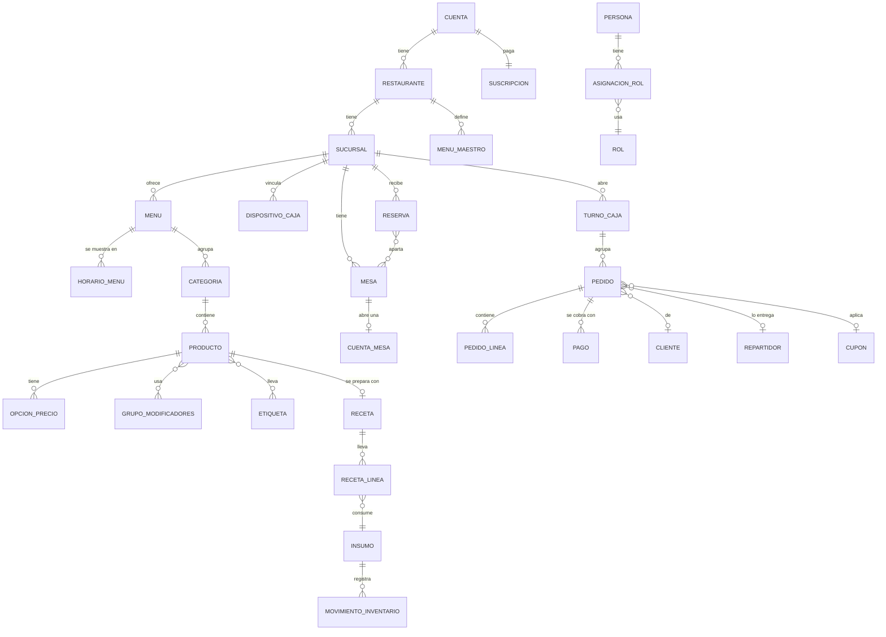
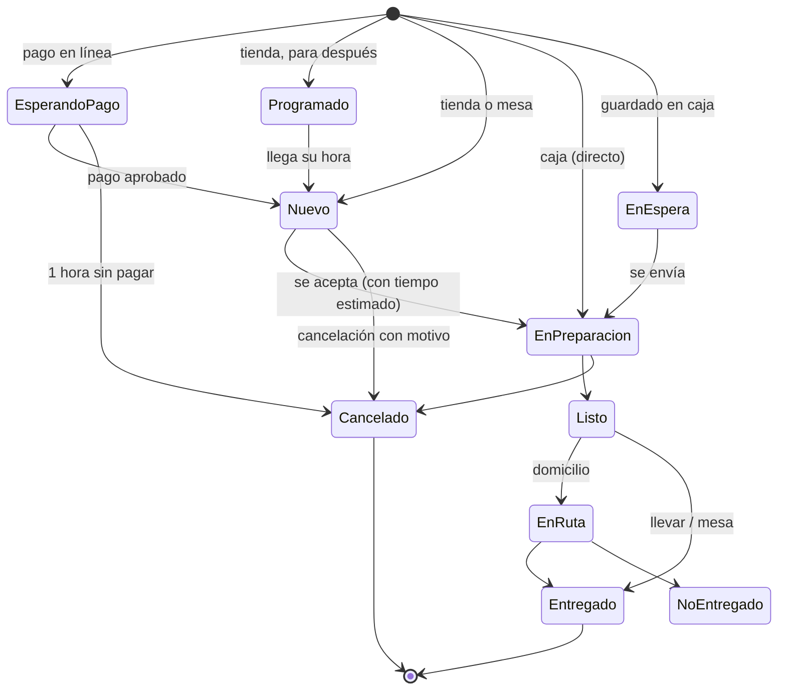

# 06 · Modelo de datos inferido

> Todo **Inferido**. Se deduce de lo que la interfaz y el soporte dejan ver; no
> se tuvo acceso a su base de datos ni a su esquema. Sirve para pensar el
> modelo de Nexus, **no** para reproducir tablas. Los nombres son nuestros.

## Entidades y relaciones

## Entidades y por qué existen

| Entidad | Rasgos que se deducen | Evidencia |
|---|---|---|
| **Cuenta** | Un titular, una suscripción, N restaurantes | Billing «una por Cuenta» |
| **Restaurante** | Marca: apariencia, etiquetas, menú maestro, WhatsApp | `/app/brand`, `/app/appearance` |
| **Sucursal** | Dirección, teléfono, horario por día, lugar de Google, plan propio, estado (activa/pausada/archivada) | `/app/branches` |
| **Menú** | Horarios múltiples (pueden cruzar medianoche), visible/oculto, orden | `/app/menus` |
| **Producto** | Visibilidad **por canal** (menú digital / tienda), agotado por sucursal, fotos | Soporte menús |
| **Opción de precio / Modificador** | Variantes de precio; grupos con efecto en precio y receta | `/app/modifiers` |
| **Insumo · Receta · Preparado** | Receta por porción; preparado = receta que produce un insumo | `/app/menus/items`, `/recipes` |
| **Movimiento de inventario** | Fuente de verdad de la existencia (kárdex) con tipo, motivo, quién y cuándo | Soporte inventarios |
| **Mesa / Cuenta de mesa** | Código QR **inmutable**; una cuenta abierta por mesa; rondas | Soporte mesas |
| **Dispositivo de caja** | Código de vinculación con caducidad de 10 min; aprobado por un humano | Soporte caja |
| **Turno de caja** | Uno por sucursal; fondo inicial; corte | Soporte caja |
| **Pedido** | Canal, modalidad (mostrador/llevar/aquí/domicilio), estado, **fotografía inmutable** de líneas, folio (temporal→definitivo), llave de idempotencia | Soporte caja y comandera |
| **Pago** | Método (efectivo, tarjeta, transferencia, otro, terminal, plataforma), división entre métodos, propina | Soporte caja |
| **Repartidor** | No es usuario del panel; PIN propio; compartido entre sucursales; efectivo cobrado | Soporte repartidores |
| **Reserva** | Estados y tiempo típico por tamaño de grupo; aparta mesa(s) | Soporte reservaciones |
| **Persona / Rol / Asignación** | Rol con ámbito; secciones × (Ver/Editar) | Soporte equipo-y-roles |
| **Bitácora (Actividad)** | Persona · Cambio · Sucursal · Fecha | `/app/activity` |

## Máquinas de estado

**Pedido** (comandera):

**Reserva:** `Por confirmar → Confirmada → (Retrasada a los 15 min) → Sentada →
Terminada`; finales `Cancelada` y `No llegó`.

**Suscripción:** `Cortesía → Activa → Pago atrasado (7 días) → Pausada →
Cancelada`; `Pendiente de pago` para cuentas antiguas.

## Invariantes que el producto garantiza

| # | Invariante | Cómo se ve |
|---|---|---|
| I1 | **El precio lo fija el servidor**, no el cliente | «Se recalcula todo en el servidor» |
| I2 | **Idempotencia** por pedido (tienda) y por venta (caja offline) | «Tocar dos veces no duplica» |
| I3 | **Pedido inmutable**; correcciones por anulación/reembolso | «No se edita; deja rastro» |
| I4 | **Existencia = suma de movimientos** | Kárdex; no hay edición directa |
| I5 | **Costo congelado** al vender | Finanzas |
| I6 | **Una cuenta abierta por mesa**; al cobrar, mesa libre y QR deja de aceptar | Mesas |
| I7 | **Código de plataforma único por sucursal** | Plataformas de delivery |
| I8 | **Slug de menú y código de mesa estables** | «Nunca cambia» |
| I9 | **Un solo turno de caja por sucursal** | Caja |
| I10 | **Borrado recuperable 30 días** | Restaurante y datos de ejemplo |
| I11 | **El dinero del restaurante no pasa por el proveedor** | Pagos |

## Eventos de dominio que se deducen

Útiles para el outbox de Nexus (ver 07):

`pedido.creado` · `pedido.aceptado` · `pedido.listo` · `pedido.entregado` ·
`pedido.cancelado` · `pago.registrado` · `turno.abierto` · `turno.cerrado` ·
`mesa.abierta` · `mesa.cerrada` · `reserva.confirmada` · `reserva.sentada` ·
`inventario.movimiento` · `producto.agotado` · `repartidor.asignado` ·
`suscripcion.cambio_estado`.

## Lo que no se pudo ver

- Esquema real, índices, tipos de ID, particionado por tenant.
- Cómo se resuelve el tiempo real (canal) y la cola offline en el cliente.
- Cuerpos de las Server Actions (ni su validación).
- Reglas fiscales (CFDI) y del Asesor de IA.
