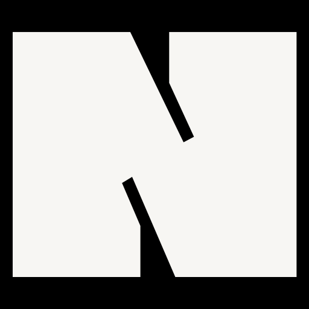
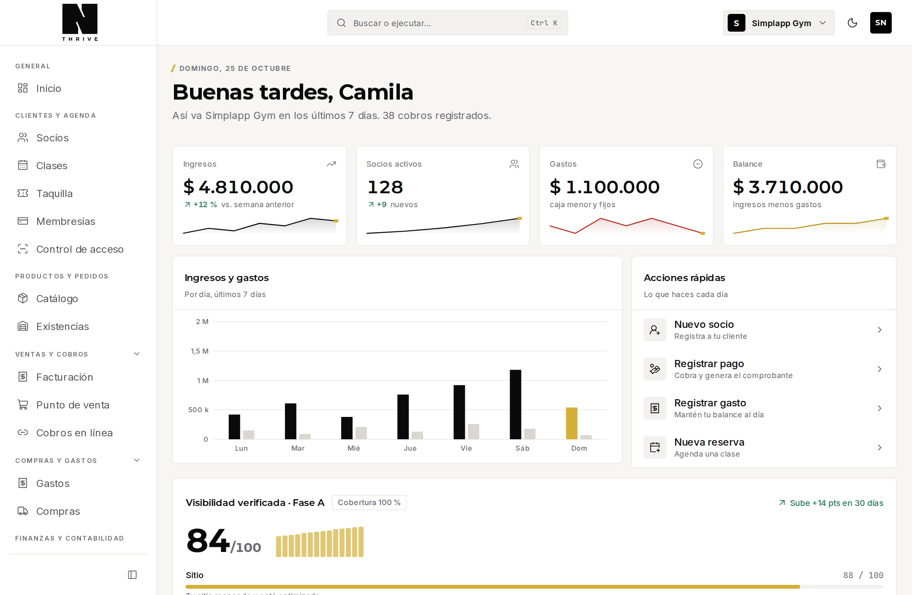

<p align="center">
  
</p>

<h1 align="center">NEXUS THRIVE</h1>

<p align="center">
  <strong>El sistema operativo digital de los negocios colombianos.</strong><br>
  Clientes, dinero, agenda, inventario, membresías y operación en una sola plataforma que se adapta al rubro.
</p>

<p align="center">
  <a href="https://app.nexusthrive.com.co"><strong>Abrir la aplicación</strong></a> ·
  <a href="https://nexusthrive.com.co">Sitio público</a> ·
  <a href="https://nexusthrive.com.co/help">Centro de ayuda</a> ·
  <a href="docs/nexus-architecture/product-vision.md">Visión de producto</a> ·
  <a href="PRODUCT.md">Producto</a> ·
  <a href="DESIGN.md">Diseño</a>
</p>

<p align="center">
  
  
  
  
  
  
  
</p>

<p align="center">
  
</p>

<p align="center"><sub><strong>NEXUS V2.</strong> El nuevo Inicio: barra lateral por categorías (Ventas y cobros, Compras y gastos, Finanzas y contabilidad, Presencia en línea…), métricas, ingresos y gastos, acciones rápidas y presencia verificada. Datos de demostración. La versión anterior está en la rama <a href="https://github.com/NexusThrive/nexus-thrive/tree/archive/v1"><code>archive/v1</code></a>.</sub></p>

## ¿Qué es NEXUS?

NEXUS es una plataforma **multi-negocio (SaaS)** para pymes en Colombia. Reúne
en un solo lugar lo que hoy suele estar repartido entre un cuaderno o Excel para
los clientes, WhatsApp para atenderlos, una caja o app para cobrar, un software
contable para facturar y nada para que el negocio aparezca en internet.

La idea es que **el negocio opere el día entero desde NEXUS**: vender, cobrar,
facturar, controlar inventario y caja, atender clientes, agendar, gestionar
membresías y accesos, y hacerse visible. Cada rubro ve su propia versión del
producto —un gimnasio ve socios, membresías y control de acceso; un museo ve
taquilla y aforo; una constructora ve obras, APU y actas— pero por debajo son
las mismas capacidades combinadas.

NEXUS se organiza en superficies complementarias:

| Superficie | Quién la usa | Para qué |
| --- | --- | --- |
| **Espacio del negocio** (`/{negocio}/…`) | Dueño, administrador, cajero y equipo | Operar el día: clientes, ventas, cobros, caja, agenda, inventario y acceso |
| **Operations Center** (`/admin/…`) | Equipo NEXUS | Operar la plataforma: negocios, soporte, planes, facturación y auditoría |
| **Sitio público y ayuda** ([nexusthrive.com.co](https://nexusthrive.com.co)) | Visitantes y usuarios | Entender el producto y aprender a usarlo |

## ¿Qué queremos lograr?

Queremos que NEXUS sea **el sistema operativo del negocio de una pyme
colombiana**, no otro ERP aislado ni un software contable más. La visión se
apoya en estas decisiones:

- **Adaptarse al rubro, no al revés.** El vocabulario, los campos y los módulos
  cambian según el negocio; el motor de datos es el mismo.
- **La operación diaria primero, la contabilidad después.** Cada venta y cada
  gasto se registran bien desde el inicio, con su documento, para entregárselos
  al contador o a su software.
- **Cada capacidad sirve sola y mejor acompañada.** El inventario funciona sin
  POS; con POS descuenta solo. La agenda funciona sin mensajería; con mensajería
  avisa sola.
- **El dinero no se equivoca.** Todo cobro es transaccional, con recibo
  consecutivo, trazabilidad y anulación auditada.
- **El servidor decide.** Los roles, permisos y módulos se validan en el
  servidor; la pantalla solo oculta lo que el usuario no puede usar.
- **Integrar antes que construir** lo que ya es commodity regulado: factura
  electrónica DIAN, pasarela de pagos, WhatsApp Business y correo.
- **Colombia de fábrica.** Pesos, NIT, cédula, DIAN, WhatsApp como canal
  principal y medios de pago locales.

La ruta de construcción está ordenada en seis fases:

| Fase | Objetivo |
| --- | --- |
| **1 · Base estable** | Seguridad, permisos, servicio de dinero y módulos validados en el servidor |
| **2 · Esquema único y capacidades** | Un solo modelo de datos, integridad referencial y registro de capacidades |
| **3 · Vender y facturar** | POS multi-línea, inventario completo, factura electrónica DIAN y documento POS |
| **4 · Cobrar y avisar solos** | Pagos en línea, WhatsApp Business API y tareas programadas |
| **5 · Que lo encuentren** | Mini-sitio del negocio, catálogo público, SEO local y redes |
| **6 · Ecosistema** | Exportación contable, contador externo, varios negocios por persona y nómina si hay demanda |

El detalle completo está en
[`docs/nexus-architecture/product-vision.md`](docs/nexus-architecture/product-vision.md),
y el plan técnico por etapas en
[`docs/nexus-architecture/roadmap.md`](docs/nexus-architecture/roadmap.md).

## Versiones

| Versión | Dónde | Qué es |
| --- | --- | --- |
| **V2** (`main`, etiqueta `v2.0.0`) | Esta rama | Un solo sistema por funciones y categorías: POS, cobros en línea, facturación electrónica por proveedor, cartera, contabilidad, tienda y sitio, presencia verificada, varias organizaciones por persona y panel de Usuarios en el Operations Center |
| **V1** (rama [`archive/v1`](https://github.com/NexusThrive/nexus-thrive/tree/archive/v1), etiqueta [`v1.0`](https://github.com/NexusThrive/nexus-thrive/releases/tag/v1.0)) | Rama archivada | El piloto interno original: CRM, finanzas, inventario básico, agenda, membresías, taquilla y construcción |

## Estado actual (V2)

NEXUS es **una sola plataforma**: todas las funciones pertenecen al mismo
sistema, el rubro es contexto y no una barrera, y los límites comerciales son de
uso (usuarios, clientes), no de paquetes de funciones. Cada función se enciende
o se apaga desde **Funciones** sin borrar datos, con su categoría, sus
dependencias y su estado de configuración.

**Construido y probado con datos locales:** punto de venta con turnos y
devoluciones, cobros en línea con conciliación, facturación con notas crédito y
débito, factura electrónica (puerto, proveedor de prueba y adaptador HTTP),
cartera, contabilidad (plan de cuentas, asientos con libro inalterable,
estados financieros y exportación para el contador), impuestos con vigencia y
numeración, inventario con bodegas, kardex, traslados y conteos, compras y
proveedores, importar y exportar, mini-sitio y tienda en línea, ficha de Google,
campañas con UTM y reseñas, presencia verificada con madurez y avisos, varias
organizaciones por persona con límites fijados desde el Operations Center.

**Aún no probado contra servicios reales:** Wompi, DIAN (proveedor tecnológico),
Google Places, Nequi, envío de WhatsApp y correo, subdominios con DNS. La
contabilidad y las tarifas fiscales de ejemplo deben confirmarse con un
contador antes de usarse en producción.

El estado por capa está en [`.docs/capas/README.md`](.docs/capas/README.md) y
[`.docs/capas-estado-2026-10-25.md`](.docs/capas-estado-2026-10-25.md); el
seguimiento de la ejecución, en
[`.docs/ejecucion-nocturna.md`](.docs/ejecucion-nocturna.md); las migraciones,
en [`docs/prod-sql/00-ORDEN.md`](docs/prod-sql/00-ORDEN.md).

## Módulos

| Módulo | Qué resuelve | Estado |
| --- | --- | --- |
| **Clientes (CRM)** | Ficha 360° con datos por rubro, pagos, membresías, notas, actividad, QR y NFC | Disponible |
| **Finanzas** | Cobros con recibo consecutivo, caja menor, gastos con soporte y anulación auditada | Disponible |
| **Inventario y ventas** | Productos y servicios, stock con movimientos y venta directa | Disponible |
| **Facturación interna** | Recibos y cuentas de cobro numeradas, pago y anulación | Disponible |
| **Agenda** | Calendario, citas, cupos y recordatorios por WhatsApp | Disponible |
| **Membresías y acceso** | Planes, renovación, congelamiento, vencimientos y check-in QR/NFC | Disponible |
| **Taquilla** | Franjas, aforo, grupos y venta de entradas para museos | Disponible |
| **Construcción** | Catálogo APU, presupuesto, cotización, Lean, bitácora, avance e informes | Disponible |
| **Equipo y permisos** | Invitaciones, roles y acceso por negocio | Disponible |
| **Punto de venta** | Turnos, venta multilínea, código de barras, tiquete y devoluciones | Disponible |
| **Cobros en línea** | Enlaces de pago, conciliación y Wompi (sin probar con credenciales reales) | Beta |
| **Factura electrónica** | Puerto con proveedor de prueba y adaptador HTTP; falta un proveedor real | Beta |
| **Cartera y contabilidad** | Cuentas por cobrar y pagar, plan de cuentas, asientos, estados y exportación | Disponible / Beta |
| **Impuestos y numeración** | Tarifas con vigencia, retenciones y consecutivos con resolución | Disponible |
| **Compras y proveedores** | Órdenes, recepción al inventario y facturas de proveedor | Beta |
| **Presencia en línea** | Mini-sitio, tienda, ficha de Google, campañas y reseñas, presencia verificada | Disponible / Beta |

## Vertical de construcción

Una obra es el contenedor de todo; fuera de ella solo existe el catálogo APU.

| Menú | Ruta | Contenido |
| --- | --- | --- |
| Obras | `/{negocio}/projects` | Ficha · Presupuestador · Cotizaciones · Planificador Lean · Bitácora y campo · Informes |
| Cotizaciones | `/{negocio}/quotes` | Una carpeta por obra con sus versiones y seguimientos |
| Catálogo APU | `/{negocio}/catalog` | Actividades APU (con auxiliares y capítulos) e insumos con foto; importador en `/catalog/import` |

El flujo completo es: **catálogo → presupuesto → cotización → ejecución →
informes**. La cotización congela una revisión del presupuesto; cuando el cliente
aprueba, se crea la línea base (Informe Cero) y el presupuesto se bloquea. La
planificación Lean, la bitácora con fotos y las actas de avance alimentan el
informe semanal con valor ganado.

El código vive en `lib/construction/*` (datos por dominio),
`lib/construction/apu-importer/*` (importador) y
`app/[tenant]/(app)/{projects,quotes,catalog}`.

## Tecnologías

| Capa | Tecnología | Uso |
| --- | --- | --- |
| **Frontend** | Next.js 16.3 (App Router, Turbopack) · React 19.2 · TypeScript 5 | Aplicación, rutas y server components |
| **Estilos y UI** | Tailwind CSS 4 · `@nexus/brand` · Radix UI · Lucide | Tokens de marca, componentes accesibles e iconos |
| **Datos** | Prisma 8 (`@prisma/orm-postgres`) · PostgreSQL en Supabase | Contrato de datos, migraciones y consultas |
| **Identidad** | Clerk | Sesión, registro, organización y actor tokens del equipo NEXUS |
| **Archivos** | PostgreSQL (`bytea`) · Vercel Blob | Adjuntos, fotos y tránsito de importaciones grandes |
| **Integraciones** | WhatsApp Cloud API (Meta) · Resend · Photon/Leaflet · Google Places · `tesseract.js` | Bandeja, mapas y OCR de comprobantes |
| **Calidad** | Vitest · Playwright · axe · Storybook 10 | Pruebas unitarias, integración, E2E, accesibilidad y catálogo de componentes |
| **Infraestructura** | Vercel · GitHub Actions · pnpm 12 | Despliegue desde `main`, CI y gestión de dependencias |

La Supabase del proyecto se usa **solo como PostgreSQL**: no hay cliente de
Supabase ni Supabase Auth en el código.

## Arquitectura

NEXUS es hoy un **monolito modular** Next.js con un solo despliegue y una sola
base de datos. La separación principal está en las rutas:

```
app/[tenant]/(app)   Espacio del negocio: shell, menú y módulos
app/admin            Operations Center del equipo NEXUS
app/onboarding       Alta de un negocio y aplicación de códigos de acceso
app/api              Route handlers (archivos, Blob, webhooks)
lib/                 Dominio, datos, reglas de negocio y capacidades
packages/brand       Sistema de diseño y logo oficial
prisma/              Contrato de datos y migraciones
docs/                Arquitectura, guías y SQL de producción
```

Las páginas y server actions pasan por `requireTenantContext`/`requireStaff`;
cada negocio se aísla con `tenantId` resuelto en el servidor. Los flujos de
dinero usan el servicio transaccional de dinero y las reglas puras viven junto a
sus pruebas. La auditoría completa, con hallazgos y deuda técnica, está en
[`docs/nexus-architecture/README.md`](docs/nexus-architecture/README.md) y la
arquitectura objetivo en
[`docs/nexus-architecture/target-architecture.md`](docs/nexus-architecture/target-architecture.md).

## Puesta en marcha

```bash
pnpm install
cp .env.example .env   # o crea .env con las variables de abajo
pnpm prisma db migrate --db "$DATABASE_URL"
pnpm dev
```

Variables de entorno:

| Variable | Uso |
| --- | --- |
| `DATABASE_URL` | PostgreSQL de la aplicación |
| `NEXT_PUBLIC_CLERK_PUBLISHABLE_KEY`, `CLERK_SECRET_KEY` | Clerk |
| `NEXT_PUBLIC_APP_URL` | URL pública de la app (enlaces compartidos, QR, recibos) |
| `BLOB_READ_WRITE_TOKEN` | Vercel Blob (solo servidor; los tokens de subida se emiten en `/api/blob-upload`) |
| `DEV_ALLOWED_ORIGINS` | Hosts extra del dev server separados por coma (Tailscale, LAN) |
| `TEST_DATABASE_URL` | Base aparte para los tests de integración |

Para **producción** hay una lista completa con valores sugeridos en
`.env.produccion` y el orden de ejecución del SQL en
[`docs/prod-sql/00-ORDEN.md`](docs/prod-sql/00-ORDEN.md).

### Autenticación en producción

El login lo monta Clerk en el navegador, desde un host codificado en la
Publishable Key. Al cambiar de dominio hay que actualizar la key, el CNAME del
Frontend API y los orígenes permitidos. Todo está en
[`docs/clerk-produccion.md`](docs/clerk-produccion.md).

## Verificación

```bash
pnpm exec tsc --noEmit
pnpm lint
pnpm test
DATABASE_URL=$TEST_DATABASE_URL pnpm test:integration
pnpm build
```

El CI (`.github/workflows/ci.yml`) ejecuta todo esto sobre un Postgres efímero.
El test `lib/construction/apu-importer/master-pack*.file*.test.ts` verifica un
pack APU real si se le pasa `MASTER_PACK_FILE=/ruta/al/archivo.xlsx`.

- Cómo preparar la base de pruebas: [`docs/guias/pruebas.md`](docs/guias/pruebas.md).
- Cómo agregar una funcionalidad: [`docs/guias/nueva-funcionalidad.md`](docs/guias/nueva-funcionalidad.md).
- Ramas, CI, secretos y despliegue: [`docs/guias/devops.md`](docs/guias/devops.md).

## Equipo de ingeniería

El repositorio incluye un plugin de Claude Code, [`plugins/product-team`](plugins/product-team/README.md), con
**43 subagentes nativos** (ingeniería, Studio y el Steward), cada uno con su skill, más los flujos
`nueva-funcionalidad` y `ciclo-sprint`. No hay motor externo ni Python: la revisión independiente la da usar
**otro subagente** y la evidencia es la salida real de los comandos.

```text
objetivo → HU con criterios → especialista → implementación + pruebas
→ QA por otro agente → revisión senior por otro agente → CI verde → integración en sprint
```

| Pieza | Dónde |
| --- | --- |
| Subagentes y skills por rol | `plugins/product-team/` |
| Instalación | `.claude-plugin/marketplace.json` |
| Compuerta de calidad | `.product-team/ci.json`, `CLAUDE.md` y el CI |
| Criterio del dueño (Steward) | `docs/ingenieria/steward/criterios.md` |
| Registro de herramientas externas | `docs/ingenieria/herramientas/registro.json` |
| Arquitectura y decisiones | [`docs/ingenieria/arquitectura/`](docs/ingenieria/arquitectura/overview.md) |
| Diagramas Mermaid | [`docs/diagrams/`](docs/diagrams/README.md) |
| Conocimiento y fuentes | [`docs/knowledge/`](docs/knowledge/README.md) |

```text
/plugin marketplace add NexusThrive/nexus-thrive
/plugin install product-team@nexus-thrive
```

Reglas del equipo (por instrucción, no por código): nada se da por terminado sin evidencia; quien implementa no
emite el veredicto de QA ni de revisión; tres intentos por historia y luego decisión humana; `docs/ingenieria/PAUSA`
detiene el ciclo de sprint; nunca `--force`, `--no-verify`, push ni merge a `main`.

Integraciones externas: Graphify funciona en local (`--code-only`). NotebookLM **no está integrado**: la decisión
está pendiente del dueño ([`docs/PENDIENTES.md`](docs/PENDIENTES.md)). n8n se retiró hasta tener una instancia real.

## Versiones

`main` es la única rama que se despliega (Vercel la toma sola) y cada versión
publicada lleva un tag: `v1.0.0` (V1), `v1.0.1` (parche), `v1.1.0`
(funcionalidad nueva) y `v2.0.0` (rompe algo de lo existente).

```bash
pnpm release v1.0.1 "fix(ventas): no deja registrar una venta sin fecha"
```

El script verifica que el árbol esté limpio y en `main`, corre las puertas
(tipos, lint, pruebas y build) y crea y sube el tag. **No** sube `main` ni aplica
el SQL de producción: eso es del PR y del SQL Editor de Supabase.

El proceso completo está en [`docs/VERSIONADO.md`](docs/VERSIONADO.md) y el
historial en [`CHANGELOG.md`](CHANGELOG.md).

## Documentación

| Documento | Para qué |
| --- | --- |
| [`PRODUCT.md`](PRODUCT.md) | Qué es NEXUS, para quién y principios de producto |
| [`DESIGN.md`](DESIGN.md) | Marca, tokens, componentes, movimiento y layout |
| [`docs/nexus-architecture/`](docs/nexus-architecture/README.md) | Auditoría, arquitectura actual y objetivo, seguridad, deuda y roadmap |
| [`docs/design/`](docs/design/interaction-patterns.md) | Patrones de interacción, accesibilidad y calidad |
| [`docs/guias/`](docs/guias/README.md) | Pruebas, nueva funcionalidad y DevOps |
| [`docs/ingenieria/arquitectura/`](docs/ingenieria/arquitectura/overview.md) | Equipo de ingeniería: agentes, loops, conocimiento, automatización, seguridad y operación |
| [`docs/diagrams/`](docs/diagrams/README.md) | Diagramas Mermaid de arquitectura, agentes, loops, conocimiento, n8n y despliegue |
| [`docs/knowledge/`](docs/knowledge/README.md) | Catálogo de fuentes, políticas, investigación y sincronización |
| [`docs/prod-sql/`](docs/prod-sql/00-ORDEN.md) | Orden del SQL manual de producción |

---

<p align="center"><sub>NEXUS THRIVE · Hecho en Colombia para que operar un negocio sea más simple.</sub></p>
