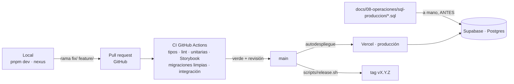

# Flujo de DevOps

[← Wiki](../README.md)

Cómo viaja un cambio desde tu máquina hasta `app.nexusthrive.com.co`, qué lo
protege en cada tramo y qué falta para que el flujo sea estable sin depender de
la memoria de nadie. El detalle de versiones, tags y CHANGELOG está en
[VERSIONADO.md](../07-ingenieria/versionado.md); aquí no se repite.

---

## 1. El recorrido

| Entorno | Base | Clerk | Quién lo usa |
|---|---|---|---|
| Local | `localhost:5432/nexus` | Instancia de desarrollo (`pk_test`) | Quien desarrolla |
| Pruebas | `localhost:5432/nexus_test` (local) · Postgres 17 efímero (CI) | No hace falta | `pnpm test:integration`, CI |
| Producción | Supabase | Instancia de producción (`pk_live`) | Clientes del piloto |

---

## 2. Ramas

- `main` es la única rama que se despliega.
- Todo entra por pull request en GitHub: `fix/<qué>`, `feature/<qué>`,
  `hotfix/<qué>`, `refactor/<qué>`, `docs/<qué>`.
- Un PR hace **una** cosa. Si mientras arreglas ves otra, va en otro PR.
- Commits en español, imperativo, con alcance: `fix(caja): no cobra dos veces
  una factura`.

**Protección de `main`** (Settings → Branches en GitHub):

- Solo entra por pull request.
- Sin force push ni borrado de `main`.
- El job `verify` del CI debe estar en verde antes de fusionar.
- Los administradores pueden saltarse la regla para un hotfix urgente; si lo
  haces, déjalo anotado en el commit.

---

## 3. El CI

`.github/workflows/ci.yml`, un job `verify` con Postgres 17:

1. `pnpm install --frozen-lockfile` (el lockfile manda; pnpm es el único gestor).
2. `tsc --noEmit`.
3. `pnpm lint` (incluye las reglas de arquitectura).
4. `pnpm test` (unitarias, sin base).
5. `pnpm build-storybook`.
6. Migraciones sobre una base vacía (`prisma db migrate`): prueba que las 33+
   migraciones aplican desde cero.
7. `pnpm test:integration`.

Si un paso falla **sin log**, es infraestructura de GitHub: re-ejecuta el job
antes de investigar el código.

## 4. SQL de producción

Hoy la base de producción **no se migra sola**: Vercel despliega el código y el
SQL se corre a mano en el SQL Editor de Supabase. Por eso:

1. Todo cambio de `prisma/schema/` trae un `.sql` en `docs/08-operaciones/sql-produccion/`,
   aditivo e idempotente, anotado en `00-ORDEN.md`.
2. El SQL se corre **antes** de mergear si la app nueva lee columnas o tablas
   nuevas.
3. `scripts/check-prod-sql.sh` falla si cambió el contrato y no hay SQL nuevo.

El CI descarga el historial completo (`fetch-depth: 0`) y, en cada PR, corre
`check-prod-sql.sh` contra la rama base antes de los tipos: un PR que cambie el
contrato sin su SQL falla en el primer minuto.

**Esquema único (DATA-03):** producción se reconstruyó desde las migraciones
el 2026-10-23 con `scripts/rebuild-db.sh` y tiene el mismo esquema que el CI.
Desde ahí, cada versión con cambios de esquema corre
`pnpm exec prisma db migrate --db <producción>` antes de mergear, y el SQL
manual se retira.

---

## 5. Secretos

| Regla | Por qué |
|---|---|
| Los valores viven solo en Vercel (producción) y en tu `.env` local, que no se versiona | El historial de Git es público y no se borra de verdad (los PR cerrados conservan commits viejos) |
| `.env.example` lista los nombres, sin valores | Para saber qué configurar |
| `.env.produccion` solo lleva valores públicos (URLs) | Hoy cumple: solo `NEXT_PUBLIC_APP_URL` y las URLs de Clerk |
| Scripts que necesitan una contraseña la piden por variable y fallan si falta | `scripts/psql-supabase.sh` exige `SUPABASE_DB_PASSWORD` |
| Nunca pegues una cadena de conexión en un issue, PR, doc o conversación guardada | Así se filtraron en `conversations/` (SEC-04) |
| Si un secreto llega a Git: rotarlo primero, limpiar el historial después | Limpiar sin rotar no sirve: ya pudo copiarse |

Variables que usa el servidor (nombres en `.env.example`): base
(`DATABASE_URL`, `DIRECT_URL`), Clerk, `RECEIPT_LINK_SECRET`, Vercel Blob,
WhatsApp Cloud API, Resend y correo entrante.

*Secret scanning* y *Push protection* están activos en los dos repos: GitHub
rechaza el push que traiga una clave reconocible y avisa de las que ya estén.

---

## 6. Desplegar y volver atrás

**Desplegar:** mergear a `main`. Después, la comprobación en producción de
[VERSIONADO.md §6](../07-ingenieria/versionado.md) (login, acceso por código, panel).

**Volver atrás el código:** en Vercel → Deployments → el despliegue anterior →
*Promote to Production*. Es inmediato y no toca la base. Después, revert del
commit en `main` por PR para que el siguiente despliegue no lo traiga de vuelta.

**Volver atrás la base:** no hay migraciones hacia atrás. Por eso el SQL es
aditivo: una columna nueva que la versión anterior no lee no estorba. Borrar o
renombrar columnas se hace en dos versiones: primero la app deja de usarla,
después (en otra versión) se borra.

**Respaldo:** antes de un SQL que modifique datos (no solo que agregue),
descarga un respaldo desde Supabase (Database → Backups) o
`pg_dump` de las tablas afectadas.

---

## 7. Observar producción

Hoy hay: logs de funciones en Vercel y errores en `console.error` (la bitácora
del negocio registra ahí si no puede escribir).

Siguiente paso, en este orden:

1. **Errores con contexto**: un servicio de errores (Sentry o similar) en
   `instrumentation.ts`, con `tenantId` y ruta en cada evento, nunca datos del
   cliente.
2. **Chequeo de vida**: un `GET /api/health` que pruebe la base, vigilado desde
   fuera cada pocos minutos.
3. **Tareas programadas** (vencimientos de membresía, recordatorios): Vercel
   Cron → endpoint firmado → tarea idempotente que se puede correr dos veces.

---

## 8. Resumen de lo que falta para un flujo estable

### Aprovisionamiento privado de negocios

El ciclo aprobado está en [arquitectura/0011](../05-decisiones/ADR-0011-arquitectura-aprovisionamiento-administrado.md); implementación y evidencia en el [reporte](../07-ingenieria/propuestas/aprovisionamiento-administrado.md). Los cambios se presentan como PR apilados; no desplegar una combinación parcial que reintroduzca el alta pública o el aceptador antiguo.

Antes del despliegue:

1. Revisar backup, marker y esquema reales. Aplicar la migración `20261116T1819_managed_business_provisioning` desde el snapshot verificado `a9b88b71…`, o revisar el [SQL operativo equivalente](sql-produccion/2026-11-16-aprovisionamiento-administrado.sql) según el proceso de producción. No volver a aplicar todo el directorio SQL. Si hay invitaciones pendientes duplicadas, resolver los casos sin borrar historial antes de introducir unicidad.
2. En **cada instancia** de Clerk, seleccionar **Access mode → Invite-only → Save**. Probar también Account Portal y registro de personal invitado. Esto es una intervención pendiente del operador; los cambios de código no modifican el dashboard.
3. Configurar `NEXT_PUBLIC_APP_URL` con el origen HTTPS canónico, claves Clerk correspondientes al entorno, `RESEND_API_KEY` y `INBOX_EMAIL_FROM` con remitente verificado. La integración crea/reconcilia una invitación Clerk sin envío automático y reutiliza el proveedor de correo existente. Para una identidad ya existente envía acceso por login, sin crear otra identidad. Los nuevos registros se completan con un ticket válido; los roles del negocio nunca se toman de metadata pública de Clerk.
4. Cambiar los fallbacks desplegados de login/registro a `/auth/callback`; las plantillas `.env.example` y `.env.produccion` ya reflejan ese destino. Los componentes fuerzan el callback para evitar un retorno antiguo al wizard.
5. Programar `GET /api/cron/provisioning` con `Authorization: Bearer $CRON_SECRET` cada minuto en el servicio de cron elegido. Sin secreto responde 503; sin autorización responde 401. No se creó una programación real desde esta sesión. El alta/renovación ya agenda un intento después del commit mediante `after`; el cron recupera reintentos y procesos interrumpidos.
6. Probar con un destinatario de ensayo autorizado: crear → marcar listo → activar → verificar entrega → aceptar con principal verificado → suspender/reactivar. Registrar instancia, operador y evidencias sin tickets ni secretos. Falta realizar esta validación externa antes de dar el servicio por desplegado.

El dispatcher procesa solo entregas vencidas para reintento y leases liberados; tiene un presupuesto de 40 segundos entre trabajos y hasta seis intentos por ciclo. El lease se registra antes de llamar al proveedor. Ante timeout, reconcilia la invitación Clerk y reutiliza una clave de idempotencia de correo por invitación local. El proveedor tiene su propia ventana de deduplicación: no existe una transacción exactamente una vez entre PostgreSQL y HTTP. Un reintento manual abre otro ciclo de intentos sin crear invitación nueva; renovar una vencida sí crea sucesora y conserva la anterior revocada.

«Aceptada por el proveedor» no acredita llegada a la bandeja. Fallos, falta de configuración o entrega incierta quedan visibles en la ficha administrativa. No revocar una cuenta Clerk para suspender un negocio ni una invitación remota vigente compartida para revocar una autorización local. Rollback a código anterior al aprovisionamiento requiere contención y revisión; conservar datos y esquema aditivo.

| Falta | Esfuerzo | Efecto |
|---|---|---|
| Migrar producción desde el despliegue (paso en CI o en Vercel) | Horas | Nadie tiene que acordarse de migrar |
| Errores con contexto + health check | Horas | Te enteras antes que el cliente |
| Base de pruebas para previews de Vercel | Horas | Probar un PR con datos sin tocar producción |
