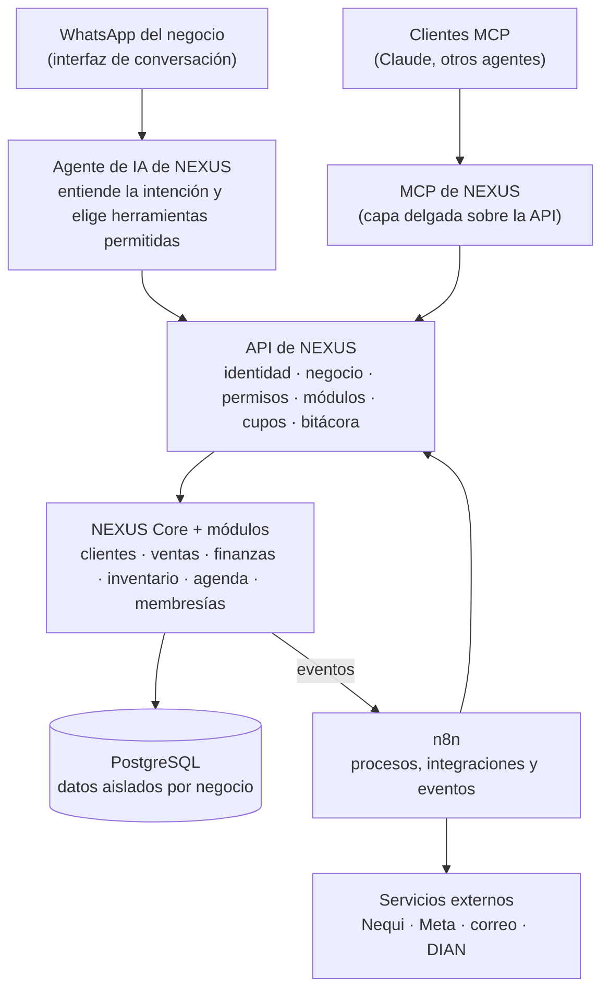

# Pendientes de NEXUS

Lista viva de lo que falta, en orden de prioridad. Cuando algo se termina, se
marca y se anota dónde quedó (PR o archivo). La visión de producto está en
[product-vision.md](nexus-architecture/product-vision.md) y la ruta técnica de
crecimiento en [scaling-path.md](nexus-architecture/scaling-path.md).
La guía por capas (qué está hecho y qué sigue en cada capacidad) está en
[`.docs/README.md`](../.docs/README.md).

Actualizado: 2026-10-23.

---

## 0. Punto de partida (ya hecho)

Para no repetir trabajo: la base está estable desde las PR #45 y #46.

- Seguridad de la auditoría corregida: SEC-01, 02, 03, 05, 06, 07, 08, 09 y 11
  ([remediation-log.md](nexus-architecture/remediation-log.md)).
- Dinero transaccional e idempotente (`lib/business/money-service.ts`).
- Una sola matriz de permisos (`lib/business/permissions.ts`), módulos exigidos
  en el servidor (`modulesForRoute`), bitácora del negocio (`logTenantAction`).
- Esquema único: producción reconstruida desde las migraciones el 2026-10-23
  (`scripts/rebuild-db.sh`); RLS en las 71 tablas; llaves a `Tenant` en todas.
- Un solo motor de precios (catálogo de la base, `/admin/planes`).
- `main` protegida, CI con chequeo de SQL y de RLS, escaneo de secretos activo.

---

## Lo siguiente

Según el [mapa de capacidades](../.docs/mapa-de-capacidades.md#qué-es-lo-siguiente-en-realidad).
Estado al 2026-10-23 (PR #48–#52 y el del documento comercial):

| Paso | Estado |
|---|---|
| 0 · Códigos de activación a medida | Hecho (§3), falta visto bueno |
| 1 · Registro de capacidades y construcción separada | Hecho |
| 2 · Documento comercial unificado | Servidor hecho (venta al cobrar, nota crédito, conversión, informe del día); **falta la pantalla** |
| 3–7 · Cartera, POS, datos fiscales, DIAN/Nequi, eventos/API/agente | Diseño propuesto en [propuesta-bloque-b-3-a-7.md](nexus-architecture/propuesta-bloque-b-3-a-7.md) |

## 1. Tareas cortas que dependen de ti

| # | Tarea | Dónde |
|---|---|---|
| 1.1 | Mergear la PR de la landing | `NexusThrive/nexus-thrive-web#2` |
| 1.2 | Enviar el ticket para purgar los PR #36–#44 (aún muestran los secretos viejos, ya rotados) | support.github.com |
| 1.3 | Activar **Verify at sign-up** en Clerk producción y anotar la fecha | [clerk-produccion.md §6](clerk-produccion.md) |
| 1.4 | Borrar el respaldo local del historial viejo cuando ya no haga falta (contiene los secretos rotados) | `NexusThrive/_respaldos/` |

---

## 2. Deuda técnica

| # | Tarea | Hallazgo | Criterio de terminado |
|---|---|---|---|
| 2.1 | ~~Separar la suite de construcción (`construction`) de la cotización genérica (`quotes`)~~ (hecho: PR «producto: registro de capacidades y separar construcción») | ARCH-01 | Ningún rubro no constructor ve pantallas APU |
| 2.2 | ~~Pasar `ModuleName` de enum a texto validado contra un registro de capacidades en código~~ (hecho, mismo PR) | ADR-0003 | Agregar un módulo toca ≤ 3 archivos |
| 2.3 | ~~Sacar las consultas directas a la base de los 42 archivos de `eslint/legacy-db-access.mjs`~~ (hecho: PR «seguridad: sin acceso directo a la base desde app/») | ARCH-04 | La lista vacía |
| 2.4 | Estados en texto con `CHECK` (`TicketSale.status`, `Invoice.kind`, `StockMovement.kind`…) y FK compuestas `(tenantId, id)` en dinero | DATA-04 | Migración aplicada |
| 2.5 | Migrar producción desde el despliegue (paso de CI o de Vercel), no a mano | DATA-03 | Nadie corre `prisma db migrate` a mano |
| 2.6 | Errores con contexto (Sentry o similar) y `GET /api/health` vigilado | — | Alerta antes de que el cliente avise |
| 2.7 | Límite de intentos compartido entre instancias: `lib/rate-limit.ts` guarda en memoria y en Vercel cada instancia cuenta aparte | — | Límite en la base o en un almacén compartido |

---

## 3. Producto inmediato: códigos de activación con precio propio

**Hecho (PR «producto: códigos de activación a medida»)**, pendiente de visto
bueno. Un código (`BenefitCode`) ya no da solo un plan y unos días: en
*Accesos* (`/admin/beneficios`) se le puede poner un **contrato a medida**.

| Campo del código | Qué hace al canjearse |
|---|---|
| `priceUsdCents` (precio mensual acordado, USD) | La `Subscription` queda **ACTIVA** con ese precio (aparece en *Facturación* y no vence sola como una prueba); `Tenant.planMonthlyUsdCents` toma ese precio |
| `modules[]` | Activa exactamente esos módulos (más el Inicio) en vez de los del plan |
| `maxUsers`, `maxCustomers` | Se copian al negocio; el servidor los exige al invitar (`seatLimit`) y al crear o restaurar clientes (`saveCustomer`, restaurar) |

Sin precio, el código sigue siendo una prueba gratis que vence sola (y al
vencer se limpian los límites). Falta, cuando exista la §5:
`automations[]` y cupos de uso en el mismo código.

## 4. Presupuestar el sistema

Antes de publicar precios (`SHOW_PRICING` sigue apagado):

1. Costo fijo mensual: Vercel, Supabase, Clerk, dominio, correo.
2. Costo por negocio: almacenamiento, conexiones, mensajes.
3. Costo variable de la §5: tokens de IA, ejecuciones de n8n, conversaciones
   de WhatsApp (Meta cobra por conversación), comisiones de pago.
4. Uso real por rubro en el piloto (cuántos clientes, cobros y mensajes).

Con eso se fijan los planes en `/admin/planes` y los cupos de la §5.

---

## 5. NEXUS con automatizaciones y agentes de IA

### 5.1 La idea

> No construir un agente gigante que lo haga todo, sino una plataforma con
> capacidades empresariales seguras que muchos agentes y automatizaciones
> puedan usar.

El negocio sigue pudiendo operar a mano; lo manual pasa a ser supervisión y
control. No hace falta automatizar todo antes de lanzar: hace falta una
arquitectura donde agregar una automatización no obligue a reconstruir nada.

### 5.2 Arquitectura

Quién hace qué:

| Capa | Responsabilidad | Nunca |
|---|---|---|
| NEXUS Core | Lógica de negocio y datos oficiales | — |
| API | Qué operación existe, para quién, con qué cupo; deja rastro | Confiar en el negocio o el usuario que diga el cliente |
| MCP | Exponer las mismas operaciones de la API a agentes compatibles | Tener reglas propias (sería un segundo backend) |
| n8n | Orquestar procesos y servicios externos | Tocar la base directo |
| Agente de IA | Interpretar la petición y elegir herramientas permitidas | Decidir a qué negocio pertenece la petición; inventar cifras |
| WhatsApp | Conversación | Ser la base de datos o el motor de permisos |

Reglas que no se negocian:

1. **El negocio y el usuario los resuelve el servidor**, no el modelo: por la
   llave de API, el número vinculado o la sesión.
2. **Las respuestas salen de datos reales** devueltos por la API; el modelo
   redacta, no calcula.
3. **Lo que escribe pide confirmación** según su riesgo (enviar, cobrar,
   anular). El agente prepara; la persona aprueba.
4. **El dinero lo mueve `money-service.ts`**, nunca un agente ni n8n
   directamente. Un agente no maneja credenciales bancarias.
5. **Todo queda en la bitácora** (`logTenantAction`), con el agente o la
   automatización como autor.
6. **Lo que escribe un cliente final es dato, no instrucción**: un mensaje de
   WhatsApp no puede cambiar las reglas del agente (inyección de instrucciones).
7. **Hay cupos**: tokens, ejecuciones y mensajes se miden por negocio; nada
   "ilimitado" sin medir.

### 5.3 Qué hay que construir (sobre lo que ya existe)

| Pieza | Reutiliza | Nuevo |
|---|---|---|
| API interna `/api/v1` | Repositorios de `lib/`, `can()`, `modulesForRoute`, `logTenantAction` | Route handlers versionados; respuestas mínimas |
| Llaves de API por negocio | Matriz `BUSINESS_PERMISSIONS` como alcances | Tabla `ApiKey` (hash, alcances, negocio, autor, vencimiento, último uso) |
| Eventos para n8n | Outbox de [scaling-path.md §Etapa 2](nexus-architecture/scaling-path.md) | `OutboxEvent` + webhooks firmados hacia n8n |
| Automatizaciones por negocio | `TenantModule` como patrón | `TenantAutomation` (activa, configuración, conexión), `AutomationRun` (cada ejecución, costo, resultado) |
| Cupos de uso | — | `UsageCounter` por negocio y periodo; corte al llegar al límite |
| Conexiones externas | — | `ExternalConnection` con credenciales cifradas (nunca en texto plano) |
| Acciones con aprobación | — | `AgentAction` (borrador → aprobada / rechazada → ejecutada) y su bandeja en el negocio |
| WhatsApp por negocio | `app/api/webhooks/whatsapp`, `lib/ops/inbox-providers.ts` (hoy solo el panel) | Número vinculado a un negocio; teléfono verificado por integrante |
| MCP de NEXUS | La API de arriba | Servidor MCP con autenticación por llave y las herramientas de §5.4 |

### 5.4 Primeras herramientas (MCP y agente)

Nombres de diseño, no endpoints existentes. Empezar **solo con lectura** y
crecer según lo que pidan los clientes.

| Herramienta | Lee de | Permiso | Riesgo |
|---|---|---|---|
| `business.get_summary` | `lib/dashboard` | cualquier miembro | lectura |
| `sales.list` | `Payment` (cobros) | `money.handle` | lectura |
| `finance.get_cash_summary` | `lib/business/finance-db.ts` | `money.handle` | lectura |
| `customers.search` | `createTenantDb().customers` | cualquier miembro | lectura (datos personales: devolver lo mínimo) |
| `inventory.check_stock` | `lib/business/products-db.ts` | cualquier miembro | lectura |
| `reports.generate` | las anteriores | `business.manage` | lectura |
| `messages.prepare` | plantillas de WhatsApp | cualquier miembro | borrador con aprobación |
| `tasks.create_draft` | — | según tarea | borrador con aprobación |
| `workflows.run` | `TenantAutomation` | según la automatización | ejecución con aprobación |

Cada herramienta: esquema de entrada validado, permiso comprobado en el
servidor, respuesta con lo mínimo necesario y registro en la bitácora.

### 5.5 El asistente por WhatsApp

Ejemplo de la experiencia (cifras ficticias):

> **Dueña:** ¿Cómo nos fue hoy en ventas?
> **NEXUS:** Hoy registramos 28 ventas por $840.000. Hay 3 pagos pendientes de
> confirmación y 5 productos con existencias bajas.
> **Dueña:** Prepara recordatorios para los pendientes.
> **NEXUS:** Preparé 3 borradores. Revisa destinatarios e importes antes de
> confirmar el envío.

Requisitos, en orden:

1. Vincular el número de WhatsApp a un negocio y verificar quién escribe
   (teléfono del integrante verificado, no solo el que llega en el mensaje).
2. Resolver usuario, rol y permisos en el servidor.
3. Consultar por la API; responder con base en el resultado.
4. Registrar consultas y acciones.
5. Pedir confirmación para lo sensible.

WhatsApp Business Cloud exige número aprobado, plantillas aprobadas por Meta
para mensajes iniciados por el negocio y cobra por conversación: entra en el
presupuesto (§4).

### 5.6 Pagos con Nequi

Según el documento de la idea, Nequi Negocios ofrece APIs de QR dinámico,
notificaciones de pago, suscripciones, dispersiones y reportes; producción
exige habilitación, pruebas y certificación. **Verificar condiciones vigentes
en el portal oficial** antes de diseñar el detalle:

- APIs para negocios: <https://www.nequi.com.co/negocios/apis>
- Portal de desarrolladores: <https://developer.nequi.com.co/>
- Proceso de integración: <https://www.nequi.com.co/negocios/como-te-integras>

Encaje en el código actual:

- `PaymentProvider` ya tiene `NEQUI` y `WOMPI`; `Payment.providerRefId` es
  único, así que un pago confirmado dos veces no se registra dos veces.
- Flujo: NEXUS crea una **intención de cobro** (tabla nueva `PaymentIntent`:
  monto, negocio, origen, estado) → Nequi genera el QR → el webhook (firmado)
  o la consulta de estado confirma → **solo con el estado oficial** se llama a
  `recordIncome` y se marca la factura pagada.
- Detrás de un puerto (`PaymentGatewayPort`) para poder sumar Wompi, PSE o
  Bre-B sin tocar el resto.
- Empezar por cobros y conciliación. Suscripciones después. Dispersiones
  (mandar dinero) al final y con aprobación humana siempre.

### 5.7 Cómo se vende

Niveles conceptuales (sin precios; se definen con la §4 y se entregan con
códigos de la §3 mientras tanto):

| Nivel | Qué recibe |
|---|---|
| NEXUS Core | Funciones esenciales y operación manual |
| NEXUS Automate | Automatizaciones preconfiguradas para tareas frecuentes |
| NEXUS AI Assistant | Preguntas sobre sus datos e informes |
| NEXUS AI Operations | Flujos a medida, integraciones y agentes con más herramientas |

Se modelan como **capacidades con cupos** (igual que los módulos), no como
planes aparte: un negocio puede tener Core + Assistant con cupo bajo, por
ejemplo. Encaja con los planes actuales (Essential, Elite, Signature) y con el
registro de capacidades de ADR-0003.

### 5.8 Orden de construcción

| Paso | Contenido | Depende de |
|---|---|---|
| 1 | ~~Asegurar la arquitectura actual~~ (hecho, PR #45/#46) | — |
| 2 | API interna `/api/v1` de solo lectura + llaves por negocio + bitácora | §2.1–2.3 ayudan pero no bloquean |
| 3 | n8n en un entorno controlado, conectado por la API (nunca a la base) | Paso 2 |
| 4 | Primer agente de consulta: preguntas de solo lectura sobre ventas y actividad | Paso 2 |
| 5 | WhatsApp Business Cloud por negocio, con número y teléfono verificados | Pasos 2 y 4; aprobación de Meta |
| 6 | MCP de NEXUS sobre la misma API | Paso 2 |
| 7 | Acciones con aprobación: recordatorios, borradores, mensajes | Pasos 4–5; `AgentAction` |
| 8 | Nequi: cobros y confirmación verificable; luego conciliación | Certificación de Nequi; `PaymentIntent` |
| 9 | Cupos, medición de costo y niveles comerciales | §4 presupuesto |

### 5.9 Cómo trabajar en esto

Tres roles; al principio los cubre una persona con ayuda de herramientas de IA:

| Rol | Hace | Cuándo |
|---|---|---|
| AI Automation Engineer | Flujos en n8n, conexión de APIs y WhatsApp, eventos | Ya (prioridad) |
| AI Integration Engineer / arquitecto | API de NEXUS, herramientas de agentes, MCP, permisos | Pasos 2 y 6 |
| AI Product Engineer | Que el cliente active y pruebe una automatización sin saber de técnica | Pasos 7 y 9 |

Empezar como **AI Automation Engineer con foco en arquitectura de
integraciones**: n8n ya trae nodos de agentes, API y MCP, así que no hay que
construir un motor de flujos propio.

---

## 6. Decisiones abiertas

| Pregunta | Afecta |
|---|---|
| ¿Se aprueba el código de activación con precio, módulos y límites (§3)? Ya está construido; falta el visto bueno | Facturación inmediata |
| ¿Cuánto cuesta NEXUS por rubro? (§4) | Planes y cupos |
| ¿n8n propio (self-hosted) o en la nube de n8n? | Paso 3; costo y datos |
| ¿Qué modelo de IA y con qué tope de gasto por negocio? | Pasos 4 y 9 |
| ¿Nequi primero, o Wompi (tarjeta, PSE, Nequi) como pasarela única? | Paso 8 |
| ¿Proveedor tecnológico DIAN? | Factura electrónica ([product-vision.md §3](nexus-architecture/product-vision.md)) |
| ¿Qué rubros se venden primero? | Prioridad de todo lo anterior |
