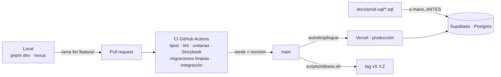

# Flujo de DevOps

[← Guías](README.md)

Cómo viaja un cambio desde tu máquina hasta `app.nexusthrive.com.co`, qué lo
protege en cada tramo y qué falta para que el flujo sea estable sin depender de
la memoria de nadie. El detalle de versiones, tags y CHANGELOG está en
[VERSIONADO.md](../VERSIONADO.md); aquí no se repite.

---

## 1. El recorrido

| Entorno | Base | Clerk | Quién lo usa |
|---|---|---|---|
| Local | `localhost:5432/nexus` | Instancia de desarrollo (`pk_test`) | Quien desarrolla |
| Pruebas | `localhost:5432/nexus_test` (local) · Postgres 17 efímero (CI) | No hace falta | `pnpm test:integration`, CI |
| Producción | Supabase | Instancia de producción (`pk_live`) | Clientes del piloto |

---

## 2. Ramas

- `main` es la única rama que se despliega.
- Todo entra por PR: `fix/<qué>`, `feature/<qué>`, `hotfix/<qué>`,
  `refactor/<qué>`, `docs/<qué>`.
- Un PR hace **una** cosa. Si mientras arreglas ves otra, va en otro PR.
- Commits en español, imperativo, con alcance: `fix(caja): no cobra dos veces
  una factura`.

**Pendiente de configurar en GitHub** (Settings → Branches → `main`):

- [ ] Exigir PR para mergear (sin push directo).
- [ ] Exigir que pase el check `verify` del CI.
- [ ] Prohibir force push y borrado de `main`.

Sin esto, las reglas de este documento son solo acuerdos.

---

## 3. El CI

`.github/workflows/ci.yml`, un job `verify` con Postgres 17:

1. `pnpm install --frozen-lockfile` (el lockfile manda; pnpm es el único gestor).
2. `tsc --noEmit`.
3. `pnpm lint` (incluye las reglas de arquitectura).
4. `pnpm test` (unitarias, sin base).
5. `pnpm build-storybook`.
6. Migraciones sobre una base vacía (`prisma db migrate`): prueba que las 33+
   migraciones aplican desde cero.
7. `pnpm test:integration`.

Si un paso falla **sin log**, es infraestructura de GitHub: re-ejecuta el job
antes de investigar el código.

## 4. SQL de producción

Hoy la base de producción **no se migra sola**: Vercel despliega el código y el
SQL se corre a mano en el SQL Editor de Supabase. Por eso:

1. Todo cambio de `prisma/contract.prisma` trae un `.sql` en `docs/prod-sql/`,
   aditivo e idempotente, anotado en `00-ORDEN.md`.
2. El SQL se corre **antes** de mergear si la app nueva lee columnas o tablas
   nuevas.
3. `scripts/check-prod-sql.sh` falla si cambió el contrato y no hay SQL nuevo.

El CI descarga el historial completo (`fetch-depth: 0`) y, en cada PR, corre
`check-prod-sql.sh` contra la rama base antes de los tipos: un PR que cambie el
contrato sin su SQL falla en el primer minuto.

**Meta (DATA-03):** que producción se migre con las mismas migraciones que el CI
(`prisma db migrate` en un paso de despliegue) y retirar el SQL manual. Antes
hay que comparar el esquema real de producción con el migrado (`pg_dump
--schema-only`) y cerrar las diferencias.

---

## 5. Secretos

| Regla | Por qué |
|---|---|
| Los valores viven solo en Vercel (producción) y en tu `.env` local, que no se versiona | El historial de Git es público y no se borra de verdad (los PR cerrados conservan commits viejos) |
| `.env.example` lista los nombres, sin valores | Para saber qué configurar |
| `.env.produccion` solo lleva valores públicos (URLs) | Hoy cumple: solo `NEXT_PUBLIC_APP_URL` y las URLs de Clerk |
| Scripts que necesitan una contraseña la piden por variable y fallan si falta | `scripts/psql-supabase.sh` exige `SUPABASE_DB_PASSWORD` |
| Nunca pegues una cadena de conexión en un issue, PR, doc o conversación guardada | Así se filtraron en `conversations/` (SEC-04) |
| Si un secreto llega a Git: rotarlo primero, limpiar el historial después | Limpiar sin rotar no sirve: ya pudo copiarse |

Variables que usa el servidor (nombres en `.env.example`): base
(`DATABASE_URL`, `DIRECT_URL`), Clerk, `RECEIPT_LINK_SECRET`, Vercel Blob,
WhatsApp Cloud API, Resend y correo entrante.

Recomendado: activar en GitHub *Secret scanning* y *Push protection*
(Settings → Code security). En repos públicos es gratis y frena el push de un
secreto antes de que entre.

---

## 6. Desplegar y volver atrás

**Desplegar:** mergear a `main`. Después, la comprobación en producción de
[VERSIONADO.md §6](../VERSIONADO.md) (login, acceso por código, panel).

**Volver atrás el código:** en Vercel → Deployments → el despliegue anterior →
*Promote to Production*. Es inmediato y no toca la base. Después, revert del
commit en `main` por PR para que el siguiente despliegue no lo traiga de vuelta.

**Volver atrás la base:** no hay migraciones hacia atrás. Por eso el SQL es
aditivo: una columna nueva que la versión anterior no lee no estorba. Borrar o
renombrar columnas se hace en dos versiones: primero la app deja de usarla,
después (en otra versión) se borra.

**Respaldo:** antes de un SQL que modifique datos (no solo que agregue),
descarga un respaldo desde Supabase (Database → Backups) o
`pg_dump` de las tablas afectadas.

---

## 7. Observar producción

Hoy hay: logs de funciones en Vercel y errores en `console.error` (la bitácora
del negocio registra ahí si no puede escribir).

Siguiente paso, en este orden:

1. **Errores con contexto**: un servicio de errores (Sentry o similar) en
   `instrumentation.ts`, con `tenantId` y ruta en cada evento, nunca datos del
   cliente.
2. **Chequeo de vida**: un `GET /api/health` que pruebe la base, vigilado desde
   fuera cada pocos minutos.
3. **Tareas programadas** (vencimientos de membresía, recordatorios): Vercel
   Cron → endpoint firmado → tarea idempotente que se puede correr dos veces.

---

## 8. Resumen de lo que falta para un flujo estable

| Falta | Esfuerzo | Efecto |
|---|---|---|
| Protección de `main` en GitHub | 5 min | Las reglas se cumplen solas |
| Secret scanning + push protection | 2 min | No vuelve a entrar un secreto |
| Esquema único (DATA-03) y migración automática | Días; necesita el `pg_dump --schema-only` | Se acaba el SQL manual |
| Errores con contexto + health check | Horas | Te enteras antes que el cliente |
| Base de pruebas para previews de Vercel | Horas | Probar un PR con datos sin tocar producción |
