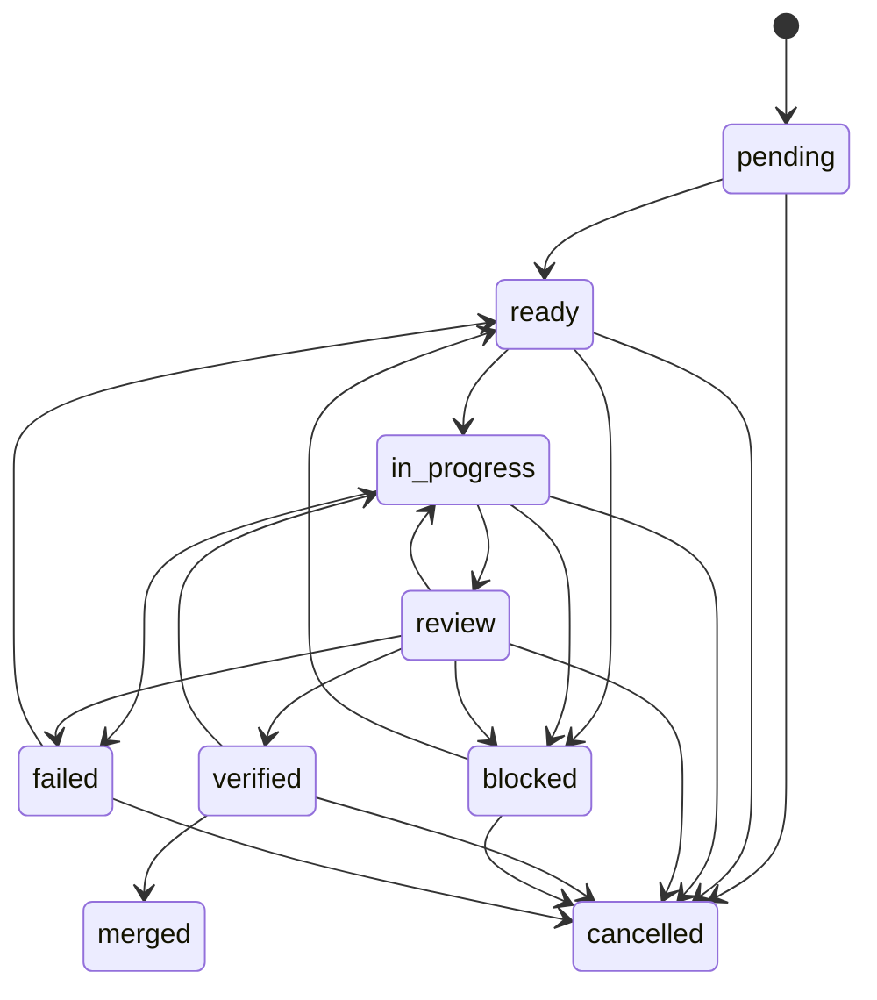

# Loops, estados y límites

## 1. Ciclo de una historia

```text
objetivo
  → leer estado y conocimiento
  → analizar requisitos
  → verificar dependencias
  → diseñar
  → asignar especialista
  → implementar y probar
  → compuerta local
  → QA independiente
  → revisión senior
  → CI verde
  → merge a sprint
  → actualizar estado y reporte
  → siguiente tarea
```

## 2. Máquina de estados



| Transición | Requisito |
|---|---|
| `pending → ready` | dependencias existentes y satisfechas |
| `ready → in_progress` | sin pausa, sin árbol sucio, intentos < 3 |
| `in_progress → review` | compuerta local aprobada |
| `review → verified` | QA aprobado + revisión senior aprobada, por otros agentes |
| `verified → merged` | CI verde registrado (`stage=ci_green`) |
| `* → cancelled` | decisión humana registrada |

`in_progress → merged` no existe. El núcleo lanza `TransitionError` y no escribe
el cambio.

## 3. Compuertas

Configuradas en `.product-team/workflow-policy.json` y ejecutadas con comandos
reales del repositorio:

| Compuerta | Comando | Obligatoria |
|---|---|---|
| `lint` | `pnpm lint` | sí |
| `typecheck` | `pnpm exec tsc --noEmit` | sí |
| `test` | `TEST_DATABASE_URL= pnpm test` | sí |
| `build` | `pnpm build` | no |

```bash
scripts/nexus-eng verify HU-CRM-014 --gate required
```

La salida se recorta y se redacta antes de guardarse. Un fallo se registra como
`failed` y la tarea no avanza.

## 4. Intentos

- Máximo **3** intentos de implementación por historia.
- Cada `start` o `retry` incrementa el contador.
- Al intento 3 fallido, la tarea pasa a `blocked` con motivo y el orquestador se
  detiene: se requiere decisión humana.
- El contador nunca se reinicia automáticamente.
- Cambiar criterios de aceptación para hacer pasar una prueba está prohibido.

## 5. Checkpoint

Se guarda con:

```bash
scripts/nexus-eng checkpoint HU-CRM-014 \
  --agent backend-engineer \
  --files lib/crm/repository.ts lib/crm/repository.test.ts \
  --tests "pnpm test lib/crm/repository.test.ts" \
  --failures "sin fallos" \
  --next-action "añadir validación de fecha" \
  --client opencode
```

Contenido: tarea, objetivo, agente, rama, commit base, hashes SHA-256 de los
archivos, pruebas, fallos, intentos, dependencias, próxima acción, cliente y fecha.
No contiene secretos ni transcripciones.

## 6. Recuperación

```bash
scripts/nexus-eng recover HU-CRM-014 --client claude-code
```

Estados posibles:

| Estado | Significado | Acción |
|---|---|---|
| `resumable` | rama, commit base y hashes coinciden | continuar desde `next_action` |
| `drift` | rama distinta, commit no ancestro o archivo cambiado | **detenerse** y pedir decisión |
| `no_checkpoint` | nunca se guardó | reconstruir desde Git y pruebas |
| `task_missing` | la tarea no existe en el estado | revisar estado canónico |

La recuperación funciona aunque la conversación original ya no exista: no depende
de la memoria del modelo. Si hay deriva, no se reanuda automáticamente.

## 7. Pausa

```bash
scripts/nexus-eng pause --reason "revisión manual"
scripts/nexus-eng unpause
```

Con `docs/ingenieria/PAUSA` presente:

- `next` devuelve `paused` y no elige tarea nueva;
- `start` falla con `PolicyError`;
- el trabajo en curso puede terminar de forma segura y guardar checkpoint;
- el archivo no se borra solo; lo retira una persona.

## 8. Prevención de ciclos infinitos

- Límite duro de intentos.
- Una tarea solo puede estar `in_progress` si sus dependencias están `merged`.
- `review` sin veredictos no avanza.
- La compuerta se ejecuta con timeout (900–1800 s según el caso).
- n8n reintenta como máximo 3 veces con espera.
- El orquestador no reintenta una tarea `blocked` sin `unblock` explícito.

## 9. Disciplinas: mismo motor, distinto especialista

`Task.discipline` (`engineering`, `design`, `documentation`, `marketing`,
`growth`, `research`) no crea estados nuevos: cambia el agente por defecto, las
reglas de enrutamiento y los revisores sugeridos. El ciclo de la sección 1 y la
máquina de la sección 2 aplican igual a una historia de backend y a una pieza de
contenido.

```bash
scripts/nexus-eng loop --discipline design
scripts/nexus-eng route --discipline marketing --tags seo
scripts/nexus-eng add-task --title "Revisar contraste del dashboard" --discipline design
scripts/nexus-eng review-plan HU-DIS-003
```

| Disciplina | Agente por defecto | QA sugerido | Revisión senior sugerida |
|---|---|---|---|
| `engineering` | `senior-engineer` | `qa-engineer` | `senior-reviewer` |
| `design` | `senior-product-designer` | `visual-qa-engineer` | `head-of-product-design` |
| `documentation` | `knowledge-engineer` | `knowledge-engineer` | `senior-reviewer` |
| `marketing` | `marketing-director` | `brand-consistency-reviewer` | `marketing-analytics-specialist` |
| `growth` | `growth-engineer` | `marketing-analytics-specialist` | `marketing-director` |
| `research` | `research-engineer` | `knowledge-engineer` | `senior-reviewer` |

`review-plan` excluye al implementador y, si todos los candidatos están
excluidos, devuelve `missing` en vez de inventar un revisor: decide una persona.
La autoaprobación sigue rechazándose en `record_review`.

Decisión completa en [ADR 0010](../../adr/0010-dos-equipos-y-loops-compartidos.md).

