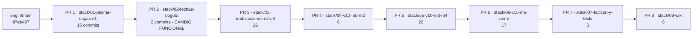

# Informe de la pila de PR

Fecha: 2026-10-31. Complementa el [plan de PR](plan-de-prs.md). **Ninguna rama se subió y no hay PR abiertos.** `main` (`97eb497`) no ha avanzado: las ramas cuelgan de él sin necesidad de rebase.

## 1. Grafo y cambios respecto al plan anterior



Cadena lineal: cada rama es un prefijo de la siguiente (`git merge-base --is-ancestor` verdadero en los 8 pares) y ninguna queda «detrás» de su base. Las ramas `stack/*` se reconstruyeron con `git cherry-pick` a partir de la rama de trabajo, que no se modificó. Los dos cambios pedidos:

| Cambio | Antes | Ahora |
|---|---|---|
| **Fechas** | Un commit dentro del PR 2 (29 commits de refactor) | **PR 2 propio**: 2 commits, 8 archivos, justo tras el PR 1 |
| **`app/icon.svg`** | Dentro del commit de cierre de `lib/` (PR 5) | **PR 7**, en un commit propio junto al resto del favicon. El cierre de `lib/` (PR 6) ya no toca nada visual |

### Dónde queda el cambio de fechas

PR 2 (`stack/02-fechas-bogota`). Contiene: la corrección (`dbe79e3`: `documents-db.ts`, `invoices-db.ts`, `plain-date.ts`, sus pruebas unitarias y de integración) y un commit de documentación y diagnóstico (`3552ede`: hallazgo, SQL de solo lectura y su prueba). Se colocó **antes** de la reorganización para que se revise sin ruido; ninguno de sus archivos de código se mueve de lugar dentro de ese PR. Detalle: [informe del cambio de fechas](informe-cambio-fechas-pr2.md).

## 2. Verificación completa de cada PR

Cada rama se verificó **en su propio estado** (árbol de trabajo aislado, base PostgreSQL 17 desechable con `pg_trgm`, migraciones aplicadas de cero): `pnpm verify` completo (lint, `tsc`, `check:layers`, unitarias sin base, integración, `next build`). Es la **segunda pasada**, hecha después de volver determinista la prueba horaria del PR 1 (ver §2.1); las ramas se reconstruyeron sobre ese cambio.

| PR | Base | Build | Unitarias (archivos / pruebas) | Integración (archivos / pruebas) | `verify` (hora de Bogotá) | Estado |
|---|---|---|---|---|---|---|
| 01 · prisma y capas | `main` | ✓ | 100 / 1 445 | 58 / 343 | verde (19:54) | Verificada |
| 02 · **fechas** | PR 1 | ✓ | 101 / 1 462 | 60 / 366 | verde (18:44) | Verificada |
| 03 · E2–E9 | PR 2 | ✓ | 109 / 1 649 | 66 / 413 | verde (18:54) | Verificada |
| 04 · V10 M0–M2 | PR 3 | ✓ | 113 / 1 711 | 66 / 413 | verde (19:04) | Verificada |
| 05 · V10 M3–M4 | PR 4 | ✓ | 116 / 1 747 | 66 / 413 | verde (19:14) | Verificada |
| 06 · V10 M5 y cierre | PR 5 | ✓ | 124 / 1 907 | 66 / 413 | verde (19:24) | Verificada |
| 07 · favicon y `tests/` | PR 6 | ✓ | 125 / 1 912 | 66 / 413 | verde (19:34) | Verificada |
| 08 · wiki | PR 7 | ✓ | 127 / 1 924 | 66 / 413 | verde (19:44) | Verificada (y de nuevo tras el commit final de documentos) |

Cómo leer la tabla: «Unitarias» son las que pasan **sin** base de datos (las de integración quedan omitidas en ese paso y se cuentan aparte); «Integración» es `pnpm test:integration` completo. El PR 2 suma 23 pruebas de integración (9 de fechas y 14 del SQL de diagnóstico) y 13 unitarias. Los conteos no cambian respecto a la primera pasada: el arreglo de la prueba horaria no añade ni quita pruebas.

### 2.1 Prueba horaria del PR 1

`accounting/reports.integration` escribía el libro con el reloj real y comparaba con el «hoy» de Bogotá; entre las 19:00 y las 24:00 de Bogotá fallaba (`expected 2 to be 5`) en cualquier rama sin la corrección de fechas, o sea, en el PR 1. Ahora el commit `test(contabilidad): …` del PR 1 fija el reloj (solo `Date`, solo durante la siembra) a las 12:00 de Bogotá y compara contra ese día fijo. No cambia código de la aplicación ni adelanta el PR 2.

| Comprobación | Resultado |
|---|---|
| PR 1 con la prueba **antigua**, 19:00 de Bogotá | Falla: `expected 2 to be 5` |
| PR 1 con la prueba **nueva**, 19:00 de Bogotá | Pasa (3 de 3) |
| `pnpm verify` completo del PR 1, 19:54 de Bogotá | Verde |
| Ramas 02–08, ejecutadas entre las 18:44 y las 19:44 de Bogotá | Verdes |

Comprobaciones adicionales, iguales en las 8 ramas:

| Comprobación | Resultado |
|---|---|
| Migraciones y contrato Prisma compilado frente a `main` | **0 archivos cambiados** en las 8 |
| Guardián de SQL de producción (`scripts/check-prod-sql.sh origin/main`) | Pasa en las 8 |
| `prisma migration status` sobre la base migrada de cero | Sin pendientes en las 8 |
| Contrato público (15 operaciones + OpenAPI) frente a la línea base | **Idéntico** en las 8 |
| `tsc --noEmit` y `check:layers` | 0 errores; 0 violaciones (el PR 1 conserva sus excepciones abiertas de E0) |

Limitaciones: el contrato público se comparó con la captura anterior a V10 M1; en las ramas anteriores se leyó de `lib/operations/registry.ts`. Un árbol aislado no ejecuta el paso de Git de `test-integration.sh` (que solo corre con un `.git` de directorio), por eso el guardián de SQL se ejecutó aparte. La verificación completa se hizo localmente, no en el CI de GitHub.

## 3. Que no se pierde ni se duplica nada

- **Árbol final**: `stack/08-wiki` frente a la rama de trabajo difiere solo en los documentos editados a propósito (hallazgo de fechas y resultados de E2, que ahora dicen que la corrección va en el PR 2), los documentos de entrega y **un archivo de prueba**: `reports.integration.test.ts`, con el reloj fijo.
- **Commits equivalentes** (comparación por `patch-id`): de los 101 commits de la rama de trabajo, 97 tienen un commit idéntico en la pila. Los 4 distintos son los previstos: `da534e8` (resultados de E2: la nota de fechas ya no dice «sin corregir»), `724229b` + `0cbcdca` (consolidados en `3552ede`, el commit de diagnóstico del PR 2) y `b6a3039` (cierre de `lib/` sin `app/icon.svg`, que pasa al commit nuevo `2189c91`).
- Total de commits: 101 en la rama de trabajo y 102 en la pila (dos del diagnóstico de fechas se fusionaron en uno; se añadieron el commit del favicon, el de la prueba horaria y el de documentación final).

## 4. Favicon

El cambio de `app/icon.svg` ya no está en el PR 6 (cierre de `lib/`); está en el PR 7, en el commit `2189c91` (`fix(marca): app/icon.svg sin rectángulo de fondo`), junto con el commit que retira `favicon.ico` y el resto de la marca.

```diff
 <svg xmlns="http://www.w3.org/2000/svg" viewBox="362 157 800 800" width="512" height="512" role="img" aria-label="NEXUS THRIVE">
-  <rect x="362" y="157" width="800" height="800" fill="#000000" />
-  <path fill="#F7F6F3" d="M394.83 … Z" />
-</svg>
+  <path fill="#F7F6F3" d="M394.83 … Z"/>
+</svg>
\ No newline at end of file
```

El trazo es idéntico; solo desaparece el fondo y el archivo pierde el salto de línea final. **Efecto visible:** el logotipo crema (`#F7F6F3`) se ve poco en pestañas de navegador claras. El cambio es de la persona dueña del repositorio; antes viajaba sin mencionarse dentro del commit de cierre de `lib/`.

## 5. Merge commit

Con la cadena lineal verificada, «Create a merge commit» conserva los commits de cada PR tal como están en su rama, y las ramas siguientes siguen siendo descendientes sin retoques. «Rebase and merge» reescribe hashes y obliga a rebasar los PR restantes; el squash está descartado.

## 6. Qué no se hizo

- No se subió ninguna rama ni se abrió ningún PR; el `pushurl = no_push` del remoto `github` no se tocó. No se publicó la Wiki ni se activó ningún workflow.
- No se corrigieron fechas históricas ni el recibo del punto de venta.
- Las ramas `pr/01…07` de la primera versión del plan siguen existiendo en local (no se borran ramas sin tu autorización); están **obsoletas**. Conviene conservarlas hasta confirmar que la pila nueva está publicada y fusionada.
