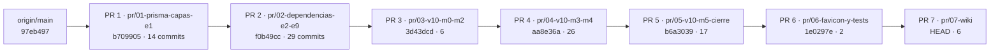

# Informe de la pila de PR

Fecha: 2026-10-31. Complementa el [plan de PR](plan-de-prs.md). **Ninguna rama se subió y no hay PR abiertos.** `main` (`97eb497`) no ha avanzado: las siete ramas cuelgan de él sin necesidad de rebase.

## 1. Grafo de dependencias



Cadena lineal: cada rama es un prefijo del historial de la siguiente (`git merge-base --is-ancestor` verdadero en todos los pares) y ninguna está «detrás» de su base. **Dependencias de contenido** (por qué no se pueden reordenar):

| PR | Depende de | Razón (inferida del contenido de cada tramo; no demostrada) |
|---|---|---|
| 2 | 1 | Usa `check-layers` y `layers.json` creados en el PR 1 y el contrato ya dividido |
| 3 | 2 | El verificador por áreas parte de las reubicaciones de E2–E9 |
| 4 | 3 | `business/*` y `platform/*` usan la raíz de composición de `lib/runtime` |
| 5 | 4 | finance a `domains` presupone `platform` y `business` ya modulares |
| 6 | 5 | Las pruebas se mueven a su ruta final bajo `tests/<área>/<módulo>` de la estructura del PR 5 |
| 7 | 6 | La wiki cita rutas de `tests/` y las áreas finales |

Archivos tocados en más de un PR: 370 (esperable en una cadena de refactor: p. ej. 78 archivos de `app/` cambian de import en el PR 4 y otra vez en el PR 5). No hay archivos de un PR revertidos por otro.

## 2. Estado de cada rama

| Rama | Base | Commits | Archivos | Cambios fuera de su tema |
|---|---|---|---|---|
| `pr/01-prisma-capas-e1` | `main` | 14 | 143 | Ninguno (`prisma/contract.json` y `contract.d.ts` sin cambios; 0 migraciones) |
| `pr/02-dependencias-e2-e9` | PR 1 | 29 | 335 | El arreglo de fechas (`acebe5f`) es un cambio de comportamiento dentro de refactors |
| `pr/03-v10-m0-m2` | PR 2 | 6 | 127 | Ninguno |
| `pr/04-v10-m3-m4` | PR 3 | 26 | 298 | Ninguno |
| `pr/05-v10-m5-cierre` | PR 4 | 17 | 772 | **`app/icon.svg`** (ver §3); `app/layout.tsx` solo cambia imports |
| `pr/06-favicon-y-tests` | PR 5 | 2 | 172 | Mezcla dos asuntos sin relación (marca y pruebas): ver recomendación |
| `pr/07-wiki` | PR 6 | 6 | 317 | 9 archivos fuera de `docs/` con cambios **solo de comentarios** (rutas citadas): `lib/` ×7, `app/api/v1/…/route.ts`, `components/organisms/responsive-sheet.tsx` |

Comprobaciones por rama (árbol de trabajo aislado, sin base de datos): ver §5.

## 3. Diferencia exacta del favicon

El cambio de `app/icon.svg` está en el commit `b6a3039` (**PR 5**, etapa Z de V10); la eliminación de `app/favicon.ico` y el resto de la marca, en `53445b8` (**PR 6**).

**PR 5 · `app/icon.svg`** — se quitó el rectángulo negro de fondo y se reformateó el archivo (el cambio lo hizo la persona dueña del repositorio en su árbol de trabajo y el commit lo arrastró con `git add -A`):

```diff
 <svg xmlns="http://www.w3.org/2000/svg" viewBox="362 157 800 800" width="512" height="512" role="img" aria-label="NEXUS THRIVE">
-  <rect x="362" y="157" width="800" height="800" fill="#000000" />
-  <path fill="#F7F6F3" d="M394.83 … Z" />
-</svg>
+  <path fill="#F7F6F3" d="M394.83 … Z"/>
+</svg>
\ No newline at end of file
```

(El trazo del logotipo es idéntico; solo desaparece el fondo y el archivo pierde el salto de línea final.) El mensaje del commit no lo menciona.

**PR 6 · `53445b8`** (`fix(marca)`): elimina `app/favicon.ico` (8 911 bytes); `app/layout.tsx` declara `icons: { icon: [{ url: "/icon.svg", type: "image/svg+xml" }], apple: "/icons/apple-touch-icon.png" }`; `app/manifest.ts` pasa a un solo icono SVG; `public/sw.js` deja de precachear `/icons/icon-192.png` (VERSION v2); la historia `avatar.stories.tsx` usa `apple-touch-icon.png`; `docs/design/pwa.md` actualizado. Los PNG `icon-192`, `icon-512` y `maskable-512` se conservan sin referencias.

**Efecto visible:** sin fondo negro, el logotipo crema (`#F7F6F3`) se ve poco en pestañas de navegador claras.

**Recomendación:** mover el cambio de `app/icon.svg` del PR 5 al PR 6 (donde está el resto del favicon) para que el PR 5 sea puramente `lib/`. Se haría con un commit nuevo y sin reescribir historial; no se hizo para no alterar las ramas sin tu decisión.

## 4. Merge commit o rebase

- Las bases están bien construidas (cadena lineal, 0 commits detrás). Con **«Create a merge commit»** cada PR conserva sus commits tal como están en las ramas, y las siguientes ramas siguen siendo descendientes sin retoques.
- Con **«Rebase and merge»** GitHub reescribe los hashes de cada PR al integrarlo; los PR siguientes tendrían que rebasarse (lo pide GitHub al cambiar la base). Es viable pero añade pasos y riesgo de conflicto en archivos tocados por varios PR (370).
- **Squash** queda descartado (pierde la base de los PR siguientes).
- Recomendación: merge commit, tras decidir las dos separaciones sugeridas (fechas y `icon.svg`).

## 5. Verificación independiente por rama

Cada rama se comprobó en un árbol de trabajo aislado (`git worktree`) con `tsc --noEmit`, `pnpm check:layers` y `vitest run` **sin base de datos** (las pruebas de integración quedan omitidas). Resultados:

| Rama | `tsc --noEmit` | `check:layers` | Pruebas de `tests/` (sin BD) |
|---|---|---|---|
| `pr/01-prisma-capas-e1` | 0 errores | 269 archivos; 45 dependencias y 6 rubros cubiertos por excepciones abiertas (estado de E0) | **Suite completa** (incluye `lib/`): 1 445 pasadas, 346 omitidas por falta de BD |
| `pr/02-dependencias-e2-e9` | 0 | 283 archivos, 0 excepciones | 14 archivos / 287 pruebas |
| `pr/03-v10-m0-m2` | 0 | 289 archivos, 0 excepciones | 18 / 349 |
| `pr/04-v10-m3-m4` | 0 | 290 archivos, 0 excepciones | 20 / 385 |
| `pr/05-v10-m5-cierre` | 0 | 290 archivos, 0 excepciones | 30 / 552 |
| `pr/06-favicon-y-tests` | 0 | 289 archivos, 0 excepciones | 122 archivos / 1 900 (3 omitidas) |
| `pr/07-wiki` | 0 | 289 archivos, 0 excepciones | 122 / 1 900 (3 omitidas) |

Alcance honesto de esta tabla: en las ramas 2 a 5 las pruebas de `lib/` todavía no se habían movido a `tests/`, así que esta comprobación solo ejecutó las pruebas que ya estaban en `tests/` (arquitectura y unitarias de esa fecha); la suite completa de cada tramo la ejecutó `pnpm verify` en el momento de cada commit, no se repitió ahora. La integración (con base de datos) solo se ejecutó en el extremo final (`pr/07-wiki`/HEAD): 66 archivos y 413 pruebas.

## 6. Qué no se hizo

- No se subió ninguna rama ni se abrió ningún PR; el `pushurl = no_push` del remoto `github` no se tocó.
- Las dos separaciones recomendadas (arreglo de fechas fuera del PR 2; `icon.svg` del PR 5 al PR 6) **no se ejecutaron**: requieren decisión.
