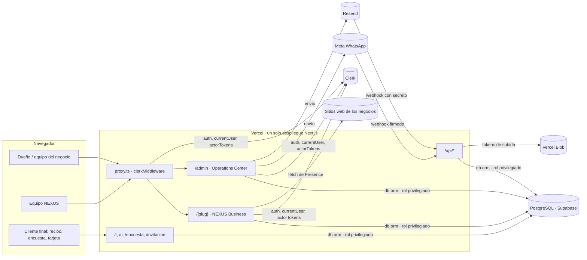
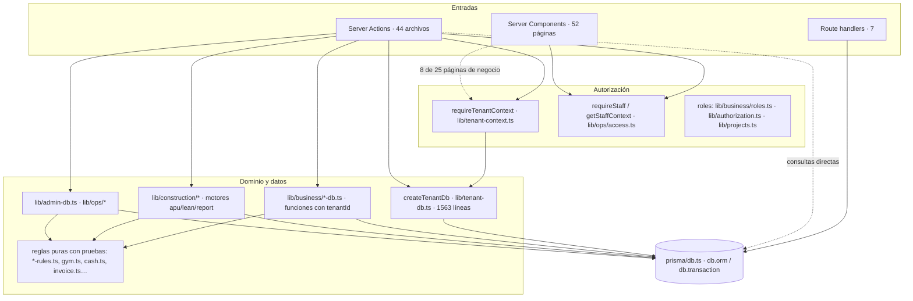

# 03 · Arquitectura técnica actual

[← Índice](README.md) · Describe lo que **existe**. Las propuestas están en
[target-architecture.md](target-architecture.md).

## 1. Stack verificado

| Pieza | Versión / uso real | Evidencia |
|---|---|---|
| Next.js | 16.3.8, App Router, Turbopack; `proxy.ts` en lugar de `middleware.ts` | `package.json`, `proxy.ts` |
| React | 19.2.8 | `package.json` |
| TypeScript | ^5, `strict` | `tsconfig.json` |
| Estilos | Tailwind CSS 4 + CSS modules + paquete propio `packages/brand` | `postcss.config.mjs`, `app/globals.css` |
| ORM | Prisma 8 (`@prisma/orm-postgres` 8.0.0-rc.14, CLI `prisma` 8.0.0-rc.20). Contrato en `prisma/contract.prisma`, emitido a `prisma/contract.json` + `contract.d.ts` | `prisma.config.ts`, `prisma/db.ts` |
| Base de datos | PostgreSQL en Supabase (solo como Postgres; extensión `pg_trgm`) | `.env.example`, `docs/prod-sql/*` |
| Identidad | Clerk (`@clerk/nextjs` ^7.9) | `proxy.ts`, `app/layout.tsx` |
| Archivos | Bytes en Postgres (`Attachment`, `ApuImage`, `ChargeEvidence`); Vercel Blob solo como tránsito de importaciones grandes | `lib/business/finance-db.ts:41`, `app/api/blob-upload/route.ts` |
| Mensajería | WhatsApp Cloud API (Meta) y Resend, opcionales, solo para la bandeja del panel | `lib/ops/inbox-providers.ts` |
| Mapas | Photon + Leaflet (Google Places opcional) | `lib/maps/*` |
| OCR | `tesseract.js` (comprobantes) | `lib/payment-scan.ts` |
| Pruebas | Vitest 5 (unitarias + integración con Postgres) | `vitest.config.mts`, `test-integration.sh` |
| Catálogo UI | Storybook 10 | `.storybook/` |
| CI | GitHub Actions: tsc, lint, test, Storybook, migraciones en Postgres 17 limpio, integración | `.github/workflows/ci.yml` |
| Despliegue | Vercel desde `main`; `maxDuration` 60 s | `vercel.json`, `docs/VERSIONADO.md` |
| Runtime | Polyfill de `Temporal` en `instrumentation.ts` (Prisma 8 usa codecs Temporal) | `instrumentation.ts` |

No se encontró: cliente de Supabase, Supabase Auth, colas, cron, Redis, caché
compartida, observabilidad externa (Sentry o similar), feature flags más allá de
`SHOW_PRICING`.

## 2. Vista de contexto

## 3. Frontend

| Aspecto | Cómo está | Evidencia |
|---|---|---|
| Rutas | Segmento dinámico `[tenant]` con grupo `(app)` (shell + gate de onboarding); `/admin` aparte; `/onboarding` de primer nivel | `app/` |
| Layouts | `app/layout.tsx` (Clerk, tema) → `[tenant]/layout.tsx` (acceso) → `(app)/layout.tsx` (shell, menú, notificaciones, intro de la N al entrar tras iniciar sesión) | — |
| Sistema de componentes | Atomic design: `components/{atoms,molecules,organisms,templates,providers}` con historias de Storybook | `components/` |
| Formularios | Mezcla de `useActionState` + `FormData` (formularios antiguos) y acciones con objetos tipados (más recientes) | `finance/actions.ts` vs `billing/actions.ts` |
| Validación | Validadores manuales por módulo (`validators.ts`), sin librería de esquemas; se repite en servidor | `app/[tenant]/(app)/*/validators.ts` |
| Estado | Estado local de React + contexto del shell (`components/providers/shell-context.tsx`); preferencias en `localStorage` | — |
| Terminología por rubro | `getVerticalTerms` + `VerticalTermsProvider` | `lib/vertical-terms.ts` |
| Carga y error | 20 `loading.tsx`; **ningún** `error.tsx`; vacíos con `EmptyState` | — |
| Componentes cliente | 203 archivos con `"use client"` | — |

Separación de capas: las páginas consultan la base directamente
(`db.orm.public.Tenant.where(...)` aparece en casi todas) además de usar
`createTenantDb`. No hay capa de "loaders" ni de servicios de lectura.

## 4. Backend

| Punto | Estado actual |
|---|---|
| Validación en servidor | Sí en las acciones revisadas (nunca se confía en el plan/módulos del navegador en el onboarding) |
| Reglas de negocio puras | Buena práctica extendida: `lib/ops/*-rules.ts`, `lib/business/{gym,cash,inventory,invoice,museum}.ts`, motores de construcción, todas con pruebas |
| Lógica en el cliente | Cálculo de precios del configurador público (`lib/pricing`, `localStorage`); render de recibos PNG (`lib/business/receipt-share.ts`); el servidor recalcula lo que importa |
| Transacciones | Usadas en onboarding, construcción, canje de códigos, facturas (creación), stock; **no** en cobros, ventas, gastos, pago de facturas |
| Errores | Las acciones devuelven `{ ok, message }` o estados de formulario; los errores del motor se registran con `console.error` y se ocultan al usuario |
| Procesos asíncronos | Ninguno. Vencimientos (beneficios, membresías) se calculan al leer; `expireBenefitTrial` escribe durante el render del layout |
| Webhooks | WhatsApp (HMAC SHA-256, `timingSafeEqual`) y correo entrante (secreto compartido). No hay webhook de Clerk |
| Servicios externos | Clerk (`auth`, `currentUser`, `clerkClient().actorTokens`), Meta, Resend, Vercel Blob, Photon/Google Places, `fetch` a sitios de negocios |

## 5. Datos

- **Contrato**: `prisma/contract.prisma` (2.084 líneas, 71 modelos, 33 enums).
- **Migraciones Prisma**: `migrations/app/*` (33 aplicables). Se verificó que sobre
  una base vacía producen exactamente las 71 tablas del contrato.
- **SQL manual de producción**: `docs/prod-sql/*.sql`, ejecutado a mano en el SQL
  Editor de Supabase (`docs/prod-sql/00-ORDEN.md`). Activa RLS en 36 tablas, cosa
  que las migraciones de Prisma no hacen: **las dos fuentes ya difieren**.
- **Semillas**: no hay `seed`; el catálogo comercial se siembra al leer
  (`lib/plans/settings.ts`) y los roles del panel al primer acceso
  (`ensureSystemRoles`).
- **Acceso**: un único cliente `db` con la URL de `DATABASE_URL` (rol con
  privilegios totales; RLS no aplica).

Detalle del modelo en [domain-and-data-model.md](domain-and-data-model.md).

## 6. Responsabilidad de cada sistema

| Dato | Dueño | Mecanismo de enlace |
|---|---|---|
| Persona, credenciales, sesión, correo | Clerk | `clerkUserId` copiado a `User` y `StaffMember` |
| Membresía en un negocio y rol | Postgres (`User`) | `requireTenantContext` |
| Equipo NEXUS y permisos | Postgres (`StaffMember`, `StaffRole`) | `getStaffContext` |
| Negocio, plan, módulos | Postgres (`Tenant`, `TenantModule`, `Subscription`) | — |
| Catálogo comercial | Postgres (`PlanSetting`…) con valores por defecto en código (`lib/plans/pricing.ts`) | Siembra perezosa |
| Archivos | Postgres (`bytea`) | `/api/files/{id}` |
| Conversaciones de la bandeja | Postgres, alimentado por Meta/Resend | Webhooks |

## 7. Acoplamientos principales

1. **Páginas ↔ base de datos**: lectura directa sin capa intermedia ni
   autorización propia en 17 páginas.
2. **Módulo `quotes` ↔ construcción**: un valor de enum activa tres pantallas de
   construcción ([ARCH-01](technical-debt.md#arch-01)).
3. **Menú ↔ rubro**: entradas condicionadas por `vertical` dentro de
   `MODULE_NAV` (taquilla, salidas, check-in).
4. **`lib/tenant-db.ts`**: un objeto de 1.563 líneas que importa construcción,
   finanzas, membresías y onboarding.
5. **Plan ↔ módulos**: `contractedModules` se escribe en onboarding y canje, pero
   nadie lo lee para autorizar.
6. **Roles ↔ módulos**: reglas de rol repartidas en tres archivos.

Siguiente: [domain-and-data-model.md](domain-and-data-model.md).
