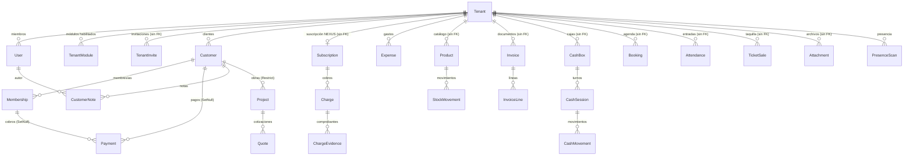

# 04 · Modelo de dominio y datos

[← Índice](README.md) · Fuente: `prisma/contract.prisma` en `1551e9a`. El estado de
la base desplegada **no** se inspeccionó.

## 1. Mapa de dominio (lo que existe)

| Categoría | Entidades reales | Notas |
|---|---|---|
| Identidad y acceso (negocio) | `User` (membresía), `TenantInvite`, enum `Role` | La persona vive en Clerk; `User` = (`clerkUserId`, `tenantId`, `role`, `active`) |
| Identidad y acceso (plataforma) | `StaffMember`, `StaffRole` (permisos `String[]`), `StaffInvite`, `AuditLog` | Equipo NEXUS, sin negocio |
| Organización y configuración | `Tenant`, `TenantModule`, `Tenant.settings` (JSON), `TenantContact` | `Tenant` mezcla identidad legal, ubicación, ecosistema digital, plan y estado comercial |
| Catálogo comercial de NEXUS | `PlanSetting`, `ModuleSetting`, `VerticalSetting`, `CustomerTierSetting`, `BillingPolicy` | Editable desde el panel |
| Suscripción a NEXUS | `Subscription`, `Charge`, `ChargeEvidence`, `BenefitCode`, `BenefitRedemption` | Cobro manual + códigos |
| Clientes del negocio | `Customer`, `CustomerNote`, `Attachment` (foto) | `Customer.profile` JSON por rubro |
| Catálogo de productos y servicios | `Product` (`ProductKind`: PRODUCT, SERVICE, PLAN, TICKET, TOUR) | Un solo catálogo para todo |
| Operaciones comerciales | `Payment`, `Invoice`, `InvoiceLine`, `Booking`, `Membership`, `TicketSale`, `Departure`, `TourBooking` | `Payment.sourceType/sourceId` enlaza el origen por texto |
| Inventario | `Product.stock`, `StockMovement` | — |
| Finanzas | `Payment`, `Expense`, `CashBox`, `CashSession`, `CashMovement` | Caja menor por turnos |
| Construcción (vertical) | `ApuItem`, `ApuActivity`, `ApuActivityComposition`, `ApuChapter`, `ApuImage`, `ApuImportRun`, `ApuItemPriceHistory`, `Project`, `ProjectHeader`, `ProjectBudget`, `BudgetChapter`, `BudgetItem`, `BudgetItemResource`, `BudgetItemProgress`, `BudgetBaseline`, `BudgetLockEvent`, `Quote`, `QuoteItem`, `ProjectFollowUp`, `ProjectPlan`, `LookaheadTask`, `WeeklyCommitment`, `FieldLog`, `FieldLogEntry` | 24 de 71 modelos |
| Gimnasio (vertical) | `Attendance`, `Customer.accessCode/nfcUid`, `Membership.frozen*` | — |
| Presencia digital | `PresenceRequest`, `PresenceScan` | — |
| Operations Center | `Lead`, `LeadActivity`, `SupportTicket`, `TicketMessage`, `SatisfactionSurvey`, `InboxConversation`, `InboxMessage` | — |
| Notificaciones | `DismissedNotification` | Los avisos se calculan |
| Reportes | — (no hay entidades; se calculan) | `lib/report-engine.ts`, `lib/finance-series.ts` |
| Automatizaciones | — | NO ENCONTRADO |

## 2. Distinción persona / membresía / cliente

| Concepto | Entidad | ¿Se distingue bien? |
|---|---|---|
| Persona que usa NEXUS | Clerk (`clerkUserId`) | Sí, pero **no hay entidad local de persona**: nombre y correo se copian en cada `User` y no se sincronizan |
| Pertenencia a un negocio | `User` (único por `clerkUserId`+`tenantId`) | Sí; permite varios negocios por persona, aunque el onboarding lo prohíbe y no hay selector |
| Integrante NEXUS | `StaffMember` | Sí, separado del negocio. Pero existe además el rol de negocio `SUPERADMIN`, y `isSuperAdmin` lo busca en **cualquier** negocio (`lib/admin-db.ts:469`) |
| Cliente del negocio | `Customer` | Sí, totalmente separado de `User` |
| Contacto del negocio para NEXUS | `TenantContact` | Sí |

## 3. Diagrama ER (núcleo de negocio)

Relaciones "por texto" (sin FK, el código las resuelve): `Payment.sourceType/sourceId`,
`Payment.cashSessionId`, `Payment.invoiceId`, `Expense.projectId`,
`Invoice.customerId`, `InvoiceLine.productId`, `CashMovement.paymentId/expenseId`,
`Attendance.customerId/membershipId`, `Attachment.ownerId`, `Tenant.customerTierId`,
`Tenant.accountManagerId`, `BenefitCode.createdById`.

## 4. Integridad referencial y aislamiento a nivel de base

- **30 modelos** con `tenantId` tienen FK a `Tenant` (borrado en cascada).
- **22 modelos** con `tenantId` **no** tienen FK en el contrato: `Booking`,
  `TenantContact`, `Lead`, `SupportTicket`, `Subscription`, `Charge`,
  `BenefitRedemption`, `InboxConversation`, `SatisfactionSurvey`, `Attachment`,
  `CashBox`, `CashSession`, `CashMovement`, `Product`, `StockMovement`, `Invoice`,
  `TenantInvite`, `Attendance`, `TicketSale`, `Departure`, `TourBooking`,
  `PresenceRequest`. Su borrado depende de `lib/tenant-deletion.ts` (lista
  explícita, con prueba de integración que la compara con la base).
- Las FK entre entidades de negocio son **simples** (`Payment.customerId →
  Customer.id`), no compuestas con `tenantId`. La base acepta que un pago del
  negocio A apunte a un cliente del negocio B; solo el código lo impide.
- Restricciones únicas útiles: `User(clerkUserId, tenantId)`,
  `TenantModule(tenantId, moduleName)`, `Payment(tenantId, receiptNumber)`,
  `Invoice(tenantId, kind, number)`, `TicketSale(tenantId, number)`,
  `BenefitRedemption(codeId, tenantId)`.
- Faltan: unicidad de `Customer(tenantId, accessCode)` y `(tenantId, nfcUid)`;
  unicidad de `StaffMember.email` sin distinguir mayúsculas (hay `@unique`
  sensible a mayúsculas); `Payment.providerRefId` es único **global**.

## 5. Estados y enumeraciones

| Tipo | Valores | Observación |
|---|---|---|
| Enums Prisma | `Role`, `Vertical` (17), `ModuleName` (11), `TenantPlan`, `PaymentStatus`, `PaymentProvider`, `ProjectStatus`, `QuoteStatus`… | Añadir un rubro o módulo exige migración |
| Estados en texto | `Invoice.kind`, `Expense.paidFrom`, `StockMovement.kind`, `TicketSale.status/kind`, `Departure.status`, `TourBooking.status`, `PresenceRequest.status`, `ModuleSetting.status`, `Attendance.method`, `InboxMessage.direction/delivery` | Validados solo por la aplicación |
| Estados calculados | Vencido de `Charge`, estado dinámico de `Membership` (el persistido puede quedar desactualizado) | — |

## 6. Ambigüedades y duplicaciones de datos

| Tema | Evidencia | Efecto |
|---|---|---|
| Cobros de membresía en dos sitios | `Membership.payments` (JSON) y filas `Payment` con `membershipId` | Dos verdades que pueden divergir |
| Plan en tres sitios | `Tenant.plan/planMonthlyUsdCents/contractedModules`, `Subscription.plan/priceUsdCents`, `BenefitRedemption.plan` | La "verdad" del plan depende de quién lea |
| Rol `STAFF` y `SUPERADMIN` | `Role` mezcla roles de negocio, un rol heredado y el soporte de NEXUS | Reglas de permisos con casos especiales |
| `Booking` vs `TicketSale` vs `TourBooking` | Tres modelos de "reserva" con reglas distintas | Reutilización baja entre rubros |
| `Quote` heredada vs cotización de obra | `legacy-quotes.tsx` | Dos caminos para lo mismo |

## 7. Principales flujos de datos

1. **Alta**: Clerk → `/auth/callback` → onboarding → `Tenant` + `User` +
   `TenantModule` (tx) → `BenefitRedemption` + `Subscription TRIAL` (canje).
2. **Dinero**: acción → `Payment` → `withNextNumber` (máx + 1 con reintento por
   unicidad) → `CashMovement` si es efectivo con turno abierto → `/r/{token}`.
3. **Inventario**: venta → `Payment` → `StockMovement` + `Product.stock` (tx).
4. **Acceso gym**: escaneo → `Customer` por código/UID → `Membership` vigentes →
   `Attendance` (permitido/negado/desconocido).
5. **Construcción**: catálogo APU (importación) → copia congelada al
   presupuesto → revisión emitida (`Quote`) → aprobación → `BudgetBaseline` y
   bloqueo → avance (`BudgetItemProgress`) → informes.
6. **Vencimientos**: al renderizar el layout del negocio, `expireBenefitTrial`
   baja el plan a Essential si el período del código venció.

## 8. Conceptos propuestos (no existen)

Se detallan en [target-architecture.md](target-architecture.md): `Person` (o
perfil local de la persona), `Membership` de organización con roles y permisos
por capacidad, `Capability`/`ModuleDefinition` en código, `OrganizationModule`
con estados *disponible · contratado · habilitado · configurado*, `SolutionPreset`
por rubro, `Party` (tercero) para clientes y proveedores, `SalesDocument`
genérico, eventos de dominio.

Siguiente: [modules-and-dependencies.md](modules-and-dependencies.md).
