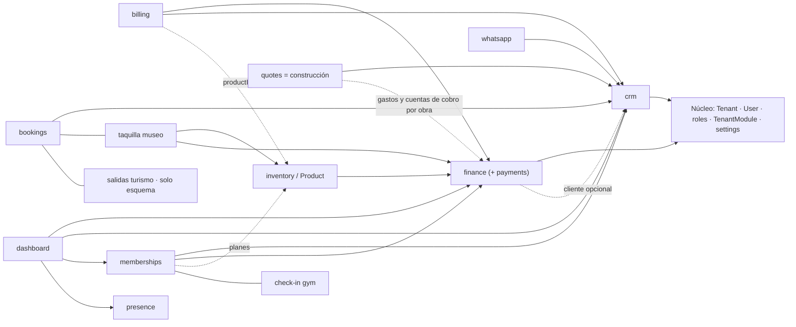

# 05 · Catálogo y dependencias de módulos

[← Índice](README.md)

## 1. Qué es hoy un "módulo"

Un módulo es un valor del enum `ModuleName` (11 valores). Ese mismo valor se usa
para cuatro cosas distintas:

| Uso | Dónde |
|---|---|
| Ítems del menú | `lib/navigation/tenant-nav.ts` (`MODULE_NAV`) |
| Habilitación por negocio | tabla `TenantModule (tenantId, moduleName, active)` |
| Precio y estado operativo | tabla `ModuleSetting` (`status` READY/BETA/PLANNED) con valores por defecto en `lib/plans/pricing.ts:121` |
| Receta por rubro | `VERTICAL_RECIPES` en `lib/admin-catalogs.ts` y `VerticalSetting.modules` |

Y se describe en **cinco** catálogos que hay que mantener a mano:

1. enum `ModuleName` (`prisma/contract.prisma:159`) — añadir uno exige migración;
2. `lib/admin-catalogs.ts` (`MODULES`, `BASE_MODULES`, `SPECIALIZED_MODULES`, etiquetas, recetas);
3. `lib/plans/pricing.ts` + tablas `ModuleSetting`/`VerticalSetting` (precio, estado);
4. `lib/onboarding/module-meta.ts` (iconos y textos del onboarding);
5. `lib/pricing/catalog.ts` (configurador público, otro modelo de "industrias" y "tiers").

Estados que el código **distingue** (comentario en `prisma/contract.prisma`, campo
`contractedModules`): *contratado* (`Tenant.contractedModules`) ≠ *habilitado*
(`TenantModule.active`) ≠ *operativo* (`ModuleSetting.status`). Lo que **no**
existe: *configurado* (asistente o requisitos previos del módulo) y *autorizado*
(qué roles lo usan). Y ninguno de los estados se aplica en el servidor: solo
filtran el menú ([SEC-06](security-audit.md#sec-06)).

## 2. Ficha por módulo

| Módulo | Responsabilidad real | Pantallas | Capa de datos | Depende de | Independencia |
|---|---|---|---|---|---|
| `dashboard` | Resumen del negocio | `/` | `tenant-db.finance`, `customers`, `memberships`, `lib/presence` | finance, crm, memberships, presence | Baja: lee de todos |
| `crm` | Clientes, notas, ficha 360°, códigos de acceso | `/crm/*` | `tenant-db.customers`, `customerNotes`; `lib/business/customer-fields.ts` | `Attachment`; gym-db para el carnet | Media |
| `finance` | Cobros, gastos, caja, recibos | `/finance` | `tenant-db.finance/payments/expenses`, `lib/business/finance-db.ts`, `charge.ts` | crm (cliente opcional) | Media; es el "núcleo de dinero" que usan los demás |
| `payments` | Alias de Finanzas → Cobros | `/payments` (redirect) | — | finance | Nula: duplicado |
| `billing` | Recibos/cuentas de cobro con líneas | `/billing/*` | `lib/business/invoices-db.ts` | finance (`recordCharge` lógica copiada), crm, inventory (`productId` opcional) | Media |
| `inventory` | Catálogo de `Product` (5 tipos) y stock, venta directa | `/inventory` | `lib/business/products-db.ts` | finance | Media; el catálogo lo usan membresías (planes), taquilla (entradas), agenda (servicios) |
| `bookings` | Agenda genérica **+** taquilla (museo) **+** salidas (turismo) | `/bookings`, `/tickets`, `/departures`* | `Booking`, `museum-db.ts`, `TicketSale` | crm, inventory, finance | Baja: tres productos distintos bajo un valor |
| `memberships` | Membresías **+** control de acceso (gym) | `/memberships`, `/checkin` | `tenant-db.memberships`, `gym-db.ts`, `Attendance` | crm, finance, inventory (planes) | Media |
| `orders` | — | `/orders` placeholder | — | — | Estado PLANNED |
| `quotes` | **Suite de construcción**: obras, presupuesto APU, cotizaciones, Lean, bitácora, informes, catálogo APU | `/projects/*`, `/quotes/*`, `/catalog/*` | `lib/construction/*`, `lib/apu-importer/*`, motores `apu/lean/report/field-log` | crm (cliente de la obra), finance (gastos e `Invoice.projectId`) | Alta internamente; mal nombrada y mal asignada |
| `whatsapp` | Plantillas a `wa.me` | `/whatsapp` | `customers.search` | crm | Alta |
| (sin módulo) Presence | Presencia digital | `/presence`, panel del inicio | `lib/presence/*` | — | Alta; fuera del catálogo y del precio |
| (sin módulo) Equipo, Ajustes, Notificaciones | Núcleo | `/settings` | `team-db.ts`, `settings/actions.ts` | — | Núcleo |

\* ruta inexistente.

## 3. Grafo de dependencias

No se detectaron dependencias circulares de importación entre carpetas de
módulos; el acoplamiento está en **`lib/tenant-db.ts`**, que importa construcción,
finanzas, membresías y onboarding a la vez, y en las páginas que leen tablas de
otros módulos directamente.

## 4. Rubros: recetas actuales

| Rubro (`Vertical`) | Registro abierto | Módulos por defecto | Pantallas propias del rubro |
|---|---|---|---|
| gym | Sí | dashboard, crm, memberships, finance, payments, whatsapp, bookings, inventory | `/checkin` |
| tourism_agency | Sí | dashboard, crm, bookings, payments, finance, whatsapp, inventory, billing | `/departures` (**404**) |
| construction | Sí | dashboard, crm, quotes, billing, finance | Suite de obra |
| restaurant | Sí | dashboard, crm, orders, inventory, payments, finance | Ninguna (`orders` es placeholder) |
| real_estate | Sí | dashboard, crm, bookings, billing, finance | Ninguna |
| museum | Sí | dashboard, crm, bookings, inventory, finance, payments, billing, whatsapp | `/tickets` |
| hospitality, carpentry, retail, beauty, healthcare, mechanic, education, hardware_store, nautical_transport, tour_guides, events | No (`SIGNUP_VERTICALS`) | Varias; **mechanic, tour_guides, events y carpentry reciben `quotes` = construcción** | — |

Fuentes: `lib/admin-catalogs.ts:41` (`SIGNUP_VERTICALS`) y `VERTICAL_RECIPES`.

## 5. Evaluación de modularidad

| Pregunta | Respuesta |
|---|---|
| ¿Qué es realmente compartido? | Clientes, dinero (cobro + recibo + caja), catálogo `Product`, agenda, equipo, archivos, notificaciones, Presence |
| ¿Qué está acoplado a un rubro? | Construcción (24 modelos), taquilla (museo), check-in (gym), salidas (turismo); se decide con `vertical === "…"` en el menú y en páginas |
| ¿Qué duplica lógica? | El patrón "crear `Payment` → numerar → entrar a caja" vive en `recordCharge` (`lib/business/charge.ts`, usado por membresías y taquilla) y está **copiado** en `createPaymentAction`, `sellProductAction` y `payInvoice` |
| ¿Configuración mezclada con lógica? | Sí: recetas, etiquetas y precios por defecto en código; también en tablas; los dos se combinan en `loadPricingConfig` |
| ¿Activar un módulo toca muchas áreas? | Sí: enum + migración, `admin-catalogs`, `tenant-nav`, `module-meta`, `pricing`, `quick-create`, carpeta en `app/[tenant]/(app)` |
| ¿Catálogo central de módulos? | No en código; parcialmente en `ModuleSetting` |
| ¿Módulos habilitados persistentes? | Sí (`TenantModule`) |
| ¿Disponible / habilitado / configurado / autorizado? | Disponible ≈ receta del rubro; habilitado = `TenantModule`; contratado = `contractedModules`; configurado y autorizado: **no existen** |
| ¿Capacidad, paquete comercial y solución por rubro separados? | No: `ModuleName` es capacidad, ítem de precio y menú a la vez; el rubro es una receta de módulos + condiciones en el menú |
| ¿Integraciones acopladas? | WhatsApp/Resend solo en el panel, aislados en `lib/ops/inbox-providers.ts` (buena base); no hay interfaz para integraciones por negocio |

**Conclusión:** un **monolito modular** es suficiente para la etapa actual. No hay
señales de carga, equipos independientes ni requisitos de despliegue que
justifiquen microservicios o bases separadas. Lo que falta es **delimitar**:
un registro de capacidades en código, una puerta de servidor por capacidad y un
"núcleo de dinero" único. Ver [target-architecture.md](target-architecture.md).

Siguiente: [security-audit.md](security-audit.md).
