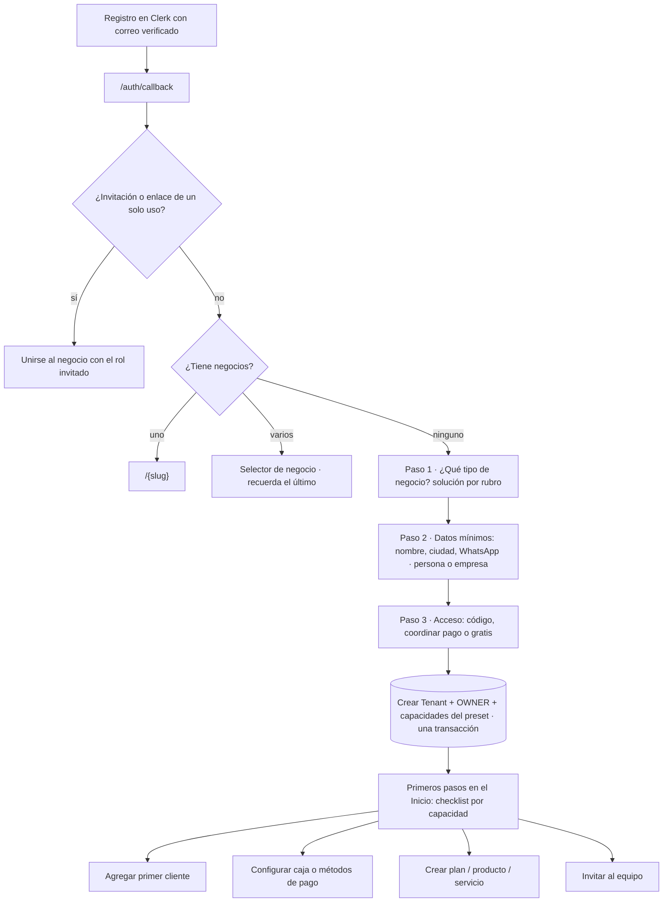

# 09 · Onboarding y experiencia objetivo

[← Índice](README.md) · **Propuesta.** El flujo actual está en
[user-journey.md](user-journey.md#3-onboarding-real).

## 1. Problemas del flujo actual que motivan la propuesta

| Problema | Evidencia |
|---|---|
| El onboarding elige módulos por receta, pero el rubro "turismo" lleva a un 404 y "restaurante" a un placeholder | [ARCH-02](technical-debt.md#arch-02) |
| Tras crear el negocio el dashboard aparece vacío, sin pasos guiados (solo accesos rápidos) | `app/[tenant]/(app)/page.tsx` |
| Los negocios creados por el equipo NEXUS no tienen un dueño invitado | [SEC-02](security-audit.md#sec-02) |
| "Sin acceso" no ofrece salida; equipo NEXUS y dueños comparten la misma puerta de entrada con lógica por correo | `app/[tenant]/layout.tsx:100`, `/auth/callback` |
| Dos wizards conviven | [ARCH-03](technical-debt.md#arch-03) |

## 2. Flujo propuesto

Reglas:

- **Menos pasos antes del valor**: la ficha completa (NIT, razón social, dirección
  con mapa) se pide cuando una capacidad la necesita (p. ej. al emitir la primera
  cuenta de cobro), no al principio.
- **Solo capacidades operativas**: un preset nunca activa una capacidad sin
  pantalla; la prueba de [ARCH-02](technical-debt.md#arch-02) lo garantiza.
- **Checklist derivado del registro**: cada capacidad declara sus "primeros pasos"
  y cuándo están cumplidos (consulta barata). Se guarda `configuredAt` por
  capacidad.
- **Cambio de rubro**: permitido solo si no hay datos que dependan del rubro, o
  como acción del equipo NEXUS con vista previa de lo que cambia.

## 3. Navegación objetivo

| Grupo | Contenido | Fuente |
|---|---|---|
| General | Inicio (dashboard del preset) | Registro + preset |
| Operación | Capacidades habilitadas **y** autorizadas para el rol | `requireCapability` + permisos |
| Dinero | Cobros, caja, gastos, documentos (si el rol maneja dinero) | Permiso `money.*` |
| Sistema | Ajustes, equipo, plan | Rol |

Estados de cada capacidad en Ajustes → Módulos: *incluida en tu plan*,
*disponible con otro plan*, *próximamente* (sin enlace), *requiere configuración*.

## 4. Estados vacíos, carga y error

- `error.tsx` en `app/[tenant]/(app)` y `app/admin` con reintento y código de
  soporte; `not-found.tsx` propio.
- "Sin acceso" con cerrar sesión, "ir a mi negocio" y "pedir acceso".
- Estado vacío con la acción principal de la capacidad (ya existe `EmptyState`).

## 5. Equipo NEXUS

Separar la entrada del equipo (`/admin`) por enlace de invitación y no por
coincidencia de correo ([SEC-01](security-audit.md#sec-01)), y permitir que un
integrante tenga también su negocio como decisión explícita
(`IDEAS-E-IMPLEMENTACIONES-IMPORTANTES.md` §2).

Siguiente: [roadmap.md](roadmap.md).
