# 10 · Plan de evolución

[← Índice](README.md) · Etapas en orden de dependencia. Cada etapa deja `main`
desplegable y termina con criterios verificables.

```mermaid
gantt
  dateFormat  X
  axisFormat  %s
  section Etapa 0 · Contención
  SEC-01, SEC-02, SEC-04, prueba SEC-03 :e0, 0, 1
  section Etapa 1 · Fundamentos de aislamiento
  requirePageContext · permisos · archivos · auditoría :e1, after e0, 2
  section Etapa 2 · Integridad de datos
  dinero transaccional · esquema único · restricciones :e2, after e0, 2
  section Etapa 3 · Modularidad
  registro de capacidades · requireCapability · separar construcción :e3, after e1, 3
  section Etapa 4 · Producto
  onboarding por preset · primeros pasos · selector de negocio :e4, after e3, 2
  section Etapa 5 · Plataforma
  cron · eventos · puertos de integración · pagos en línea :e5, after e3, 3
```

(Las barras indican orden y dependencia relativa, no fechas.)

## Etapa 0 · Contención de seguridad

| Tarea | Hallazgo | Criterio de finalización |
|---|---|---|
| Igualdad exacta de correo, sin reasignar fichas vinculadas, correo verificado | [SEC-01](security-audit.md#sec-01) | Prueba de integración con `_`/`%` falla en encontrar fichas ajenas; revisión del `AuditLog` hecha |
| Quitar bootstrap de OWNER; alta desde el panel con invitación al dueño | [SEC-02](security-audit.md#sec-02) | Consulta de negocios sin miembros en producción revisada; prueba: un tercero que abre `/{slug}` de un negocio vacío ve "Sin acceso" |
| Revisar `.env.produccion` e historial; rotar si hace falta | [SEC-04](security-audit.md#sec-04) | Archivo sin valores; secretos rotados si había |
| Ejecutar la prueba RSC de SEC-03 | [SEC-03](security-audit.md#sec-03) | Resultado documentado (vulnerable / no vulnerable) |
| Confirmar verificación de correo en Clerk | [SEC-10](security-audit.md#sec-10) | Captura de la configuración en el ADR o en `docs/clerk-produccion.md` |

Riesgo: bajo (cambios pequeños). Depende de: nada.

## Etapa 1 · Fundamentos de aislamiento y permisos

| Tarea | Criterio |
|---|---|
| `requirePageContext(slug)` con `cache()` en las 17 páginas | Prueba que recorre todas las `page.tsx` de `app/[tenant]` y exige la llamada (o test de arquitectura con `grep`) |
| Matriz única `permiso → roles` y `can(ctx, permiso)`; un solo tipo de rol | Tabla rol × acción en una prueba; membresías y borrado de clientes protegidos |
| Archivos solo para miembros activos | Prueba de integración con usuario retirado → 404 |
| Bitácora del negocio (anular, borrar, roles, módulos, borrar negocio) | Filas en `AuditLog` con `targetTenantId` |
| SSRF en Presence | Prueba con `http://127.0.0.1` y `169.254.169.254` → "sin verificar" |

Depende de: Etapa 0. Riesgo: medio (toca muchas páginas, cambio mecánico).

## Etapa 2 · Integridad de datos

| Tarea | Hallazgo | Criterio |
|---|---|---|
| Servicio `money` transaccional; pago de factura idempotente | [DATA-01](technical-debt.md#data-01) | Prueba de concurrencia: 1 cobro por factura; fallo a mitad → 0 filas |
| Una sola fuente del esquema de producción | [DATA-03](technical-debt.md#data-03) | Diff `--schema-only` producción vs migrada = vacío; `00-ORDEN.md` actualizado o retirado |
| FK a `Tenant` en las 22 tablas; FK compuestas en dinero; unicidad de `accessCode`/`nfcUid` | [DATA-04](technical-debt.md#data-04), [SEC-07](security-audit.md#sec-07) | Migración aplicada; integración verde |
| RLS sin políticas en todas las tablas (cerrar PostgREST) | [SEC-07](security-audit.md#sec-07) | `pg_tables.rowsecurity` verdadero en todas |
| Cobros de membresía solo en `Payment` | [DATA-02](technical-debt.md#data-02) | La ficha lee `Payment`; JSON retirado |

Puede ir en paralelo a la Etapa 1. Riesgo: medio-alto (migraciones de datos):
probar sobre copia de producción.

## Etapa 3 · Modularidad

| Tarea | Criterio |
|---|---|
| Registro de capacidades en código ([ADR-0003](decisions/0003-registro-de-capacidades.md)); menú, onboarding y precios derivan de él | Añadir una capacidad de prueba toca ≤ 3 archivos |
| `requireCapability(ctx, id)` en páginas y acciones; respeta contratado + habilitado | Prueba: capacidad desactivada → 404 en página y error en acción |
| Separar `construction` de `quotes`; recetas corregidas | Ningún rubro no constructor ve APU |
| Retirar del menú lo que no tiene página; decidir `orders` y salidas de turismo | Prueba de `href` ↔ `page.tsx` por rubro |
| Repositorios por capacidad; prohibir `db.orm` en `app/` | Regla de lint activa |
| Retirar wizard clásico y `lib/pricing` | Rutas redirigidas; carpeta eliminada |

Depende de: Etapa 1. Riesgo: medio.

## Etapa 4 · Producto y onboarding

Onboarding por preset, checklist de primeros pasos, selector de negocio,
`error.tsx`/`not-found.tsx`, "Sin acceso" con salida. Criterios en
[onboarding-and-ux.md](onboarding-and-ux.md). Depende de: Etapa 3.

## Etapa 5 · Plataforma

Vercel Cron para vencimientos y recordatorios; eventos de dominio en proceso;
puertos de integración (mensajería, pagos, factura electrónica); Wompi. Depende
de: Etapa 2 (dinero) y 3 (capacidades).

## Qué aplazar

- Multiempresa para asesores (después de la Etapa 4).
- Motor de automatizaciones configurable (cuando existan ≥ 3 casos reales).
- POS multi-línea y compras/proveedores: diseñarlos sobre el servicio `money` y
  `sales-docs` de las etapas 2–3, no antes.
- RLS con políticas por sesión.

## Verificación continua

`pnpm verify` debe pasar en cada etapa (con `NODE_OPTIONS` para `tsc`,
[QA-01](technical-debt.md#qa-01)), más `pnpm test:integration` sobre Postgres.
