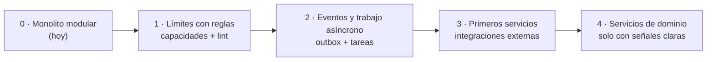

# 13 · Ruta de escalabilidad: del monolito modular a servicios

[← Índice](README.md) · Propuesta. Complementa
[ADR-0001](decisions/0001-monolito-modular.md): hoy **no** se parte en
microservicios. Este documento dice cómo preparar el código para poder hacerlo
el día que haga falta, y qué señales indican que llegó ese día.

## 1. Por qué no ahora

Un equipo pequeño, un piloto sin carga relevante y transacciones que cruzan
dominios (una venta toca dinero, inventario y recibo a la vez). Separar ahora
cambiaría transacciones locales por coordinación distribuida, multiplicaría
despliegues y bases, y no resolvería el problema real de hoy: límites difusos
dentro del código.

Lo que sí se hace desde ya es **construir las costuras**: si cada capacidad
habla con las otras solo por su interfaz pública y por eventos, sacarla después
es mover una carpeta, no reescribir.

## 2. Las etapas



### Etapa 0 · Monolito modular (hoy)

Un despliegue Next.js en Vercel, una base Postgres. Ya hay: una sola puerta de
contexto (`requireTenantContext`), una sola matriz de permisos, servicio de
dinero transaccional, prohibición de `db.orm` en `app/`.

### Etapa 1 · Límites con reglas

Es la Etapa 3 del [roadmap](roadmap.md). Cada capacidad en
`lib/capabilities/<id>/` con:

```
definition.ts   id, rutas, menú, permisos, dependencias
index.ts        interfaz pública: lo único que otras capacidades importan
repo.ts         acceso a sus tablas (nadie más las toca)
rules.ts        reglas puras
```

Reglas, aplicadas con ESLint (`no-restricted-imports` por carpeta):

1. Una capacidad importa del núcleo (`lib/core`) y de la **interfaz pública**
   (`index.ts`) de otra, nunca de sus archivos internos.
2. Cada tabla tiene **una** capacidad dueña. Las demás no la consultan: le
   piden los datos a su dueña.
3. Ninguna consulta cruza capacidades con un `JOIN` en código de aplicación
   (los reportes son la excepción, y viven aparte con acceso de solo lectura).

Señal de que la etapa está hecha: se puede listar, para cada tabla, su
capacidad dueña, y el lint no tiene excepciones.

### Etapa 2 · Eventos y trabajo asíncrono

Lo que no tiene que pasar en la misma petición sale de ella.

**Outbox transaccional.** La capacidad que hace algo escribe, en la misma
transacción, una fila en `OutboxEvent`:

```
OutboxEvent(id, tenantId, type, payload jsonb, createdAt, processedAt, attempts)
```

Ejemplos: `money.received`, `invoice.issued`, `membership.expiring`,
`stock.low`. Un despachador (Vercel Cron cada minuto, o un worker) lee lo
pendiente y llama a los suscriptores. Como la fila se escribe con la venta, no
hay evento sin venta ni venta sin evento.

Reglas:

- Todo evento lleva `tenantId`. Ningún suscriptor procesa sin él.
- Los suscriptores son **idempotentes**: procesar dos veces el mismo evento da
  el mismo resultado (guardan el `id` del evento que ya aplicaron).
- El `payload` es un contrato versionado (`type: "money.received.v1"`): se
  agrega, no se cambia.

Primeros usos: enviar la factura electrónica, mandar el recibo por WhatsApp,
avisar vencimientos, actualizar el mini-sitio cuando cambia el catálogo.

### Etapa 3 · Primeros servicios: las integraciones externas

Lo primero que se separa es lo que **ya** habla con terceros por red, falla por
causas ajenas y necesita reintentos. Cada uno vive detrás de un puerto desde la
etapa 1, así que separarlo es cambiar el adaptador que llama en proceso por uno
que publica en una cola.

| Candidato | Por qué primero |
|---|---|
| Factura electrónica (proveedor DIAN) | Latencia y rechazos ajenos; reintentos; auditoría propia |
| Mensajería (WhatsApp Cloud API, correo) | Webhooks entrantes, límites de envío, picos |
| Procesamiento de archivos (fotos, OCR de comprobantes, importador APU) | CPU y memoria; hoy compite con las páginas en la misma función |
| Presencia digital (sondeo de sitios, SEO, Google, redes) | Llamadas lentas a terceros; tareas programadas |

Estos servicios **no tienen base de negocio propia**: reciben un evento,
llaman al tercero y devuelven el resultado con otro evento o un webhook firmado
hacia el monolito.

### Etapa 4 · Servicios de dominio

Separar una capacidad con datos propios (inventario, agenda, construcción) solo
cuando aparezca al menos una de estas señales, medida y no supuesta:

| Señal | Ejemplo |
|---|---|
| Carga distinta | El POS necesita responder en < 200 ms en hora pico mientras los informes de construcción tardan segundos |
| Ritmo de cambio distinto | Un equipo propio despliega construcción varias veces al día y bloquea a los demás |
| Requisito de aislamiento | Un cliente grande exige su base separada, o la DIAN exige retener documentos con otras reglas |
| Límite técnico | La base única no da (conexiones, tamaño, bloqueos) aun con índices, réplicas de lectura y particiones por `tenantId` |

Al separar: la capacidad se lleva **sus** tablas (las que ya eran suyas desde la
etapa 1), expone su interfaz pública como API interna y sigue publicando sus
eventos al mismo bus. El resto del sistema no cambia, porque ya hablaba con
ella así.

## 3. Qué no se separa

- **Identidad, negocio, membresías y permisos** (el núcleo): todo lo demás
  depende de ellos en cada petición.
- **Dinero**: es el corazón transaccional. Se escala verticalmente, con
  réplicas de lectura para reportes, antes de partirlo.

## 4. Escalar sin partir (lo que se hace antes de cualquier servicio)

En orden de costo, de menor a mayor:

1. Índices que empiecen por `tenantId` en toda tabla de negocio (DATA-04).
2. Cachear lecturas por petición (`cache()`, ya en `requirePageContext`) y por
   negocio con invalidación por etiqueta.
3. Paginación en toda lista (ya en CRM; falta en otras).
4. Pool de conexiones adecuado al modelo serverless (Supabase pooler).
5. Réplica de lectura para reportes y dashboards.
6. Trabajo pesado fuera de la petición (etapa 2).
7. Particionar tablas grandes (`Payment`, `CashMovement`, `AuditLog`) por fecha.

## 5. Cómo se ve en el día a día

Al escribir una funcionalidad hoy, tres hábitos bastan para no cerrar la puerta:

- Llama a otra capacidad por su función pública, no leyendo sus tablas.
- Si algo puede pasar después (avisar, enviar, sincronizar), escríbelo como
  "cuando pase X, haz Y", aunque hoy Y se llame en la misma petición.
- Pon el `tenantId` en todo: tablas, eventos, logs, archivos.
