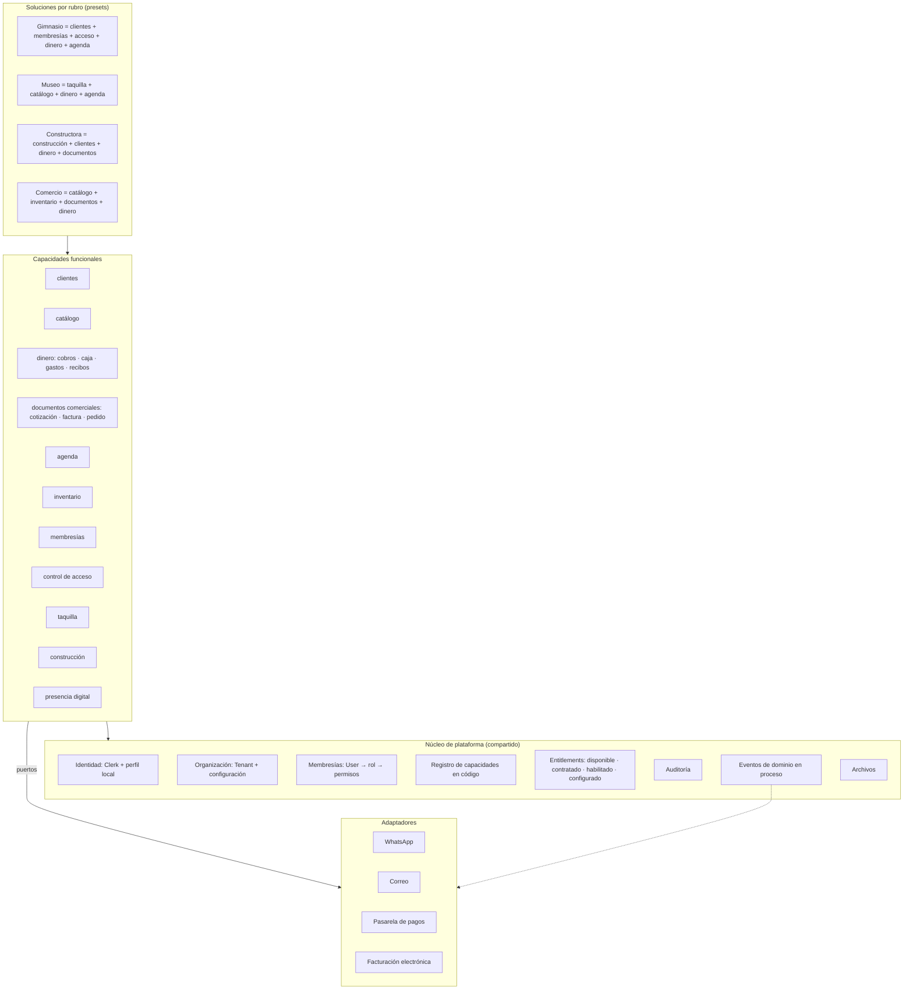

# 08 · Arquitectura objetivo propuesta

[← Índice](README.md) · **Nada de esto está implementado.** Cada propuesta indica qué
pieza actual reutiliza. Las decisiones están como *propuestas* en
[decisions/](decisions/README.md).

## 1. Principios

1. **Monolito modular** en el mismo repositorio y despliegue. Sin microservicios ni
   bases separadas: no hay carga, equipos ni requisitos que lo justifiquen
   ([ADR-0001](decisions/0001-monolito-modular.md)).
2. **Aislamiento primero**: ninguna lectura ni escritura de negocio sin un
   `TenantContext` resuelto en el servidor.
3. **Capacidades, no rubros**: los rubros son *presets* que combinan capacidades
   compartidas; el código específico de un rubro vive como capacidad propia.
4. **El paquete comercial no es la estructura del código**: planes y precios se
   asignan a capacidades, no al revés.
5. **Evolución incremental**: cada paso deja la aplicación desplegable.

## 2. Vista general



## 3. Conceptos y su encaje con el código actual

| Concepto | Propuesta | Reutiliza | Cambio de modelo |
|---|---|---|---|
| Núcleo compartido | Carpeta `lib/core/` con contexto, permisos, entitlements, auditoría, archivos | `lib/tenant-context.ts`, `finance-db.ts` (archivos), `admin-db.logAudit` | No |
| Organizaciones aisladas | `requireTenantContext` y un nuevo `requirePageContext` (con `cache()`) como **única** puerta; repositorios que reciben el contexto | `createTenantDb` | No |
| Usuarios con membresías y permisos | Mantener `User` como membresía; matriz `permiso → roles` en código; `can(ctx, "money.void")` | `lib/business/roles.ts` | No en la primera etapa; opcional `Person` después ([ADR-0002](decisions/0002-identidad-y-membresias.md)) |
| Módulos con responsabilidades | Cada capacidad: carpeta `lib/capabilities/<id>/` con `definition.ts` (id, rutas, menú, permisos, dependencias, estado), repositorio y acciones | `MODULE_NAV`, `VERTICAL_RECIPES`, `module-meta` | Sí: `ModuleName` pasa de enum a texto validado contra el registro ([ADR-0003](decisions/0003-registro-de-capacidades.md)) |
| Capacidades habilitadas por organización | `TenantModule` + `config` JSON + `configuredAt`; puerta de servidor `requireCapability(ctx, id)` en páginas y acciones | `TenantModule`, `contractedModules`, `checkModuleToggle` | Columnas nuevas |
| Soluciones por rubro | `SolutionPreset` en código: capacidades por defecto, terminología, dashboard, campos de cliente | `VERTICAL_RECIPES`, `vertical-terms.ts`, `customer-fields.ts` | No |
| Paquetes comerciales separados | `PlanSetting` asigna capacidades (o tramos) — nunca rutas | `lib/plans/*` | Mínimo |
| Navegación adaptada | `buildTenantNav` derivado del registro + entitlements + permisos del rol | `lib/navigation/tenant-nav.ts` | No |
| Integraciones desacopladas | Puertos (`MessagingPort`, `PaymentGatewayPort`, `EInvoicePort`) con adaptadores; eventos en proceso (`moneyReceived`, `membershipExpiring`) con suscriptores | `lib/ops/inbox-providers.ts` | No |
| Dinero como núcleo | Un solo servicio transaccional para ingresos y egresos | `recordCharge` | No |
| Trabajos programados | Vercel Cron → endpoint firmado → tareas idempotentes | — | No |

## 4. Lo que **no** se recomienda

- Separar cada rubro en una aplicación o repositorio.
- Microservicios, colas o bases por negocio.
- RLS completa con políticas por sesión mientras haya un solo rol de app y un ORM
  sin contexto de sesión: alto coste, beneficio menor que una capa de acceso
  obligatoria y FK compuestas ([ADR-0004](decisions/0004-aislamiento-en-aplicacion.md)).
- Reescribir construcción: es la parte más madura y con más pruebas.
- Un motor genérico de automatizaciones antes de tener tres casos reales.

## 5. Estructura de carpetas objetivo (orientativa)

```
lib/
  core/            contexto, permisos, entitlements, auditoría, archivos, eventos
  capabilities/
    customers/     definition.ts · repo.ts · rules.ts
    money/         cobros, caja, gastos, recibos (un servicio transaccional)
    catalog/       Product
    inventory/
    sales-docs/    cotización genérica, factura interna, pedido
    agenda/
    memberships/
    access-control/
    ticketing/
    construction/  (lo que hoy es lib/construction + apu-importer)
    presence/
  solutions/       presets por rubro
  integrations/    puertos + adaptadores
app/[tenant]/(app)/<ruta>/   delgado: page → requirePageContext → requireCapability → repo
```

## 6. Multiempresa futura (asesores, contadores, agencias)

No es requisito de NEXUS Business. El modelo actual ya lo permite en datos
(`User` único por persona+negocio). Faltaría: selector de negocio, recordar el
último negocio, un tipo de membresía "externa" con permisos limitados y, más
adelante, una vista agregada. Ninguno de estos pasos obliga a cambiar el
aislamiento por `tenantId`.

Siguiente: [onboarding-and-ux.md](onboarding-and-ux.md).
