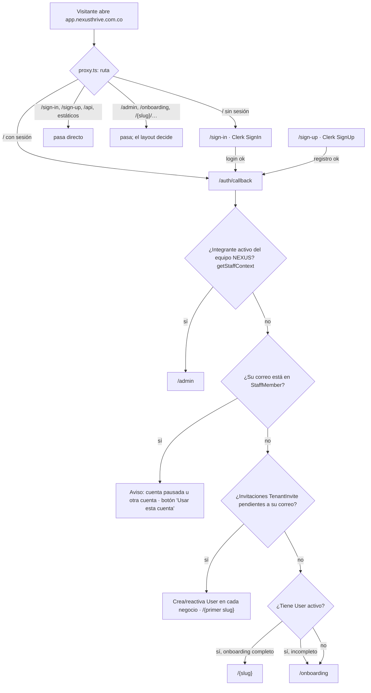
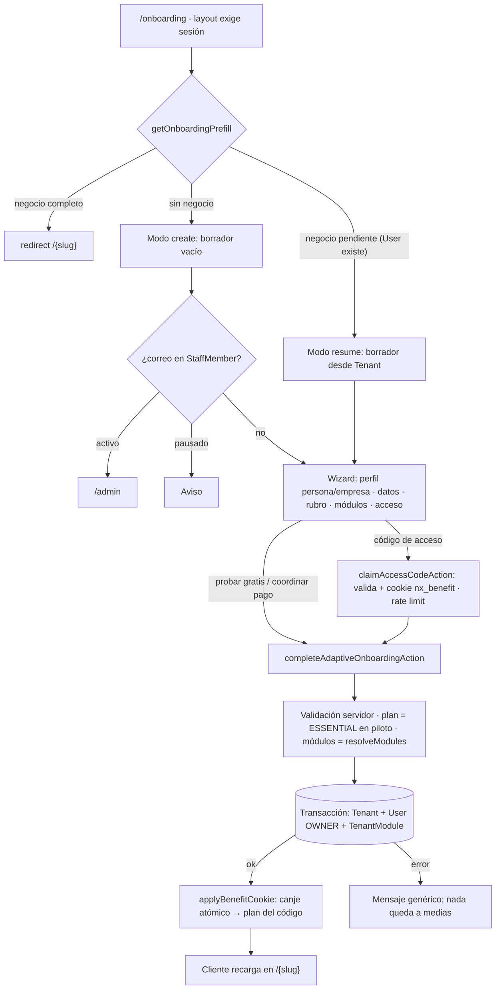
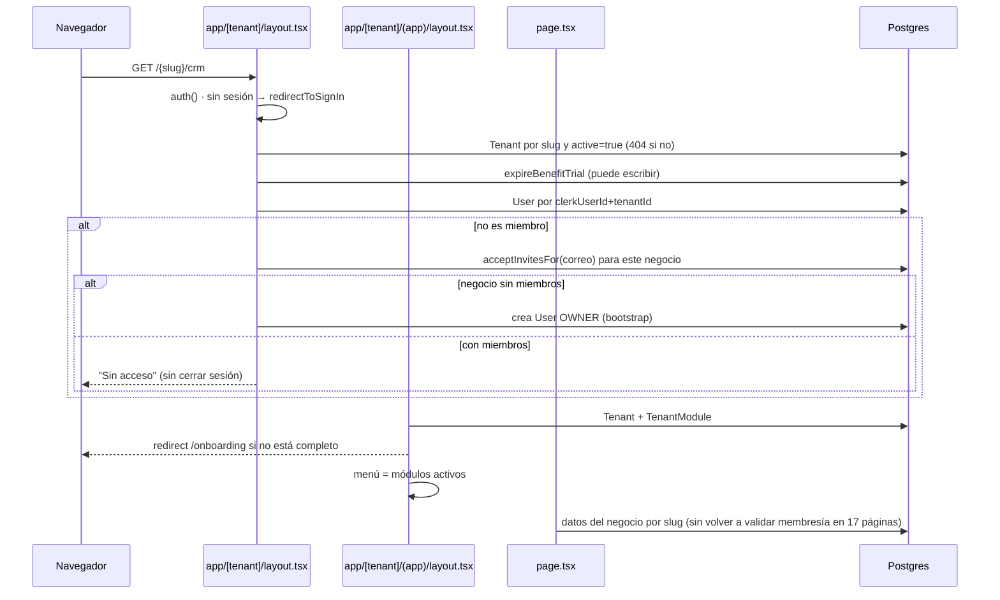

# 02 · Recorrido completo del usuario

[← Índice](README.md) · Todo lo descrito aquí es el comportamiento **actual** según
el código. La propuesta de experiencia está en [onboarding-and-ux.md](onboarding-and-ux.md).

## 1. Identidad en cada capa

| Capa | Identificador | Dónde se obtiene |
|---|---|---|
| Navegador | Sesión de Clerk (cookie) | `<ClerkProvider>` en `app/layout.tsx:23` |
| Proxy (middleware) | `userId` de Clerk | `proxy.ts` (`clerkMiddleware`) — solo decide `/` |
| Servidor (páginas y acciones) | `auth().userId` (= `clerkUserId`) | `@clerk/nextjs/server` |
| Negocio | `User` (`clerkUserId` + `tenantId`) → `memberId` y `role` | `lib/tenant-context.ts` (`requireTenantContext`) |
| Equipo NEXUS | `StaffMember.clerkUserId` → rol y permisos | `lib/ops/access.ts` (`getStaffContext`) |
| Correo | `primaryEmailAddress ?? emailAddresses[0]` de `currentUser()` | Se usa para invitaciones y para vincular el equipo |

No hay webhook de Clerk: la fila `User` se crea cuando la persona completa el
onboarding, acepta una invitación o es la primera en entrar a un negocio vacío.
Si cambia su correo o se borra en Clerk, la base no se entera.

## 2. Entrada y autenticación

Evidencia: `proxy.ts`, `app/auth/callback/page.tsx`, `app/auth/callback/actions.ts`,
`lib/ops/access.ts`, `lib/business/team-db.ts:56`.

| Etapa | Comportamiento | Estado |
|---|---|---|
| Registro / inicio de sesión | Componentes `<SignUp>`/`<SignIn>` de Clerk en `app/(auth)/…`, localizados en español, `fallbackRedirectUrl="/auth/callback"` | IMPLEMENTADO |
| Verificación de correo | La decide la configuración del panel de Clerk; el código no la comprueba | **INDETERMINADO** |
| Recuperación de cuenta | La ofrece el componente de Clerk; no hay código propio | IMPLEMENTADO por Clerk (no verificado) |
| Cierre de sesión | `UserButton` en la barra superior (`components/organisms/app-topbar.tsx:83`); `SignOutButton` en avisos del equipo e invitaciones | IMPLEMENTADO |
| Protección de rutas | El proxy **no protege** rutas: solo redirige `/`. La protección vive en `app/[tenant]/layout.tsx`, `app/admin/layout.tsx`, `app/onboarding/layout.tsx` y en cada acción | Ver [security-audit.md](security-audit.md#sec-03) |
| Fallo de Clerk | `components/molecules/auth-mount-fallback.tsx` muestra aviso y reintento si el formulario no monta; proxy opcional de la Frontend API (`NEXT_PUBLIC_CLERK_PROXY_URL`) | IMPLEMENTADO |
| Dominio | La Publishable Key codifica el host; `docs/clerk-produccion.md` documenta qué cambiar al mover de dominio | Documentado |

## 3. Onboarding real

Hay dos wizards. El vigente es `/onboarding` (`app/onboarding/*`); el clásico
`/{slug}/onboarding` (5 pasos, `app/[tenant]/onboarding/*`) sigue accesible pero el
gate de `(app)` ya no redirige a él.

| Pregunta | Respuesta según el código |
|---|---|
| ¿Qué pasa tras el registro? | `/auth/callback` → `/onboarding` si no hay negocio |
| ¿Se crea la organización automáticamente? | No: la crea el paso final del wizard (`app/onboarding/actions.ts:262`) |
| ¿Datos de empresa? | Sí, perfil adaptativo: `INDIVIDUAL` (sin NIT obligatorio) o `COMPANY` (razón social, NIT, tamaño, dirección con Photon/Leaflet o Google Places) — `lib/onboarding/validation.ts` |
| ¿Rubro? | Sí, 17 valores del enum `Vertical`; los activos para registro salen de `VerticalSetting.signupEnabled` |
| ¿Módulos? | En piloto los decide el servidor (`resolveModules`), no el navegador |
| ¿Roles? | El creador queda `OWNER` |
| ¿Datos iniciales? | El wizard vigente no crea clientes; el clásico sí (`lib/tenant-db.ts:1512`, con deduplicación) |
| ¿Se marca completado? | `Tenant.onboardingCompleted = true` dentro de la misma transacción |
| ¿Cómo se retoma? | `(app)/layout.tsx:47` redirige a `/onboarding?tenant={slug}`; el prefill rellena desde `Tenant` |
| ¿Si vuelve a entrar? | Negocio completo → directo a `/{slug}` |
| ¿Si falla a mitad? | La transacción revierte; el canje del código va **después** y, si falla, el negocio queda en Essential (`benefitPatch`) |
| ¿Puede crear un segundo negocio? | No en modo create: "una cuenta de Clerk = un negocio" (`actions.ts:299`) |

Variantes que no pasan por el wizard:

- **Negocio creado desde el panel** (`createTenantAction`): crea `Tenant` y
  módulos **sin ningún `User`** y con `onboardingCompleted = false`. El primer
  usuario autenticado que abra `/{slug}` queda como OWNER
  (`app/[tenant]/layout.tsx:71-93`) y luego pasa por el wizard en modo resume.
  Ver [SEC-02](security-audit.md#sec-02).
- **Tarjeta NFC/QR** (`/c/{code}`): guarda el código en cookie y manda a
  registrarse; el canje ocurre al crear el negocio.

## 4. Entrada a un negocio

| Situación | Qué ve |
|---|---|
| Usuario recién creado | Dashboard con KPIs en cero, "Sin clientes aún", accesos rápidos según módulos (`lib/navigation/quick-create.ts`) y panel de Presence |
| Usuario con datos | Los mismos KPIs con datos reales del período (hoy / 7 / 30 días) |
| Retirado del negocio | "Sin acceso" |
| Negocio suspendido | 404 (`Tenant.active = false`) |
| Ruta de módulo no activo escrita a mano | **Se abre igual**: no hay control de módulo en páginas ni acciones |
| `/{slug}/departures` | 404 (no existe la página) |
| Error inesperado | Pantalla de error por defecto de Next (no hay `error.tsx`) |
| Carga | `loading.tsx` en 20 rutas (esqueletos) |

## 5. Uso de las funcionalidades: flujos operativos verificados en código

Cada flujo se siguió de la interacción a la escritura. "Transacción" indica si las
escrituras son atómicas.

| Flujo | Entrada | Validaciones | Escrituras | Transacción | Riesgo de inconsistencia |
|---|---|---|---|---|---|
| Crear negocio | `completeAdaptiveOnboardingAction` | sesión, catálogo, slug único | `Tenant`, `User`, `TenantModule` | **Sí** | Canje del código fuera de la transacción (diseño intencional) |
| Invitar al equipo | `inviteMemberAction` (`settings/team-actions.ts`) | rol que gestiona equipo, correo, plazas del plan | `TenantInvite` | No aplica | Se acepta por **correo** al entrar ([SEC-10](security-audit.md#sec-10)) |
| Crear cliente | `saveCustomerAction` (`crm/profile-actions.ts`) | nombre, correo, teléfono, campos del rubro, foto | `Customer`, `Attachment` | No | Foto huérfana si falla el segundo paso |
| Vender producto | `sellProductAction` (`inventory/actions.ts:72`) | rol de caja, stock, cliente del negocio | `Payment` → número de recibo → `StockMovement`+`Product.stock` (tx) → `CashMovement` | **Parcial** (solo el stock) | Pago sin descontar stock si falla a mitad; stock comprobado antes y no dentro de la tx |
| Registrar cobro | `createPaymentAction` (`finance/actions.ts:57`) | rol de caja, cliente del negocio, referencia única | `Payment` → número → `CashMovement` | No | Pago sin número o sin entrada a caja |
| Registrar gasto | `createExpenseAction` | rol de caja, soporte | `Expense`, `Attachment`, `CashMovement` | No | Idem |
| Cobrar factura | `payInvoiceAction` (`billing/actions.ts`) | rol de caja, estado `ISSUED` | `Payment` → número → caja → `Invoice.status = PAID` | No | **Doble cobro** con dos clics simultáneos (lee estado y actualiza después) |
| Vender membresía | `createMembershipAction` | cliente del negocio, fechas | `Membership` (+ JSON `payments`) → `recordCharge` | No | Sin control de rol: un Asesor ("sin dinero") puede cobrar |
| Check-in gimnasio | `scanAction` (`checkin/actions.ts`) | rol de caja, rate limit en memoria | `Attendance` | Una escritura | — |
| Consultar reporte | Informes de obra (`projects/[projectId]/reports/actions.ts`), reporte de visitantes del museo, KPIs | membresía | lectura | — | — |
| Activar módulo (negocio) | `toggleModuleAction` (`settings/actions.ts:164`) | OWNER/SUPERADMIN, compatible con el rubro, no `PLANNED` | `TenantModule` | Una escritura | **No consulta el plan contratado** |
| Activar rubro especial | No existe un flujo: el rubro se fija en el onboarding y el panel; cambiarlo no migra datos | — | `Tenant.vertical` | — | Pantallas condicionadas por `vertical` en el menú |
| Automatización | NO ENCONTRADO | — | — | — | — |

Siguiente: [current-architecture.md](current-architecture.md).
