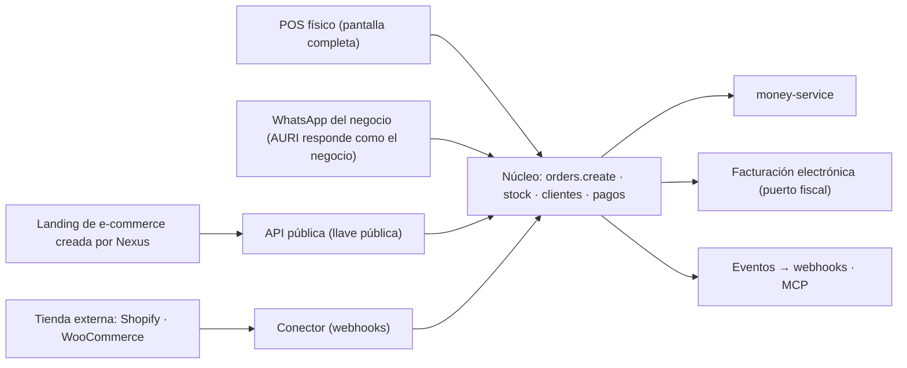

# Comercio general: productos, stock, POS, pagos y canales de venta

> Documento de trabajo para abrir las historias del comercio general. Junta tres cosas: dónde estamos (verificado en el
> código), cómo se conectan los canales de venta y los pagos, y qué pantallas hay que construir. Termina con el orden
> propuesto. Las decisiones que dependen de una persona están en la sección 10.

## 1. Alcance y reglas del juego

1. **Primero comercio general** (tiendas, ropa, merchandising, ferretería…). Después, el POS completo para restaurantes
   (su propio frente; ver `docs/SIGUIENTE-PASO.md`, decisiones D-1 a D-8 pendientes de aprobación).
2. **El gimnasio no se descuida.** Los planes de membresía son un tipo de producto (`PLAN`), así que el POS los vende; lo del
   comercio va detrás del rubro y los módulos, y cada entrega pasa una prueba de humo de los flujos del gimnasio (sección 9).
3. **Nexus no trae un editor de sitios web.** La landing de comercio electrónico la arma el personal de Nexus a pedido y se
   conecta por la API pública (sección 4). El editor que existe hoy (`sitio`) no se amplía.
4. Todo lo que se construya sigue el sistema de diseño (`packages/brand/`), define los cuatro estados (carga, error, éxito,
   vacío) y declara sus operaciones una sola vez para pantalla, API, MCP y eventos (`docs/wiki/07-integraciones/api-mcp-webhooks.md`).
5. **Decisiones tomadas (2026-11-08):**
   - El POS vive en **`/pos`**. Hoy la pantalla está en `ventas/pos` y `pos/` quedó casi vacía (solo `receipt/[id]`): se mueve la pantalla a `/pos`, se actualizan los enlaces y se deja la ruta vieja redirigiendo.
   - **Personalizar producto = un modo del renglón de la venta**, no un tipo de producto nuevo.
   - **Modo sin conexión del POS: después.** Primero se entiende cómo funcionaría; no entra en la primera versión.
   - **Las capturas de la raíz se quedan donde están** (luego se borran): `Ventas odoo*.png`, `Ventas Productos odoo*.png`, `inventory odoo*.png`, `Facturacion odoo*.png`, `topbar list config desplegable.png` y las dos de «Nuevo producto» y «Nuevo movimiento».
6. Antes de diseñar cada pieza se consulta cómo lo resuelve Odoo (`point_of_sale`, `sale`, `stock`, `website_sale`, `account`)
   y se anota en [`referencias-odoo.md`](referencias-odoo.md). Se copia la idea, no el código ni el aspecto.

## 2. Dónde estamos (verificado en el repositorio)

### Avance por capas (`node scripts/capas-progreso.mjs`)

| Capa | Lo básico (N1) | Todas las funciones | API · MCP · webhooks |
|---|---|---|---|
| V · Ventas digitales, comercio y pagos | 11/29 · 38 % | 8 % | 0/48 |
| VI · Operación, inventario y logística | 13/36 · 36 % | 5 % | 0/54 |
| VII · Caja, finanzas y contabilidad | 19/31 · 61 % | 9 % | 0/48 |
| IV · Gestión comercial y CRM | 5/19 · 26 % | 3 % | 0/30 |
| **Total del producto** | **108/251 · 43 %** | **6 %** | **0/418** |

### Lo que ya existe

| Pieza | Estado |
|---|---|
| Catálogo | Productos, servicios, planes, entradas y tours; `publishedOnline`; control de stock por producto. Se crea en un panel lateral (`product-sheet.tsx`), no en una página. **Listas de precios** (`PriceList`, `PriceListItem`) y **variantes** (`ProductVariant`, con código de barras por variante) existen en el esquema y en `catalog-db`, **sin pantallas**. Los **atributos** (talla, color) hoy son solo un JSON de la variante: falta el modelo de atributos y valores. |
| Inventario | Bodegas, existencias, movimientos, traslados, conteos y kardex; sugerencias de reposición; variantes, listas de precio y códigos de barras en el esquema (no revisé su interfaz). |
| Compras | Órdenes de compra y proveedores. |
| POS | Terminales (`PosTerminal`: una caja y una bodega), turno por cajero, carrito, devoluciones y comprobante. La pantalla está en `ventas/pos` (y en el menú como «Punto de venta»); `pos/` solo tiene `receipt/[id]`. **Decidido: queda `/pos`.** |
| Turno de caja | El turno **ya es** una sesión de caja (`CashSession`) amarrada a la terminal (`terminalId`). Falta la experiencia: arqueo, movimientos de caja y diferencias en la pantalla del POS. |
| Tienda pública | `app/s/[slug]` con carrito. Al pedir: contacto único (mismo teléfono = misma ficha, origen `STORE`), deuda en cartera, cobro en línea y evento `order.created`. |
| Cobros | Puerto de pasarela y webhook de proveedores (Wompi hoy). **Transferencias en verificación**: el cliente avisa su pago con referencia y una persona lo aprueba o lo rechaza. |
| Dinero | Todo movimiento pasa por `money-service`; hay obligaciones (cartera), asignaciones y conciliación de cobros. |
| Facturación electrónica | `NumberingResolution`, `FiscalDocument` (estado inicial `PENDING_PROVIDER`), pantalla `finanzas/facturacion-electronica` y puerto fiscal. Falta estructurarla (sección 7.5). |
| Importar y exportar | Módulo `data-exchange` (Excel) en `lib/business/data-exchange`: se reutiliza para la carga masiva de productos. |
| Clientes | Contacto único (`Party`/`Customer`), grupos propios, favoritos de búsqueda, ficha 360°. |

### Lo que falta

- **API de escritura del comercio:** solo existen `customers.upsert` y `orders.update_status`. No hay crear pedido, crear o editar
  producto ni ajustar stock por API; tampoco conectores para Shopify o WooCommerce.
- **Pedido multicanal:** el pedido de la tienda no guarda de qué canal vino ni un identificador externo (para no duplicar).
- **Medios de pago del negocio configurables** (qué usa cada negocio y cómo se registra cada uno).
- **POS en pantalla completa** y todo el catálogo masivo (importar, categorías, vistas, formulario en página).
- **Inventario pulido** (formulario de movimiento, traspasos entre ubicaciones, ajustes por conteo y correcciones) y proveedores
  con persona de contacto.
- **Facturación electrónica y reportes** estructurados.
- **Barra superior con menús desplegables** (Informes y Configuración en cada app): la barra de módulo actual (`ModuleBar` en `app-topbar.tsx`) lista las secciones en una sola fila, sin desplegables; «Informes» y «Configuración» solo existen como enlaces sueltos en el CRM.

## 3. Principio de arquitectura

**Nexus es el registro oficial** de catálogo, stock, pedidos, clientes y dinero. **Cada canal es un adaptador** que entrega
pedidos y pagos a ese registro; ninguno tiene su propia verdad.

Reglas que lo sostienen:

- **Una sola operación** `orders.create`, declarada una vez (módulo, permiso, esquema, riesgo, eventos). La usan el POS, la
  tienda, la API, el MCP, AURI y los conectores. Ninguno copia la lógica.
- **Cada pedido guarda su canal y su id externo** (`channel`, `externalId`) con idempotencia: si el webhook llega dos veces, no
  se duplica.
- **El dinero solo lo mueve `money-service`.** Un canal que cobra por su cuenta registra «pagado externamente», sin pasar el
  dinero por Nexus.
- **Pagos y facturación por puertos y adaptadores**: ninguna pasarela ni proveedor fiscal queda cableado.

## 4. Canales de venta

| Canal | Quién cobra | Cómo llega a Nexus | Notas |
|---|---|---|---|
| **Físico (POS)** | El negocio, en caja | Pantalla completa de Nexus | Efectivo, tarjeta, transferencia o mixto; factura POS al cobrar. |
| **WhatsApp** | Según el medio de pago elegido | El negocio **conecta su número** a Nexus; **AURI responde como si fuera el negocio** y arma el pedido o la cotización | El LLM se conecta al final (hoy AURI es solo interfaz). Debe respetar permisos y no inventar precios ni stock. |
| **Landing de e-commerce hecha por Nexus** | Nexus (enlace de cobro) o transferencia/contra entrega | La landing llama a la API pública con una llave pública (catálogo, carrito, pedido) | Sin editor dentro de Nexus: la crea el personal. Comprador como invitado. |
| **Tienda externa** (Shopify, WooCommerce) | La plataforma externa | Un conector recibe el webhook de pedido nuevo y lo traduce a `orders.create` | Entra como «pagado externamente»; luego se concilia. Primero pedidos hacia Nexus; el stock de vuelta, después. |
| **CRM / cotizaciones** | Según el pedido | Ganar una oportunidad crea el pedido (ya existe) | Se mantiene. |

**Todos trabajan entre sí**: un cliente que compró en la tienda y vuelve al local es la misma persona (contacto único); un
producto vendido en cualquier canal descuenta del mismo stock; todo pedido termina en cartera, caja y facturación de la misma
manera.

## 5. Medios de pago: no todos usan Wompi

Wompi es **un** adaptador de pasarela, no el sistema de pagos. Nexus debe poder registrar pagos que no pasan por ninguna
pasarela.

**Modelo propuesto: «medios de pago del negocio».** Cada negocio enciende los suyos:

| Medio | Cómo se registra | Verificación |
|---|---|---|
| Efectivo | En caja, con el turno abierto; cambio y arqueo | Arqueo al cerrar el turno |
| Datáfono / tarjeta (externo) | Monto, franquicia y últimos 4 o número de voucher | Conciliación con el depósito |
| Transferencia (Nequi, Daviplata, Bancolombia, llave…) | Monto, banco o app y referencia; foto del comprobante opcional | **Pendiente de verificar** hasta que una persona lo apruebe (ya existe el flujo de «transferencias en verificación») |
| Pasarela (Wompi u otra, vía puerto) | Enlace de cobro; el webhook confirma | Automática |
| Crédito / fiado | Abre una deuda en cartera con vencimiento | Se salda con abonos |
| Mixto | Varios pagos sobre una misma venta | Cada uno según su tipo |

Un negocio que no usa Nequi no lo ve; uno que usa otra app agrega la suya. Cada medio define si exige referencia, si pide
verificación y a qué cuenta (caja, banco, billetera) entra el dinero.

## 6. Clientes: de dónde vienen y qué se anida en ellos

- **Un contacto único por persona o empresa**, venga de donde venga (mismo teléfono o correo = misma ficha), con su origen
  (POS, tienda, web, Shopify, WhatsApp, CRM) y su consentimiento de datos.
- **No se mezclan con los usuarios del negocio**: esa tabla es del equipo. El comprador de una web es un contacto.
- **Comprador como invitado**, sin registro previo. Más adelante, un «ver mis pedidos» con enlace por WhatsApp o correo, sin contraseña.
- **Lo que cuelga de un cliente que compra:** pedidos y ventas, productos comprados, devoluciones, entregas, cartera y cobros,
  facturas, cotizaciones, oportunidades, citas y membresías (gimnasio), grupos, y métricas de recompra (última compra, ticket
  promedio, grupos automáticos como «compró en los últimos 90 días»).
- **Merchandising y pedidos a medida:** hay negocios cuyo «producto» es un pedido por crear (camisetas con diseño, tazas…). Ahí el
  artículo se anida con datos del cliente y con atributos propios del negocio (sección 7.1).

## 7. Pantallas a construir

### 7.0 La barra superior de cada app (lo que hace Odoo, adaptado)

**Cómo está montado hoy el repo.** La barra de módulo (`ModuleBar`, en `components/organisms/app-topbar.tsx`) sale de los grupos de
`buildTenantNav` (`lib/experience/navigation/tenant-nav.ts`), que a su vez salen del registro de capacidades
(`lib/core/capabilities/registry.ts`): cada capacidad declara sus `nav` (ruta, icono, etiqueta) y su categoría («Ventas y cobros»,
«Producto», «Finanzas y contabilidad»…). La barra muestra el nombre del módulo y sus secciones **en una fila plana**; un ítem es un
enlace, nunca un menú. Los permisos de cada enlace salen de `NAV_PERMISSION` y `can()`.

**Lo que muestran las capturas de Odoo.** Cada app tiene una barra con sus secciones **y dos menús desplegables al final:
«Informes» y «Configuración»**. Ventas: *Pedidos · Productos · Informes · Configuración*. Inventario: *Información general ·
Operaciones · Productos · Informes · Configuración*. Facturación: *Tablero · Clientes · Proveedores · Informes · Configuración*. El
desplegable de Configuración de Ventas (captura `topbar list config desplegable`) trae *Ajustes · Teams · Deliveries · Payments* y,
en un grupo aparte, *Pedidos de venta › Plantillas, Encabezados/pies de página*. Los «equipos de venta» de esa lista son
**canales**: *Ventas, Sitio web, Punto de venta, Quiosco*.

**Lo que se hace en Nexus.** Todas las apps llevan, al final de su barra, **«Informes» y «Configuración» como menús
desplegables**, con los mismos permisos de siempre (el gerente ve Configuración e Informes; el cajero no).

- `NavItem` gana un menú hijo (`menu`: grupos con título y enlaces). `ModuleBar` pinta un desplegable cuando el ítem lo tiene (con
  el `DropdownMenu` del sistema, operable con teclado) y un enlace cuando no. En móvil se muestran dentro de «Más».
- Cada capacidad declara sus propios menús de Informes y Configuración en el registro; no se arman a mano en la barra.
- «Informes» siempre existe, aunque al principio tenga una sola entrada; así el lugar queda fijo y las pantallas se van sumando.
- «Configuración» agrupa los ajustes **del módulo** (no los de todo el negocio, que siguen en Sistema).

**Menús propuestos por app** (nombres de dueño de negocio, no de ERP; ideas del árbol de Odoo 17, sin copiar sus textos):

| App | Secciones | Informes ▾ | Configuración ▾ |
|---|---|---|---|
| **Ventas** | Pedidos · Productos | Ventas · Vendedores · Productos · Clientes | Ajustes · **Canales de venta** (tienda física, sitio web, WhatsApp, tienda externa) · Entregas · **Medios de pago** · Etiquetas · Categorías · Atributos · Unidades · Plantillas y pies de documento |
| &nbsp;&nbsp;↳ Pedidos | Presupuestos · Pedidos de venta · **Para facturar** · Clientes | | |
| &nbsp;&nbsp;↳ Productos | Productos · Variantes · **Listas de precios** | | |
| **Punto de venta** (`/pos`) | Vender · Ventas del día · Turnos (sesiones) · Clientes | Reporte de turnos · Ventas por producto y por cajero | Cajas y terminales · Impresión del comprobante · Ajustes |
| **Inventario** | Información general · Operaciones · Productos | Existencias · Valorización · Movimientos (kardex) · Reposición | Ajustes · Ubicaciones y bodegas · Tipos de operación · Categorías · Atributos · Unidades · Códigos de barras |
| &nbsp;&nbsp;↳ Operaciones | Movimientos · Traspasos · Conteos y ajustes · Reabastecimiento · Órdenes de compra | | |
| **Facturación** | Tablero · Clientes · Proveedores | Facturas emitidas · Pendientes de facturar · Cartera · Impuestos | Ajustes · **Series de comprobantes** · Impuestos · Medios de pago · Términos de pago · Proveedor tecnológico |
| &nbsp;&nbsp;↳ Clientes | Facturas · Notas crédito · Recibos · Pagos · Pendientes de facturar | | |
| &nbsp;&nbsp;↳ Proveedores | Facturas de compra · Pagos | | |

Nota: «Equipos de venta» de Odoo se vuelve **«Canales de venta»** en Nexus, porque aquí el equipo es el canal (POS, web,
WhatsApp, tienda externa), y encaja con la sección 4. Las personas que venden se ven en el reporte «Vendedores».

### 7.1 Punto de venta en pantalla completa (`/pos`)

Una pantalla grande y siempre disponible, pensada para trabajar todo el día.

- **Barra superior:** hora, persona que atiende (cajero actual) y nombre de la caja seleccionada (`Punto de venta · Caja 1`).
- **Izquierda:** el catálogo.
  - Búsqueda por **escáner** (código de barras o QR del producto, si lo tiene) o por **nombre**; cada resultado con foto o icono y precio.
  - **Categorías** visibles y filtrables.
  - Un clic agrega el producto; clics repetidos suben la cantidad.
- **Derecha:** la venta en curso.
  - **Cliente opcional** (buscar, crear al vuelo o dejar «venta sin cliente»); al elegirlo, aplica su **lista de precios**.
  - **Lista de lo seleccionado** con imagen o icono, cantidad editable y quitar.
  - **Subtotal, IVA o impuestos si aplican y total final.**
  - **Botón «Cobrar (F4)»** abre el cobro (medio o medios de pago, pago mixto, cambio) y al terminar **genera la factura POS**.
- **Personalizar (un modo del renglón):** cualquier renglón se puede marcar «personalizado». Pasa a ser un **pedido por crear**: descripción, atributos del negocio (talla, color, texto o arte a imprimir), cantidad, precio acordado y datos del cliente; se anida con lo que ofrece el comercio y queda como pedido en producción o por entregar, no como venta inmediata. No hay un tipo de producto nuevo.
- **Atajos de teclado** (F4 cobrar, búsqueda siempre enfocada) y operable también con pantalla táctil.
- **Estados:** sin turno abierto (invita a abrirlo), sin productos, y error de cobro, cada uno con salida. Sin conexión: **más adelante**.

### 7.2 Turnos de caja conectados al POS

- Un turno por caja y por cajero, abierto con monto inicial; el POS no cobra sin turno. (Hoy el turno ya es una sesión de caja con terminal.)
- Movimientos de caja dentro del turno (entradas y salidas de efectivo con motivo).
- **Cierre con arqueo:** esperado contra contado, diferencia explicada, resumen por medio de pago.
- La caja (`CashBox`) pertenece a una **sucursal/ubicación** y a una bodega, para que la venta descuente del stock correcto.

### 7.3 Productos

**Vistas.** Dos, como Clientes: **tabla** y **tarjetas** (imagen, nombre y precio; en Odoo la tarjeta también muestra la referencia). El buscador es
el avanzado de las listas (filtros, agrupar por, favoritos). Filtros de entrada: *Ventas, Compra, Punto de venta, Servicios, Activos, Archivados*.

**Importar y exportar** por Excel **en lotes y en grande** (reutiliza `data-exchange`): plantilla descargable, vista previa con errores por fila, importar solo lo válido y reporte final.

**Crear y editar en página, no en modal.** Información a la izquierda y, al lado, una **previsualización del producto** con opciones,
**pegajosa (sticky)**. La captura «Nuevo producto» de la raíz es **referencia de contenido, no un molde** (aquí rige el sistema de diseño de Nexus) y no trae la previsualización.
Con lo que muestra Odoo, el formulario queda así:

| Zona | Contenido |
|---|---|
| **Encabezado** | Nombre del producto, **favorito** (estrella), foto principal. |
| **Dónde se vende** (casillas) | **Ventas · Compra · Punto de venta** (y «Tienda en línea»). Define dónde aparece. |
| **Información general** | **Tipo**: *Bien · Servicio · Combinación* (más los de Nexus: plan, entrada, tour). Política de facturación (por cantidades pedidas o entregadas). **Controlar inventario** (interruptor). Precio de venta, impuesto de venta y su equivalente sin impuestos; costo e impuesto de compra; categoría; referencia (SKU); **código de barras** (con «Auto»); etiquetas; notas internas. |
| **Atributos y variantes** | Atributos (Talla, Color…) con sus valores; **genera las variantes** y cada una tiene su SKU, código de barras, precio y costo. |
| **Ventas** | Descripción para la cotización, productos opcionales y complementarios («lleva también…»). |
| **Precios** | Precio por **lista de precios** y por cantidad (ver abajo). |
| **Compra** | Proveedores del producto (con su persona de contacto), precio de compra y tiempo de entrega. |
| **Inventario** | Stock **por ubicación**, stock mínimo y máximo, regla de reposición, peso y medidas. |
| **Contabilidad** | Impuestos y cuentas (cuando aplique). |
| **Comercio electrónico** | Publicado en la tienda, destacado, galería de imágenes, descripción pública. |
| **Resumen (botones inteligentes)** | *Ir al sitio web · Documentos · Vendido · Comprado · Entrada y salida de stock*: cada uno abre su lista ya filtrada. |

Las zonas son pestañas dentro del formulario (como en Odoo) o tarjetas seguidas (como la captura de Nexus); **decisión de diseño pendiente** (sección 10).
**La previsualización de la derecha** muestra el producto como se verá en el POS (tarjeta), en la tienda y en la ficha, con su precio, foto y existencias, y se actualiza mientras se escribe.

**Listas de precios.**
- Una lista tiene **nombre, moneda, vigencia** y reglas: *por producto, por variante o por categoría*, con **precio fijo, % de descuento o fórmula**, y **cantidad mínima**.
- Se asigna a **clientes**, a **grupos de clientes** (los grupos propios que ya existen), a un **canal** (tienda física, web, WhatsApp) o a una **sucursal**; una es la **predeterminada**.
- El POS, la cotización, el pedido y la tienda usan la misma regla para calcular el precio. Mayorista y detal son el caso típico.
- Ya existen `PriceList` y `PriceListItem`; faltan pantallas, asignación a cliente/grupo/canal y el cálculo compartido.

**Atributos y variantes.**
- **Atributos** (Talla, Color, Material) con **valores** (S, M, L…), tipo de selección (lista, botones, color) y si **crean variantes**, **no las crean** o se **personalizan** (texto libre, útil para merchandising).
- Una **variante** es una combinación y tiene su propio SKU, código de barras, precio extra, costo, imagen y stock. Hoy los atributos están como JSON en la variante: se crea el modelo de atributos y valores y se migra.
- Un atributo «personalizado» alimenta el modo **Personalizar** del POS (sección 7.1).

**Categorías:** apartado propio (árbol de categorías y subcategorías; se muestran en el POS y en la tienda), dentro de *Configuración ▾* de Ventas e Inventario.

### 7.4 Inventario

Mejorar el control de stock con: **movimientos, traspasos entre ubicaciones, órdenes de compra, ajustes por conteo y correcciones**.
Las **tiendas** y sucursales aparecen como ubicaciones. La app sigue el esquema de Odoo: *Información general* (tablero con lo pendiente y
alertas), *Operaciones*, *Productos*, *Informes* y *Configuración*.

- **Información general:** tarjetas por tipo de operación con lo pendiente (por recibir, por entregar, traspasos en tránsito), stock bajo mínimo y conteos abiertos.
- **Operaciones:** movimientos, traspasos, conteos y ajustes, reabastecimiento y órdenes de compra.
- **Formulario «Nuevo movimiento»** en página. Referencia: la captura «Nuevo movimiento» de la raíz: elegir **Entrada** o **Salida**,
  **sucursal**, **motivo** (compra, devolución, merma, ajuste…), **producto** (escaneando el código de barras o buscando por nombre o SKU)
  con cantidad, y descripción y notas. Referencia, no copia.
- **Traspasos** entre ubicaciones con estado (en tránsito, recibido) y diferencias al recibir.
- **Conteos y correcciones** con ajuste auditado.
- **Proveedores**, con **persona de contacto anidada** (nombre, cargo, teléfono, correo), disponibles al registrar una compra o un movimiento.
- Alertas de stock mínimo y sugerencias de reposición (ya hay base).
- **Configuración ▾:** ubicaciones y bodegas, tipos de operación, categorías, atributos, unidades de medida y nomenclatura de códigos de barras.

### 7.5 Facturación electrónica

La app sigue el esquema de la captura de Facturación de Odoo: *Tablero · Clientes · Proveedores · Informes · Configuración*. (La captura de
«crear factura» trae datos de ejemplo y el propio nombre del archivo avisa que **el formulario de Nexus no es así**: solo se toma la
estructura del tablero y los estados.)

- **Tablero** (arriba, cifras): *Facturas emitidas · Gastos · Efectivo · Por cobrar · Por pagar*, y debajo bloques de **Ventas**, **Compras**, **Banco** y **Cierre del punto de venta**, cada uno con su botón «Nuevo» y, si falta configuración, el paso que sigue («Establecer datos de la empresa», «Activar la facturación electrónica»).
- **Contador de facturas emitidas** y estado del día.
- **En el Inicio de apps:** «Facturas de hoy» (si hay) y «En espera», cada una con su estado.
- **Clientes:** comprobantes **emitidos**, notas crédito, recibos, pagos y **pendientes de facturar** (las ventas del POS o de la tienda aún sin factura).
- **Series de comprobantes** (en *Configuración ▾*): tipo, serie, último número, sucursal y estado (activa, vencida, agotada).
- Estados por documento: borrador → enviado al proveedor → aceptado o rechazado (con el motivo) y reintento; CUFE/CUDE visible cuando exista.
- La factura POS sale del cobro; lo que no se facturó queda en «pendientes de facturar».

### 7.6 Reportes y analítica

Un apartado solo para reportes (el menú **Informes ▾** de cada app), con varios tipos de tablas y exportación: **productos** (más
vendidos, margen, rotación), **inventario** (existencias, valorización, bajo mínimo, movimientos) y **clientes** (compras, recompra, saldo, grupos).
Filtros por fecha («últimos 7 días» como en Odoo, y rangos), sucursal y canal; usa el mismo buscador avanzado de las listas. Cada
informe se ve como **tabla**, **gráfico** o **dinámica**.

### 7.7 Listas de ventas (presupuestos y pedidos)

De las capturas de Ventas de Odoo se toma la estructura de la lista: **cifras de estado arriba** (*Por confirmar · Por entregar · A
facturar*, cada una abre la lista filtrada), **selector de periodo** con totales (*pedidos y ventas de los últimos 7 días*), búsqueda
avanzada con filtros como «Mis presupuestos», y **varias vistas** (lista, tablero, calendario, dinámica, gráfico y actividades). El
formulario conserva: estado en cinta *Presupuesto → Presupuesto enviado → Pedido de venta*, botones *Enviar · Descargar · Confirmar ·
Vista previa*, cliente, direcciones, vencimiento, **lista de precios**, condiciones de pago, fecha de entrega, líneas con *añadir línea,
sección, nota y catálogo*, interruptor **impuestos incluidos / no incluidos** y totales; la historia del pedido a la derecha. (Ya existe una
base en cotizaciones; ver `referencias-odoo.md`.)

## 8. Orden propuesto: por dónde empezar

Se empieza por dos cosas que todo lo demás necesita: **la barra de cada app con sus menús desplegables** (el lugar donde vivirán
Informes y Configuración) y **productos bien cargados**. Sin catálogo con categorías, imagen y código de barras no hay POS que valga.

| # | Historia | Por qué en este lugar |
|---|---|---|
| **0** | **Barra de módulo con menús desplegables** (*Informes ▾* y *Configuración ▾* en cada app) y el mapa de apps (Ventas, Punto de venta, Inventario, Facturación) | Transversal y pequeña: todo lo siguiente cuelga de ahí. Se hace una sola vez en `ModuleBar` y en el registro de capacidades. |
| **1** | **Catálogo masivo, categorías, atributos y listas de precios:** vistas tabla/tarjetas, importar y exportar por Excel, formulario en página con previsualización sticky, códigos de barras, imágenes, atributos y variantes, listas de precios | Todo lo demás lo consume. Se parte en dos frentes paralelos: (a) formulario, vistas y categorías; (b) importación masiva por Excel. Atributos y listas de precios después de (a). |
| **2** | **Medios de pago del negocio** y registro de pagos físicos y por transferencia (sección 5) | Pequeña y fundamental: el cobro del POS la necesita. |
| **3** | **POS en `/pos`, pantalla completa, con turno de caja:** caja, cajero, hora, carrito, cliente opcional, cobrar con F4, factura POS, renglón personalizado | El corazón del comercio. Se apoya en 1 y 2. Incluye mover la pantalla de `ventas/pos` a `/pos`. |
| **4** | **Inventario pulido:** tablero, formulario de movimiento, traspasos, conteos y correcciones, proveedores con contacto | El POS descuenta del stock; aquí se le da el control. |
| **5** | **Facturación electrónica estructurada:** tablero, series, pendientes, emitidos, Inicio de apps | La factura POS ya sale en el paso 3; aquí se ordena todo el módulo. |
| **6** | **Ventas: listas de presupuestos y pedidos** con cifras de estado, vistas y periodo; **canales de venta** | Reutiliza el buscador avanzado y las listas de precios. |
| **7** | **Pedido multicanal:** `orders.create`, canal e id externo, reserva de stock y eventos; la tienda actual pasa a usarlo | Base para landing, WhatsApp y conectores. |
| **8** | **Canales:** API pública y guía para la landing; **WhatsApp con AURI**; conectores Shopify y WooCommerce | Cuando el núcleo ya aguanta pedidos de varios lugares. |
| **9** | **Reportes y analítica** (los *Informes ▾* de cada app) | Cuando ya hay datos que mirar. |
| **10** | **Ficha del cliente comprador:** pestañas de compras, productos comprados, devoluciones y recompra | Cierra el círculo CRM → cliente → compra. |

> **Para abrir hoy:** la **0** (medio día de diseño y una historia corta) y, en paralelo, la **1(a)**, el formulario de producto en
> página con previsualización y las vistas tabla/tarjetas. La importación masiva (1b) corre como un segundo frente.

## 9. Cómo se protege el gimnasio

- Las funciones de comercio van **detrás del rubro y los módulos**; el menú del gimnasio no cambia por lo que se agregue al comercio.
- Una **prueba de humo del gimnasio** corre en cada entrega: alta de socio, venta de plan en el POS, membresía vigente, control de acceso por NFC y cobro.
- Los planes se venden como producto de tipo `PLAN`; no se crea un camino aparte.
- Cada historia incluye en su checklist: «¿toca algo que usa el gimnasio? ¿qué prueba lo cubre?».

## 10. Decisiones

**Ya tomadas** (2026-11-08): POS en `/pos`; «personalizar» es un modo del renglón; modo sin conexión, después; las capturas se quedan en la raíz; **formulario de producto con pestañas a la izquierda y previsualización pegajosa a la derecha**; **Punto de venta, Inventario y Facturación como apps propias**; **un atributo «personalizado» solo en los productos marcados como personalizables** (el servidor lo exige).

**Abiertas:**

1. **Pagos de la landing hecha por Nexus:** ¿enlace de cobro con una pasarela (la que el negocio tenga) más transferencia, o también pago contra entrega? Recomendado: pasarela por puerto + transferencia verificada.
2. **Stock con Shopify o WooCommerce:** ¿manda Nexus (recomendado) o la plataforma externa? Empezar solo con pedidos hacia Nexus.
3. **Compradores:** ¿solo invitados (recomendado) o cuentas desde el inicio?
4. **Impuestos del POS:** qué tarifas y categorías de IVA ofrece el producto (excluido, exento, gravado) y cómo se muestran en el recibo.

## 11. Qué no se verificó

- Si el POS actual de comercio está completo o a medias (se revisa en la mesa de trabajo de la historia 3).
- Los menús de Odoo salen de la rama 17.0 de su repositorio (`sale_menus.xml`, `stock_menu_views.xml`, `account_menuitem.xml`, `point_of_sale_view.xml`); el archivo de equipos de venta dio 404 y las capturas del usuario cubren lo que falta. Es información de terceros: se toman ideas, no código ni textos.
- La interfaz de variantes, listas de precio y códigos de barras (existen en el esquema).
- Qué cubre hoy el flujo de «transferencias en verificación» fuera de la tienda pública.
- El estado real de la integración con el proveedor tecnológico de facturación electrónica.

Cada punto se confirma leyendo el código al abrir su historia; nada de esto se da por hecho.

## 12. Avance (2026-11-08)

| # | Historia | Estado |
|---|---|---|
| 0 | Barra de módulo con *Informes ▾* y *Configuración ▾*; Punto de venta, Inventario y Facturación como apps | **Hecho.** Las entradas sin pantalla se ven apagadas con «Pronto». |
| 1 | Catálogo, categorías, atributos y variantes, producto en página, importación masiva | **Hecho.** |
| 1b | Listas de precios | **Hecho:** precio por producto, **escalones por cantidad**, asignación a **grupos y clientes**; el POS aplica la lista del cliente (la suya, la de su grupo o la predeterminada) y el servidor la recalcula al cobrar. |
| 2 | Medios de pago del negocio | **Hecho:** efectivo, transferencia/billetera y **crédito (fiado)** con nombre, instrucciones y orden (`/pos/medios-de-pago`). El POS y los abonos de cartera los usan. **Falta:** pasarela (Wompi) como medio del POS y que membresías, tickets y facturación usen la lista (siguen con efectivo y transferencia). |
| 3 | POS en `/pos`, pantalla completa, cliente opcional, categorías, F4, renglón a medida | **Hecho**, con lista de precios, **venta a crédito** (deja una cuenta de cobro en la cartera del cliente), tiquete con la **serie de la resolución de numeración** y **modo sin conexión** (la venta se guarda en el dispositivo y se envía sola, sin duplicarse; la página sigue necesitando conexión para abrirse). |
| 4 | Inventario | **Hecho:** cifras, Movimientos, «Nuevo movimiento», **kardex por producto**, **valorización** y **proveedores con persona de contacto**. |
| 5 | Facturación electrónica | **Hecho:** contadores por estado, cola y reintentos; la serie del POS sale de la resolución de numeración «Venta»; Inicio avisa de las facturas en espera y rechazadas. |
| 6 | Pedido multicanal | **Hecho:** `orders.create` (API/MCP) con canal e identificador externo idempotente, líneas por `product_id` o `sku`, y **existencias apartadas** por los pedidos sin pagar. |
| 7 | Canales | **Parcial:** la API sirve a la landing, Shopify, WooCommerce y n8n. **Falta:** conectores con su propio secreto por negocio (decisión de dónde se guarda) y WhatsApp con AURI (espera el modelo). |
| 8 | Informes | **Hecho:** ventas, **turnos de caja**, kardex y valorización. |
| 9 | Ficha del cliente comprador | **Hecho.** |
| R | Roles por negocio | **Auditado:** todas las acciones de servidor de un negocio comprueban sesión y rol (las únicas sin sesión son las públicas por token). **Falta** decidir permisos más finos (hoy: `business.manage`, `money.handle`, etc.). |

## 13. Foco de producto (2026-11-09)

- **Rubros que se ofrecen:** comercio, gimnasio y restaurante (`OFFERED_VERTICALS`). El registro y Configuración solo muestran esos tres; «General / Otro» y el resto quedan como valores internos para los negocios que ya existen, que conservan el suyo. El Operations Center puede apagar uno, pero no encender otro.
- **Primer comercio de referencia:** un negocio de personalización y estampados para marcas (vende en tienda física y recibe pedidos y preguntas por canales en línea). Encaja con el POS, los productos «a medida», los pedidos por canal (`orders.create`) y las listas de precios por cantidad.
- **Receta de Comercio:** Inicio, CRM, Punto de venta, Pedidos, Inventario, Compras, Cobros, Finanzas, WhatsApp y Facturación.

