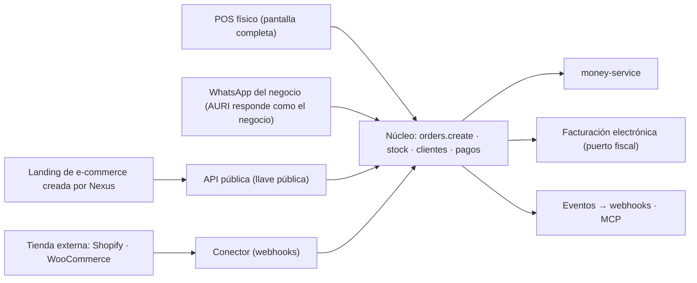

# Comercio general: productos, stock, POS, pagos y canales de venta

> Documento de trabajo para abrir las historias del comercio general. Junta tres cosas: dónde estamos (verificado en el
> código), cómo se conectan los canales de venta y los pagos, y qué pantallas hay que construir. Termina con el orden
> propuesto. Las decisiones que dependen de una persona están en la sección 10.

## 1. Alcance y reglas del juego

1. **Primero comercio general** (tiendas, ropa, merchandising, ferretería…). Después, el POS completo para restaurantes
   (su propio frente; ver `docs/SIGUIENTE-PASO.md`, decisiones D-1 a D-8 pendientes de aprobación).
2. **El gimnasio no se descuida.** Los planes de membresía son un tipo de producto (`PLAN`), así que el POS los vende; lo del
   comercio va detrás del rubro y los módulos, y cada entrega pasa una prueba de humo de los flujos del gimnasio (sección 9).
3. **Nexus no trae un editor de sitios web.** La landing de comercio electrónico la arma el personal de Nexus a pedido y se
   conecta por la API pública (sección 4). El editor que existe hoy (`sitio`) no se amplía.
4. Todo lo que se construya sigue el sistema de diseño (`packages/brand/`), define los cuatro estados (carga, error, éxito,
   vacío) y declara sus operaciones una sola vez para pantalla, API, MCP y eventos (`docs/wiki/07-integraciones/api-mcp-webhooks.md`).
5. Antes de diseñar cada pieza se consulta cómo lo resuelve Odoo (`point_of_sale`, `sale`, `stock`, `website_sale`, `account`)
   y se anota en [`referencias-odoo.md`](referencias-odoo.md). Se copia la idea, no el código ni el aspecto.

## 2. Dónde estamos (verificado en el repositorio)

### Avance por capas (`node scripts/capas-progreso.mjs`)

| Capa | Lo básico (N1) | Todas las funciones | API · MCP · webhooks |
|---|---|---|---|
| V · Ventas digitales, comercio y pagos | 11/29 · 38 % | 8 % | 0/48 |
| VI · Operación, inventario y logística | 13/36 · 36 % | 5 % | 0/54 |
| VII · Caja, finanzas y contabilidad | 19/31 · 61 % | 9 % | 0/48 |
| IV · Gestión comercial y CRM | 5/19 · 26 % | 3 % | 0/30 |
| **Total del producto** | **108/251 · 43 %** | **6 %** | **0/418** |

### Lo que ya existe

| Pieza | Estado |
|---|---|
| Catálogo | Productos, servicios, planes, entradas y tours; `publishedOnline`; control de stock por producto. Se crea en un panel lateral (`product-sheet.tsx`), no en una página. |
| Inventario | Bodegas, existencias, movimientos, traslados, conteos y kardex; sugerencias de reposición; variantes, listas de precio y códigos de barras en el esquema (no revisé su interfaz). |
| Compras | Órdenes de compra y proveedores. |
| POS | Terminales (`PosTerminal`: una caja y una bodega), turno por cajero, carrito, devoluciones y comprobante. **Hoy hay dos carpetas**: `ventas/pos` y `pos`; hay que decidir cuál queda. |
| Turno de caja | El turno **ya es** una sesión de caja (`CashSession`) amarrada a la terminal (`terminalId`). Falta la experiencia: arqueo, movimientos de caja y diferencias en la pantalla del POS. |
| Tienda pública | `app/s/[slug]` con carrito. Al pedir: contacto único (mismo teléfono = misma ficha, origen `STORE`), deuda en cartera, cobro en línea y evento `order.created`. |
| Cobros | Puerto de pasarela y webhook de proveedores (Wompi hoy). **Transferencias en verificación**: el cliente avisa su pago con referencia y una persona lo aprueba o lo rechaza. |
| Dinero | Todo movimiento pasa por `money-service`; hay obligaciones (cartera), asignaciones y conciliación de cobros. |
| Facturación electrónica | `NumberingResolution`, `FiscalDocument` (estado inicial `PENDING_PROVIDER`), pantalla `finanzas/facturacion-electronica` y puerto fiscal. Falta estructurarla (sección 7.5). |
| Importar y exportar | Módulo `data-exchange` (Excel) en `lib/business/data-exchange`: se reutiliza para la carga masiva de productos. |
| Clientes | Contacto único (`Party`/`Customer`), grupos propios, favoritos de búsqueda, ficha 360°. |

### Lo que falta

- **API de escritura del comercio:** solo existen `customers.upsert` y `orders.update_status`. No hay crear pedido, crear o editar
  producto ni ajustar stock por API; tampoco conectores para Shopify o WooCommerce.
- **Pedido multicanal:** el pedido de la tienda no guarda de qué canal vino ni un identificador externo (para no duplicar).
- **Medios de pago del negocio configurables** (qué usa cada negocio y cómo se registra cada uno).
- **POS en pantalla completa** y todo el catálogo masivo (importar, categorías, vistas, formulario en página).
- **Inventario pulido** (formulario de movimiento, traspasos entre ubicaciones, ajustes por conteo y correcciones) y proveedores
  con persona de contacto.
- **Facturación electrónica y reportes** estructurados.

## 3. Principio de arquitectura

**Nexus es el registro oficial** de catálogo, stock, pedidos, clientes y dinero. **Cada canal es un adaptador** que entrega
pedidos y pagos a ese registro; ninguno tiene su propia verdad.

Reglas que lo sostienen:

- **Una sola operación** `orders.create`, declarada una vez (módulo, permiso, esquema, riesgo, eventos). La usan el POS, la
  tienda, la API, el MCP, AURI y los conectores. Ninguno copia la lógica.
- **Cada pedido guarda su canal y su id externo** (`channel`, `externalId`) con idempotencia: si el webhook llega dos veces, no
  se duplica.
- **El dinero solo lo mueve `money-service`.** Un canal que cobra por su cuenta registra «pagado externamente», sin pasar el
  dinero por Nexus.
- **Pagos y facturación por puertos y adaptadores**: ninguna pasarela ni proveedor fiscal queda cableado.

## 4. Canales de venta

| Canal | Quién cobra | Cómo llega a Nexus | Notas |
|---|---|---|---|
| **Físico (POS)** | El negocio, en caja | Pantalla completa de Nexus | Efectivo, tarjeta, transferencia o mixto; factura POS al cobrar. |
| **WhatsApp** | Según el medio de pago elegido | El negocio **conecta su número** a Nexus; **AURI responde como si fuera el negocio** y arma el pedido o la cotización | El LLM se conecta al final (hoy AURI es solo interfaz). Debe respetar permisos y no inventar precios ni stock. |
| **Landing de e-commerce hecha por Nexus** | Nexus (enlace de cobro) o transferencia/contra entrega | La landing llama a la API pública con una llave pública (catálogo, carrito, pedido) | Sin editor dentro de Nexus: la crea el personal. Comprador como invitado. |
| **Tienda externa** (Shopify, WooCommerce) | La plataforma externa | Un conector recibe el webhook de pedido nuevo y lo traduce a `orders.create` | Entra como «pagado externamente»; luego se concilia. Primero pedidos hacia Nexus; el stock de vuelta, después. |
| **CRM / cotizaciones** | Según el pedido | Ganar una oportunidad crea el pedido (ya existe) | Se mantiene. |

**Todos trabajan entre sí**: un cliente que compró en la tienda y vuelve al local es la misma persona (contacto único); un
producto vendido en cualquier canal descuenta del mismo stock; todo pedido termina en cartera, caja y facturación de la misma
manera.

## 5. Medios de pago: no todos usan Wompi

Wompi es **un** adaptador de pasarela, no el sistema de pagos. Nexus debe poder registrar pagos que no pasan por ninguna
pasarela.

**Modelo propuesto: «medios de pago del negocio».** Cada negocio enciende los suyos:

| Medio | Cómo se registra | Verificación |
|---|---|---|
| Efectivo | En caja, con el turno abierto; cambio y arqueo | Arqueo al cerrar el turno |
| Datáfono / tarjeta (externo) | Monto, franquicia y últimos 4 o número de voucher | Conciliación con el depósito |
| Transferencia (Nequi, Daviplata, Bancolombia, llave…) | Monto, banco o app y referencia; foto del comprobante opcional | **Pendiente de verificar** hasta que una persona lo apruebe (ya existe el flujo de «transferencias en verificación») |
| Pasarela (Wompi u otra, vía puerto) | Enlace de cobro; el webhook confirma | Automática |
| Crédito / fiado | Abre una deuda en cartera con vencimiento | Se salda con abonos |
| Mixto | Varios pagos sobre una misma venta | Cada uno según su tipo |

Un negocio que no usa Nequi no lo ve; uno que usa otra app agrega la suya. Cada medio define si exige referencia, si pide
verificación y a qué cuenta (caja, banco, billetera) entra el dinero.

## 6. Clientes: de dónde vienen y qué se anida en ellos

- **Un contacto único por persona o empresa**, venga de donde venga (mismo teléfono o correo = misma ficha), con su origen
  (POS, tienda, web, Shopify, WhatsApp, CRM) y su consentimiento de datos.
- **No se mezclan con los usuarios del negocio**: esa tabla es del equipo. El comprador de una web es un contacto.
- **Comprador como invitado**, sin registro previo. Más adelante, un «ver mis pedidos» con enlace por WhatsApp o correo, sin contraseña.
- **Lo que cuelga de un cliente que compra:** pedidos y ventas, productos comprados, devoluciones, entregas, cartera y cobros,
  facturas, cotizaciones, oportunidades, citas y membresías (gimnasio), grupos, y métricas de recompra (última compra, ticket
  promedio, grupos automáticos como «compró en los últimos 90 días»).
- **Merchandising y pedidos a medida:** hay negocios cuyo «producto» es un pedido por crear (camisetas con diseño, tazas…). Ahí el
  artículo se anida con datos del cliente y con atributos propios del negocio (sección 7.1).

## 7. Pantallas a construir

### 7.1 Punto de venta en pantalla completa

Una pantalla grande y siempre disponible, pensada para trabajar todo el día.

- **Barra superior:** hora, persona que atiende (cajero actual) y nombre de la caja seleccionada (`Punto de venta · Caja 1`).
- **Izquierda:** el catálogo.
  - Búsqueda por **escáner** (código de barras o QR del producto, si lo tiene) o por **nombre**; cada resultado con foto o icono y precio.
  - **Categorías** visibles y filtrables.
  - Un clic agrega el producto; clics repetidos suben la cantidad.
- **Derecha:** la venta en curso.
  - **Cliente opcional** (buscar, crear al vuelo o dejar «venta sin cliente»).
  - **Lista de lo seleccionado** con imagen o icono, cantidad editable y quitar.
  - **Subtotal, IVA o impuestos si aplican y total final.**
  - **Botón «Cobrar (F4)»** abre el cobro (medio o medios de pago, pago mixto, cambio) y al terminar **genera la factura POS**.
- **Personalizar producto:** para negocios sin producto fijo (merchandising), una opción convierte el renglón en un **pedido por crear**: nombre, descripción, variantes y datos del cliente; cada objeto se anida a lo que ofrece el comercio.
- **Atajos de teclado** (F4 cobrar, búsqueda siempre enfocada) y operable también con pantalla táctil.
- **Estados:** sin turno abierto (invita a abrirlo), sin productos, sin conexión y error de cobro, cada uno con salida.

### 7.2 Turnos de caja conectados al POS

- Un turno por caja y por cajero, abierto con monto inicial; el POS no cobra sin turno.
- Movimientos de caja dentro del turno (entradas y salidas de efectivo con motivo).
- **Cierre con arqueo:** esperado contra contado, diferencia explicada, resumen por medio de pago.
- La caja (`CashBox`) pertenece a una **sucursal/ubicación** y a una bodega, para que la venta descuente del stock correcto.
- Decisión pendiente: unificar `ventas/pos` y `pos`.

### 7.3 Productos

- **Dos vistas**, como Clientes: **tabla** y **tarjetas** con imagen, nombre y precio.
- **Importar y exportar** por Excel, **en lotes y en grande** (reutiliza `data-exchange`): plantilla descargable, vista previa con errores por fila, importar solo lo válido y reporte final.
- **Crear y editar en página, no en modal**: la información a la izquierda y, al lado, una **previsualización del producto** con
  opciones, **pegajosa (sticky)** para que no se quede arriba al hacer scroll.
- **Referencia:** la captura «Nuevo producto» de la raíz del proyecto (`Screenshot … Admin.png`). Es una **referencia de
  contenido, no un molde**: aquí rige el sistema de diseño de Nexus. Secciones que sirven de guía: información (nombre,
  descripción, SKU y código de barras con «Auto», categoría y subcategoría, marca, unidad), configuración (visible en tienda,
  destacado, producto complementario), tributación, imágenes (principal y secundaria), precios y stock **por ubicación**
  (costo, regular, oferta, stock inicial y mínimo) y productos complementarios. La captura **no** trae la previsualización: eso
  es nuevo.
- **Categorías:** apartado propio (árbol de categorías y subcategorías; se muestran en el POS y en la tienda).
- Un producto se puede **categorizar**, tiene **código de barras o QR** (el que traiga, o uno generado), foto, nombre y precio, y
  si es **personalizable** se marca (sección 7.1).

### 7.4 Inventario

Mejorar el control de stock con: **movimientos, traspasos entre ubicaciones, órdenes de compra, ajustes por conteo y correcciones**.
Las **tiendas** y sucursales aparecen como ubicaciones.

- **Formulario «Nuevo movimiento»** en página. Referencia: la captura «Nuevo movimiento» de la raíz (`Screenshot … movimiento.png`):
  elegir **Entrada** o **Salida**, **sucursal**, **motivo** (compra, devolución, merma, ajuste…), **producto** (escaneando el
  código de barras o buscando por nombre o SKU) con cantidad, y descripción y notas. Mismo criterio: referencia, no copia.
- **Traspasos** entre ubicaciones con estado (en tránsito, recibido) y diferencias al recibir.
- **Conteos y correcciones** con ajuste auditado.
- **Proveedores**, con **persona de contacto anidada** (nombre, cargo, teléfono, correo), disponibles al registrar una compra o un movimiento.
- Alertas de stock mínimo y sugerencias de reposición (ya hay base).

### 7.5 Facturación electrónica

- **Contador de facturas emitidas** y estado del día.
- **En el Inicio de apps:** «Facturas de hoy» (si hay) y «En espera», cada una con su estado.
- **Apartados:** comprobantes **emitidos**, **pendientes de facturar** y **series de comprobantes**.
- **Series de comprobantes:** tipo, serie, último número, sucursal y estado (activa, vencida, agotada).
- Estados claros por documento (pendiente, enviado al proveedor, aceptado, rechazado con el motivo) y reintento.
- La factura POS sale del cobro; las ventas que no se facturaron quedan en «pendientes de facturar».

### 7.6 Reportes y analítica

Un apartado solo para reportes, con varios tipos de tablas y exportación: **productos** (más vendidos, margen, rotación),
**inventario** (existencias, valorización, bajo mínimo, movimientos) y **clientes** (compras, recompra, saldo, grupos).
Filtros por fecha, sucursal y canal; usa el mismo buscador avanzado de las listas.

## 8. Orden propuesto: por dónde empezar

Se empieza por lo que todo lo demás necesita: **productos bien cargados**. Sin catálogo con categorías, imagen y código de
barras no hay POS que valga; con el catálogo listo, el POS se arma rápido.

| # | Historia | Por qué en este lugar |
|---|---|---|
| **1** | **Catálogo masivo y categorías:** vistas tabla/tarjetas, importación y exportación por Excel, categorías, formulario en página con previsualización sticky, códigos de barras e imágenes | Todo lo demás lo consume. Es lo que pides primero y se ve de inmediato. |
| **2** | **Medios de pago del negocio** y registro de pagos físicos y por transferencia (sección 5) | Pequeña y fundamental: el cobro del POS la necesita. |
| **3** | **POS en pantalla completa con turno de caja:** caja, cajero, hora, carrito, cliente opcional, cobrar con F4, factura POS, personalizar producto | Es el corazón del comercio. Se apoya en 1 y 2. |
| **4** | **Inventario pulido:** formulario de movimiento, traspasos, conteos y correcciones, proveedores con contacto | El POS descuenta del stock; aquí se le da el control. |
| **5** | **Facturación electrónica estructurada:** series, pendientes, emitidos, Inicio de apps | La factura POS ya sale en el paso 3; aquí se ordena todo el módulo. |
| **6** | **Pedido multicanal:** `orders.create`, canal e id externo, reserva de stock y eventos; la tienda actual pasa a usarlo | Base para landing, WhatsApp y conectores. |
| **7** | **Canales:** API pública y guía para la landing; **WhatsApp con AURI**; conectores Shopify y WooCommerce | Cuando el núcleo ya aguanta pedidos de varios lugares. |
| **8** | **Reportes y analítica** | Cuando ya hay datos que mirar. |
| **9** | **Ficha del cliente comprador:** pestañas de compras, productos comprados, devoluciones y recompra | Cierra el círculo CRM → cliente → compra. |

> Si hay que elegir **una** historia para abrir hoy: la **1**, partida en dos para no trabarse: primero **categorías y vistas con el
> formulario en página**, y en paralelo la **importación masiva por Excel**.

## 9. Cómo se protege el gimnasio

- Las funciones de comercio van **detrás del rubro y los módulos**; el menú del gimnasio no cambia por lo que se agregue al comercio.
- Una **prueba de humo del gimnasio** corre en cada entrega: alta de socio, venta de plan en el POS, membresía vigente, control de acceso por NFC y cobro.
- Los planes se venden como producto de tipo `PLAN`; no se crea un camino aparte.
- Cada historia incluye en su checklist: «¿toca algo que usa el gimnasio? ¿qué prueba lo cubre?».

## 10. Decisiones abiertas

1. **Pagos de la landing hecha por Nexus:** ¿enlace de cobro con una pasarela (la que el negocio tenga) más transferencia, o también pago contra entrega? Recomendado: pasarela por puerto + transferencia verificada.
2. **Stock con Shopify o WooCommerce:** ¿manda Nexus (recomendado) o la plataforma externa? Empezar solo con pedidos hacia Nexus.
3. **Compradores:** ¿solo invitados (recomendado) o cuentas desde el inicio?
4. **POS duplicado:** ¿queda `ventas/pos` o `pos`?
5. **Impuestos del POS:** qué tarifas y categorías de IVA ofrece el producto (excluido, exento, gravado) y cómo se muestran en el recibo.
6. **Modo sin conexión del POS:** ¿se exige desde la primera versión? Cambia bastante el costo.
7. **Merchandising:** ¿«personalizar producto» es un tipo de producto nuevo o un modo del renglón de la venta?
8. **Referencias en la raíz:** mover las dos capturas a una carpeta de referencias (por ejemplo `docs/product/nexus-platform/referencias-visuales/`) para que no queden sueltas.

## 11. Qué no se verificó

- Si el POS actual de comercio está completo o a medias (se revisa en la mesa de trabajo de la historia 3).
- La interfaz de variantes, listas de precio y códigos de barras (existen en el esquema).
- Qué cubre hoy el flujo de «transferencias en verificación» fuera de la tienda pública.
- El estado real de la integración con el proveedor tecnológico de facturación electrónica.

Cada punto se confirma leyendo el código al abrir su historia; nada de esto se da por hecho.
