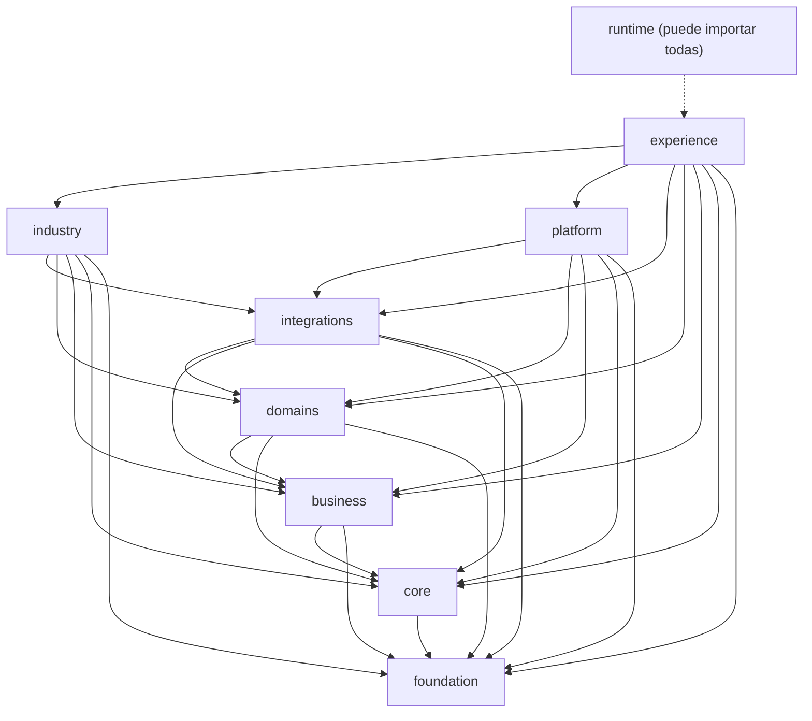

# Mapa de áreas y módulos de `lib/`

Vista de toda la implementación: nueve áreas, y dentro de cada una sus módulos. **Se generó recorriendo `lib/`** el 31 de octubre de 2026; `tests/architecture/wiki.test.ts` falla si aparece o desaparece un módulo sin actualizar esta página. Quién puede importar a quién: [reglas de dependencias](../03-arquitectura/reglas-dependencias.md). Cómo añadir un módulo: [guía de implementación](../03-arquitectura/guia-implementacion-lib.md). Cómo se documenta cada módulo: [documentación de módulos](documentacion-de-modulos.md).

Además de las nueve áreas, la raíz de `lib/` tiene dos archivos de excepción (`utils.ts` y `cn.ts`, convención de shadcn/ui).

(Las flechas indican «puede importar». `industry` y `platform` no se importan entre sí.)

### `lib/foundation`

Utilidades puras: formato, fechas, base de datos genérica, puertos, kernel financiero.

- **Módulos** (archivos): `dates/` (4) · `db/` (3) · `kernel/` (4)
- **Archivos sueltos**: `app-url.ts`, `contact.ts`, `countries.ts`, `format.ts`, `image-upload.ts`, `init-scripts.ts`, `limits.ts`, `ports.ts`, `qr.ts`, `rate-limit.ts`

### `lib/core`

Identidad, tenancy, permisos, planes, eventos, operaciones, API/MCP, sectores, capacidades.

- **Módulos** (archivos): `api/` (7) · `auth/` (5) · `capabilities/` (8) · `entitlements/` (8) · `events/` (8) · `files/` (1) · `operations/` (8) · `parties/` (2) · `sectors/` (5) · `tenancy/` (15)

### `lib/business`

Capacidades empresariales reutilizables: clientes, catálogo, ventas, inventario, compras, POS, tienda.

- **Módulos** (archivos): `catalog/` (4) · `customers/` (3) · `data-exchange/` (3) · `growth/` (2) · `inventory/` (6) · `pos/` (4) · `presence/` (13) · `purchasing/` (3) · `sales/` (15) · `scheduling/` (2) · `store/` (4)

### `lib/domains`

Dominios especializados con reglas propias (hoy finance).

- **Módulos** (archivos): `finance/` (12)

### `lib/integrations`

Adaptadores hacia proveedores externos (pagos, WhatsApp Business por negocio, facturación electrónica, Google, mapas).

- **Módulos** (archivos): `channels/` (3) · `einvoice/` (6) · `google/` (2) · `maps/` (2) · `providers/` (6)

### `lib/industry`

Particularidades por sector (gym, museum, construction).

- **Módulos** (archivos): `construction/` (38) · `gym/` (6) · `museum/` (2)

### `lib/platform`

Nexus como SaaS: administración, equipo, cobranza, soporte, CRM, bandeja, cuentas.

- **Módulos** (archivos): `accounts/` (7) · `admin/` (4) · `benefits/` (3) · `billing/` (2) · `crm/` (2) · `inbox/` (3) · `presence/` (1) · `support/` (4) · `team/` (6)

### `lib/experience`

Interfaz: navegación, dashboard, onboarding, sitio, movimiento.

- **Módulos** (archivos): `assistant/` (1) · `dashboard/` (8) · `hooks/` (2) · `motion/` (8) · `navigation/` (5) · `onboarding/` (5) · `payment-input/` (2) · `site/` (2)
- **Archivos sueltos**: `fonts.ts`, `vertical-icons.ts`

### `lib/runtime`

Raíz de composición: conecta los puertos con sus implementaciones al arrancar.

- **Módulos** (archivos): —
- **Archivos sueltos**: `api-deps.ts`, `operations.ts`, `ports.ts`, `sectors.ts`
