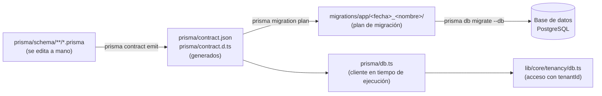

# Prisma: estructura del contrato y de sus carpetas

Nexus usa **Prisma 8** con un *contrato de datos* escrito en archivos `.prisma`. Esta página explica qué carpetas y archivos intervienen, cuáles se editan a mano y cuáles se generan, y cómo se compone el contrato por dominio. El detalle campo a campo de cada modelo vive en el propio contrato (comentarios `///`).

## 1. Vista general



| Ruta | Qué es | ¿Se edita? |
|---|---|---|
| `prisma/schema/**/*.prisma` | **Fuente de verdad** del modelo de datos, dividida por dominio | Sí |
| `prisma/schema/README.md` | Convenciones del contrato (se resumen abajo) | Sí |
| `prisma/contract.json`, `prisma/contract.d.ts` | Contrato compilado y sus tipos TypeScript | **No**: se regeneran con `prisma contract emit` |
| `prisma/db.ts` | Crea el *pool* de conexiones y el cliente tipado | Solo para cambiar la conexión |
| `prisma.config.ts` | Le dice a Prisma dónde está el contrato (`prisma/schema/**/*.prisma`), dónde escribir (`output: "prisma"`) y la conexión | Rara vez |
| `migrations/app/<fecha>_<nombre>/` | Una migración: `migration.json`, `migration.ts` y `ops.json` | Se generan con `migration plan` |
| `migrations/snapshots/<hash>` | Instantáneas del contrato direccionadas por hash | **No** |
| `migrations/refs/db.json` | Referencia a la migración actual | **No** |

Prisma lee **todos** los `.prisma` como un único esquema. Dividirlo por carpetas no cambia las tablas ni el contrato resultante: es solo organización.

## 2. Cómo se compone la carpeta `prisma/schema/`

```
prisma/schema/
├── core/            organización, identidad y seguridad compartidas
│   └── tenant · identity · team · parties · audit · files
├── platform/        operación global de Nexus como SaaS (no se consulta por tenantId)
│   └── settings · crm · support · billing
├── business/        capacidades empresariales generales
│   └── customers · catalog · inventory · sales · purchasing · pos · store · scheduling · inbox · benefits
├── finance/         dinero: pagos, caja, impuestos, contabilidad
│   └── payments · cash · tax · payables · accounting
├── integrations/    API, eventos y proveedores externos
│   └── api · events · providers
├── experience/      presencia digital, sitio y reputación
│   └── presence · site · reputation
└── industry/        un subdirectorio por rubro
    ├── construction/  apu · quotes · projects · budget · planning · field-log
    ├── gym/           memberships
    ├── museum/        ticketing
    └── tourism/       tours
```

Tamaño actual: **118 modelos y 32 enumerados** en 40 archivos (por carpeta: `business` 27 modelos, `industry/construction` 24, `finance` 19, `core` 15, `platform` 12, `experience` 8, `integrations` 8, `gym` 2, `tourism` 2, `museum` 1).

### Relación con `lib/`

Las carpetas de datos reflejan las áreas de código, con una excepción de nombre (`finance` ↔ `lib/domains/finance`):

| `prisma/schema/` | Código que la usa |
|---|---|
| `core/` | `lib/core/` (tenancy, auth, parties, events…) |
| `platform/` | `lib/platform/` |
| `business/` | `lib/business/` |
| `finance/` | `lib/domains/finance/` |
| `integrations/` | `lib/integrations/` |
| `experience/` | `lib/experience/` |
| `industry/<rubro>/` | `lib/industry/<rubro>/` |

Dirección de dependencias entre dominios del contrato: `industry` → `business` / `finance` → `core`. Nada del núcleo depende de un rubro. Las reglas equivalentes para el código están en [reglas de dependencias](../03-arquitectura/reglas-dependencias.md).

## 3. Convenciones del contrato

Un archivo típico:

```prisma
// use prisma-8

/// Cliente o socio de un negocio: contacto, código de acceso y tarjeta NFC.
///
/// Campos:
/// - `profile`: Campos propios del rubro (gym: peso, talla, objetivo…).
model Customer {
  id        String   @id @default(uuid())
  tenantId  String
  tenant    Tenant   @relation(fields: [tenantId], references: [id], onDelete: Cascade)
  name      String
  active    Boolean  @default(true)
  profile   Json?
}
```

- Todo archivo **empieza con `// use prisma-8`**; Prisma lo exige.
- La descripción de cada modelo o enum va **encima**, con `///`. Dentro de `{}` no hay comentarios: lo que explica cada campo se lista en el bloque «Campos:» o «Valores:» de arriba.
- Cada **enum vive en el archivo del modelo que lo usa**. Si lo usan dos archivos, en el del dueño (`TenantPlan` en `core/tenant`, `PaymentProvider` en `finance/payments`).
- Toda tabla de negocio lleva `tenantId` con relación a `Tenant`. Lo que está en `platform/` es de Nexus como SaaS y no se consulta por `tenantId`. La prueba `tests/architecture/tenant-scope.test.ts` vigila que cada consulta de `lib/` filtre por `tenantId`.

## 4. Cómo añadir o cambiar un modelo

1. **Elige el dominio.** Un modelo nuevo va en la carpeta que corresponda; un rubro nuevo crea su carpeta en `industry/`. Si no cabe en ninguno, es una decisión de arquitectura: consúltala antes.
2. **Edita el `.prisma`** siguiendo las convenciones de la sección 3.
3. **Regenera el contrato:**

   ```bash
   pnpm prisma contract emit
   ```

4. **Planifica la migración** (cambia `<nombre>` por algo descriptivo):

   ```bash
   pnpm prisma migration plan --name <nombre>
   ```

5. **Aplica en tu base de desarrollo y revisa:**

   ```bash
   pnpm exec prisma db migrate --db "$DATABASE_URL"
   ```

6. **Escribe el SQL de producción** en `docs/prod-sql/`. La regla de oro del repositorio es que un cambio de modelo traiga su SQL; `scripts/check-prod-sql.sh` lo comprueba en el CI y falla si falta. Orden de ejecución en [prod-sql-orden](../08-operacion-y-despliegue/prod-sql-orden.md).
7. **Escribe las pruebas** (ver [pruebas](../10-pruebas-y-calidad/pruebas.md)). Las de integración exigen una base aparte con `CREATE EXTENSION pg_trgm` antes de migrar.

> No se edita `prisma/contract.json` ni `prisma/contract.d.ts` a mano, ni se tocan `migrations/snapshots/` o `migrations/refs/`. Tampoco se modifican migraciones ya aplicadas: se crea una nueva.

## 5. Cómo se llega a la base en tiempo de ejecución

`prisma/db.ts` construye un `Pool` de `pg` y lo entrega al runtime de Prisma junto con el contrato. El tamaño del pool se ajusta con `DB_POOL_MAX` (por defecto 3 en Vercel y 10 en local, porque el *pooler* de Supabase admite pocos clientes a la vez).

**`app/` nunca importa `@/prisma/db`.** Las pantallas y acciones llaman a repositorios de `lib/`, que reciben `tenantId` y pasan por `lib/core/tenancy/db.ts`. Una regla de ESLint y `tests/architecture/data-access.test.ts` lo vigilan.

## 6. Lo que sigue pendiente

- Hay comentarios en `prisma/schema/**` que todavía nombran rutas de antes de V10; se corrigen en una pasada aparte porque tocan el contrato.
- La partición de `lib/core/tenancy/db.ts` y las fases P3–P6 del plan de esquema están en la [hoja de ruta](../02-producto/hoja-de-ruta.md).
