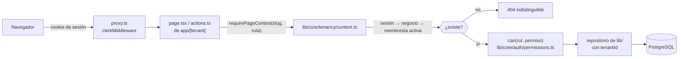

# Autenticación, permisos y aislamiento por negocio

Cómo decide Nexus quién eres, qué puedes hacer y qué datos ves. Todo lo de esta página se comprobó contra el código el 31 de octubre de 2026; las rutas citadas existen.



## 1. Autenticación

- La identidad la da **Clerk**. `proxy.ts` ejecuta `clerkMiddleware`, resuelve el subdominio automático del mini-sitio y deja pasar las rutas públicas.
- El servidor obtiene el usuario con `auth()` de `@clerk/nextjs/server`; la membresía en cada negocio vive en la base (tabla de miembros), no en Clerk.

## 2. Roles y permisos

Hay seis roles (`BusinessRole` en `lib/core/auth/roles.ts`): `SUPERADMIN` (equipo de Nexus), `OWNER` (dueño), `ADMIN`, `RECEPTION`, `ADVISOR` y `STAFF`.

Toda regla «¿puede este rol…?» sale de **una sola matriz**, `BUSINESS_PERMISSIONS` en `lib/core/auth/permissions.ts`:

```ts
import { can } from "@/lib/core/auth/permissions";

if (!can(ctx.role, "money.handle")) {
  return { ok: false, error: "No tienes permiso para cobrar." };
}
```

Reglas de la matriz:

- Las funciones `canManage`, `canHandleCash`, `canManageTeam`… son atajos sobre la matriz; no tienen reglas propias.
- La matriz sirve también en el navegador para ocultar botones, pero **la decisión que cuenta es la del servidor** en cada acción.
- Un permiso nuevo se agrega a la matriz y se cubre en `tests/unit/core/auth/permissions.test.ts`, que compara la matriz escrita a mano con la real.

## 3. Aislamiento entre negocios

El aislamiento se hace **en la aplicación** (decisión [ADR 0004](../../decisions/arquitectura/0004-aislamiento-en-aplicacion.md), estado «propuesta»):

1. **Contexto antes de leer datos.** Cada `page.tsx` llama a `requirePageContext(tenant, ruta)` y cada acción a `requireTenantContext`: sesión → negocio activo → membresía activa, o 404. El layout no basta, porque en la navegación del App Router no siempre se ejecuta.
2. **`tenantId` en cada consulta.** Toda tabla de negocio lleva `tenantId` y todo repositorio de `lib/` lo filtra. `tests/architecture/tenant-scope.test.ts` falla si una consulta a una tabla de negocio no filtra por él (salvo el panel del equipo de Nexus y unas excepciones con motivo escrito).
3. **`app/` no toca la base.** Ningún archivo de `app/` importa `@/prisma/db`; lo vigilan ESLint y `tests/architecture/data-access.test.ts`.
4. **Módulos activos.** `isRouteEnabled` comprueba que el negocio tenga activo algún módulo que habilite la ruta.

## 4. Auditoría y dinero

- Las acciones relevantes se registran con `logTenantAction` (`lib/core/tenancy/audit.ts`).
- El dinero solo lo mueve `money-service` (`lib/business/sales/money-service.ts`), con pruebas de concurrencia.

## 5. Checklist al añadir una pantalla o acción

- [ ] La página llama a `requirePageContext` con la ruta de su módulo; la acción, a `requireTenantContext`.
- [ ] Cada operación comprueba `can(rol, permiso)` y el permiso existe en la matriz.
- [ ] El repositorio recibe `tenantId` y lo pone en cada `where`.
- [ ] Las acciones sensibles llaman a `logTenantAction`.
- [ ] Sin permiso: `notFound()` o aviso, nunca datos.

Ver también [Nueva funcionalidad](../09-desarrollo/nueva-funcionalidad.md) y [Pruebas](../10-pruebas-y-calidad/pruebas.md).
