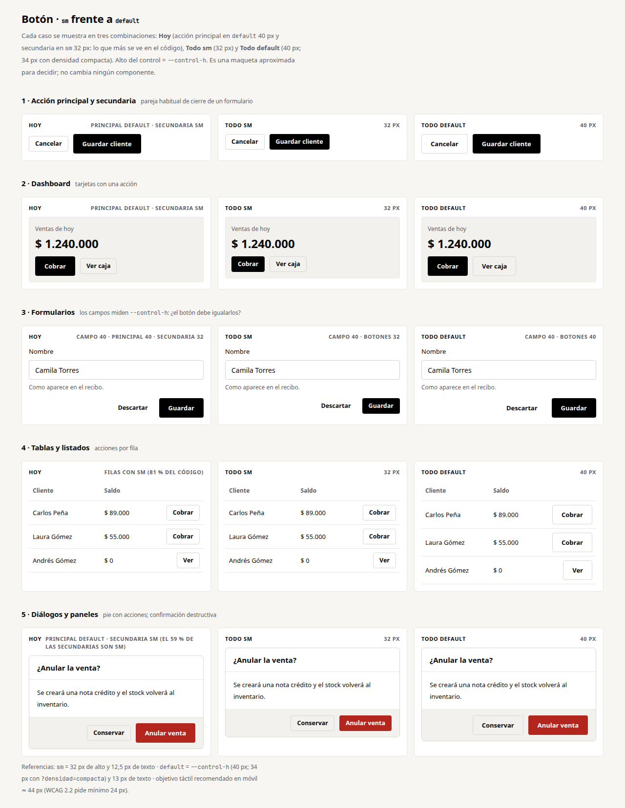
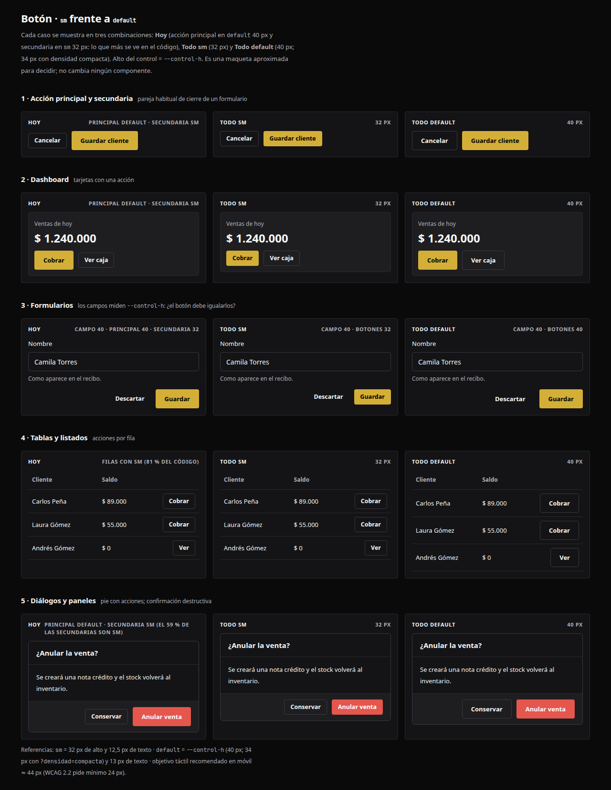
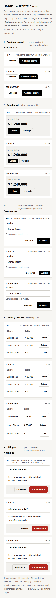
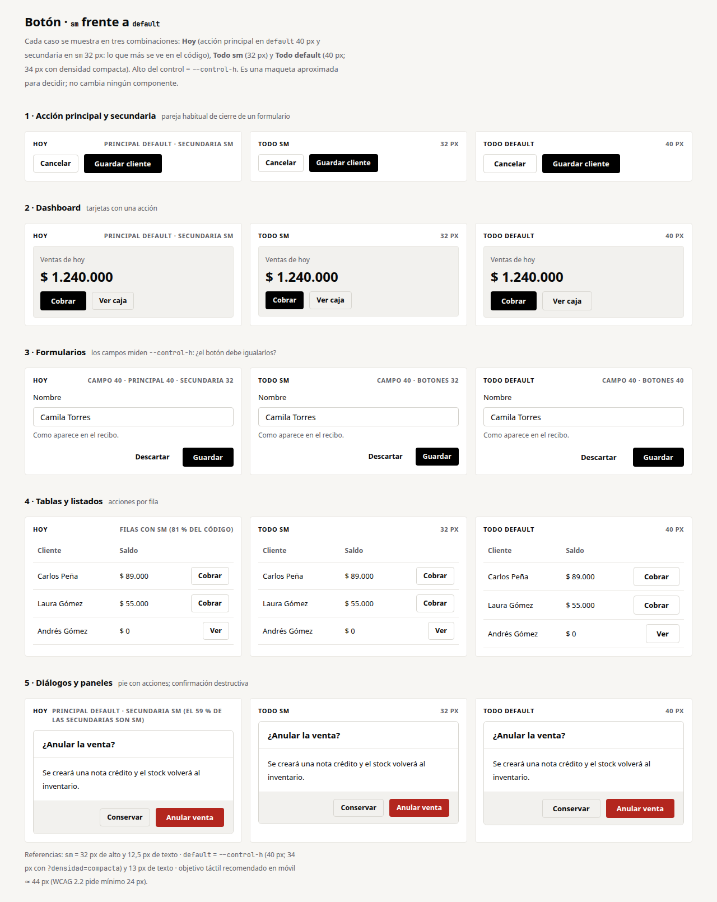

# Decisiones del Nexus Design System · resolución

Estado: **resoluciones registradas** · 2026-11-01 · base: `main` en `5c24031` (incluye el inventario de la fase B, PR #138).

Este documento recoge las decisiones sobre la escala tipográfica, la API de `Button`/`Input` y los componentes sin uso, con la evidencia
del código y las **condiciones** con las que se aprobaron. Es solo análisis y resolución: **no cambia componentes, tokens, imports,
Storybook ni archivos de código**. Referencia de diseño: la estructura de **shadcn/ui** (primitivos que se componen, variantes
declaradas, `asChild`, tokens semánticos) con la identidad de Nexus (negro y oro, bordes en lugar de sombras, radios casi nulos). No se
instala nada de shadcn: el repositorio ya adoptó su forma (§2.1).

Contexto: [`inventario-patrones.md`](inventario-patrones.md) · [`SYSTEM-DESIGN.md`](SYSTEM-DESIGN.md) · [`DESIGN.md`](DESIGN.md).

---

## 0. Estado de las decisiones

| # | Decisión | Resolución | Condiciones y siguiente paso |
|---|---|---|---|
| **1** | Escala tipográfica | **APROBADA CON CONDICIONES** | Añadir `text-2xs` (11 px) y `text-ui` (13 px); mantener los tokens existentes y una escala *display* independiente; referencia de seis pasos 11·12·13·14·16·18. 11 px solo para metadatos y contenido secundario · revisar los 37 usos por debajo de 11 px (§1.6) · comprobar contraste y legibilidad (§1.7) · validar el mapeo 15 → 16 px (§1.8) · **no migrar automáticamente los 736 usos** |
| **1b** | Campos editables en móvil | **APROBADA** (investigar y validar) | Regla de 16 px **solo** para campos editables en móvil, empezando por Safari en iOS. Investigada en §1.9; **no** se aplica a todos los componentes ni se tocan los tokens |
| **2** | API de `Button` | **APROBADA COMO DIRECCIÓN ARQUITECTÓNICA** | `<Button>` será la API pública preferida; `buttonVariants` puede conservarse como utilidad interna; se mantiene `asChild`, la accesibilidad y las variantes actuales durante la transición. Server/Client evaluado en §2.4. **No migrar todavía los 385 usos** |
| **2b** | Tamaño predeterminado del botón | **PENDIENTE** | Comparación visual preparada (§2.5). **No se elige tamaño sin evidencia adicional** |
| **2c** | API de `Input` | **ESTRUCTURA APROBADA · CONSOLIDACIÓN PENDIENTE** | Primitivos · `Field` · especializados. Contratos de `UsdInput`/`MoneyInput` y `SearchField`/`SearchInput` investigados en §2.7: **no son fusiones directas** |
| **3** | 19 componentes sin uso | **CLASIFICACIÓN PROVISIONAL APROBADA** | Conservar 5 · Consolidar 10 · Retirar 4. Los cuatro a retirar **pasan primero a Laboratorio**; **no se elimina nada en esta etapa**. `network-banner` y `staff-access-notice` se conservan y necesitan historias de estado |

| **P** | **Principio transversal: Mobile as a First-Class Experience** | **INCORPORADO COMO PRINCIPIO PROPUESTO** (a ratificar) | Una sola plataforma adaptada a cada contexto; criterios verificables R1–R5; tamaños de referencia; auditoría responsive y piloto (dashboard y restaurantes). Web responsive con PWA; sin aplicación nativa por ahora. Ver §4. **Sin migración de código** |

### Correcciones al inventario (#138)

| Dato del inventario | Matiz medido ahora |
|---|---|
| `buttonVariants` ×468 | 468 *menciones* de la palabra (incluye imports). **385 llamadas reales en 130 archivos** |
| `Button` ×26 | 26 usos en `app/`; **54 contando `components/`**, en 18 archivos |
| 737 tamaños fuera de token | **736 usos en 199 archivos** (excluye historias, pruebas y el laboratorio) |
| `network-banner` y `staff-access-notice` entre los «sin historia» | Correcto, pero **no están sin uso**: `NetworkBanner` va en `tenant-shell`; `StaffAccessNotice` en `app/onboarding` y `app/auth/callback` |

---

## 1. Escala tipográfica · aprobada con condiciones

### 1.1 Estado actual

- **Tokens** (`packages/brand/css/tokens.css`, en `rem`): `xs` 12 · `sm` 14 · `base` 16 · `lg` 18 · `xl` 20 · `2xl` 24 · `3xl` 30 · `4xl` 40 · `5xl` 52.
- **Uso real:** `text-xs` ×586 y `text-sm` ×347 conviven con **736 tamaños en píxeles arbitrarios** (`text-[13px]` y similares), en
  **21 valores distintos** y con medios píxeles (9,5 · 10,5 · 11,5 · 12,5 · 13,5 · 14,5).

| Tamaño | Usos | Rol dominante (por clase y etiqueta) |
|---|---|---|
| 9,5 · 10 · 10,5 · 11 · 11,5 px | 129 | Micro-etiquetas: 38 en mayúsculas, 45 % de los de 11 px en `font-mono`, insignias, unidades |
| 12 · 12,5 px | 97 | Texto secundario y de ayuda |
| **13 · 13,5 px** | **381** | **Texto base de la interfaz**: párrafos, etiquetas de campo, leyendas, botones (13 px de serie) |
| 14 · 14,5 px | 29 | Texto de campo (`text-sm`) y énfasis |
| 15 · 16 · 17 · 18 px | 85 | Títulos de tarjeta y de sección (88 % en `font-semibold` a 15 px) |
| 22 · 26 · 28 · 30 · 38 · 40 px | 15 | Cifras grandes (KPI): 100 % `font-semibold`/`bold`, mayoría con `tabular-nums` |

**Dónde ocurre** (usos / archivos): módulos del negocio 288 / 74 · organismos y plantillas 186 / 39 · panel CEO 130 / 33 · moléculas 56 / 28 ·
rutas públicas 30 / 8 · configuración 25 / 6 · onboarding y acceso 12 / 4 · primitivos 8 / 6 · inicio 1 / 1.

**Lectura:** el producto es **denso y consistente en la práctica** (13 px manda en todas las áreas), pero la escala oficial **no tiene
ese paso**. Los 13 px ya son la decisión de diseño real: el botón (`buttonVariants`) los usa de serie y la etiqueta de campo (`labelClasses`) también.

### 1.2 Ejemplos

| Área | Ejemplo real | Hoy | Con la escala |
|---|---|---|---|
| Inicio / primeros pasos | `components/organisms/welcome-checklist.tsx:84` `<p className="mt-0.5 text-[13px] text-muted-foreground">` | 13 px | `text-ui` |
| Listados y tablas | `app/[tenant]/(app)/pedidos-tienda/_components/orders-view.tsx:39` `<p className="text-[13px] text-muted-foreground">Entrega: …` | 13 px | `text-ui` (las 31 tablas arrastran 115 px arbitrarios) |
| Formularios | `app/admin/facturacion/_components/billing-view.tsx:79` `<label className="grid gap-1.5 text-[13px] font-medium">` | 13 px | `text-ui font-medium` |
| Configuración | `app/[tenant]/(app)/settings/_components/profile-tab.tsx:94` `<h2 className="font-display text-[15px] font-semibold …">` | 15 px título | `text-base font-semibold` (16 px) |
| Insignias | `app/[tenant]/(app)/catalog/_components/activity-catalog.tsx:615` `<span className="… text-[10px] font-medium …">manual</span>` | 10 px | `text-2xs` (11 px) |
| Cifra grande | `app/[tenant]/(app)/finance/_components/petty-cash-card.tsx:38` `<p className="font-display text-[26px] font-bold tabular-nums">` | 26 px | `text-2xl` (24 px) |

### 1.3 Alternativas consideradas

Cuántos de los 721 usos de hasta 20 px cambian de tamaño (los 15 de «cifra grande» se tratan aparte):

| Opción | Pasos | Usos que cambian | Cambio máximo | Comentario |
|---|---|---|---|---|
| **A · aditiva, 6 pasos de UI** | 11 · 12 · **13** · 14 · 16 · 18 | **271 (37 %)**; 102 (14 %) cambian ≥ 1 px | 1,5 px | Conserva `xs/sm/base/lg` y **añade** 11 y 13 |
| B · compacta, 5 pasos | 11 · 13 · 14 · 16 · 20 | 137 (19 %) con la regla del vecino más cercano | 2 px | Sin 12 px: pierde un paso útil de ayuda |
| C · sin paso de 13 | 11 · 12 · 14 · 16 · 18 | 410 (56 %) | 1,5 px | Obliga a elegir 12 o 14 para el texto base: cambia la densidad de toda la interfaz |
| D · solo los tokens actuales | 12 · 14 · 16 · 18 · 20 | 506 (70 %) | 2,5 px | Casi todo el producto cambiaría de tamaño |

### 1.4 Resolución: opción A, con condiciones

Se añaden dos tokens **sin tocar** los existentes (así `text-xs` ×586 y `text-sm` ×347 no cambian de aspecto):

```css
/* packages/brand/css/tokens.css  ·  PROPUESTA APROBADA, TODAVÍA NO APLICADA */
--text-2xs: 0.6875rem; --lh-2xs: 1rem;      /* 11 px · metadatos y contenido secundario */
--text-ui:  0.8125rem; --lh-ui:  1.25rem;   /* 13 px · texto base de la interfaz */
```

| Paso | Token | Tamaño | Rol | Absorbe | Usos |
|---|---|---|---|---|---|
| 1 | `text-2xs` (nuevo) | 11 px | **Metadatos y contenido secundario** (insignias, unidades, micro-etiquetas) | 9,5 · 10 · 10,5 · 11 | 117 |
| 2 | `text-xs` | 12 px | Ayuda, texto secundario | 11,5 · 12 · 12,5 | 109 |
| 3 | **`text-ui` (nuevo)** | **13 px** | **Texto base de la interfaz** | 13 · 13,5 | 381 |
| 4 | `text-sm` | 14 px | Texto de campo, énfasis | 14 · 14,5 | 29 |
| 5 | `text-base` | 16 px | Título de tarjeta/sección | 15 · 16 · 17 | 84 |
| 6 | `text-lg` | 18 px | Título de página/panel | 18 | 1 |
| — | `text-xl` … `text-5xl` | 20–52 px | **Escala display independiente** (cifras y encabezados) | 22 → `2xl`, 26 → `2xl`, 28 → `3xl`, 30 → `3xl`, 38/40 → `4xl` | 15 |

### 1.5 Condición: **no migrar automáticamente** los 736 usos

La migración **no** será un reemplazo masivo. Se hará por módulos, con un script que **propone** el cambio y una **revisión visual** por
módulo (capturas antes y después) antes de aceptarlo. Orden: tokens y regla de prueba (la deuda actual se congela y solo puede bajar) →
primitivos y moléculas → organismos → módulos. Los usos con rol especial (insignias, errores, documentos imprimibles, texto con
opacidad) se deciden **uno a uno** (§1.6–1.8), no por regla.

### 1.6 Condición: revisar los 37 usos por debajo de 11 px

37 usos en 19 archivos. Por tipo, con la propuesta (ninguna se aplica todavía):

| Tipo | Usos | Dónde (ejemplos) | Propuesta |
|---|---|---|---|
| **Insignias y contadores** | 16 | `activity-catalog.tsx:615,618`, `customer-table.tsx:341,440,487`, `inbox-view.tsx:127`, `admin/beneficios/page.tsx:210,218`, `plans-panel.tsx:28`, `plan-picker.tsx:114,143,213`, `add-widget-panel.tsx:120`, `notification-center.tsx:264`, `mapping-editor.tsx:119`, `r/[token]/page.tsx:45` | **`text-2xs` (11 px)** con peso ≥ 500; es el uso legítimo del paso |
| **Micro-etiquetas** (mono, mayúsculas, espaciado) | 10 | `agenda-calendar.tsx:152,194,271,278`, `c/[code]/page.tsx:47,154`, `r/[token]/page.tsx:66`, `onboarding-scene.tsx:99,186`, `role-builder.tsx:118` | `text-2xs`; mantener espaciado entre letras; revisar la cabecera de la agenda (10,5 px mono en mayúsculas) |
| **Ayuda, errores y secundarios** | 7 | `items-bank.tsx:451` (**error en `text-destructive` a 10 px**), `preview-table.tsx:41,74` (motivos de fila), `mapping-editor.tsx:138`, `agenda-calendar.tsx:273`, `whatsapp-composer.tsx:152,158` | **`text-xs` (12 px), no `text-2xs`**: un mensaje de error o de motivo debe leerse sin esfuerzo; 11 px queda reservado a metadatos |
| **Documento imprimible** | 4 | `receipt-printer.tsx:120,153` (9,5 px), `crm/[id]/carnet/page.tsx:31,38` (10 px) | **Fuera de la escala de interfaz**: se decide con la futura familia de tokens de documento e impresión |

Regla resultante: **11 px es el suelo del sistema y solo para metadatos**; los mensajes que la persona necesita para actuar (errores,
motivos, ayudas) van en 12 px o más.

### 1.7 Condición: contraste y legibilidad

Contraste calculado con las fórmulas de WCAG sobre los valores de `tokens.css` (no sobre capturas):

| Texto | Tema claro | Tema oscuro | Veredicto (AA = 4,5 : 1) |
|---|---|---|---|
| `foreground-muted` sobre `background` / `surface` / `surface-muted` | 5,85 / 6,33 / 5,60 | 9,17 / 8,53 / 7,71 | **Cumple** en todas las superficies |
| `accent-text` sobre `surface` | 5,74 | 8,75 | Cumple |
| `danger` sobre `surface` | 6,54 | 5,06 | Cumple |

El texto pequeño que usa los **tokens** cumple AA; el problema son los usos **con opacidad**, que bajan el contraste:

| Caso | Usos | Contraste medido | Veredicto |
|---|---|---|---|
| `text-white/45` sobre fondo oscuro (`onboarding-scene.tsx:99,186`) | 4 | **4,49 : 1** sobre `#0a0a0b` (4,54 sobre `#141416`) | **Al límite: no cumple por 0,01** |
| `text-muted-foreground` con `opacity-65` / `opacity-70` (`whatsapp-composer.tsx:152`, `notification-center.tsx:343`, `income-chart.tsx:215`) | 3 | **≈ 2,9–3,5 : 1** sobre blanco (opacidad de 65 %, 70 % y 75 %) | **No cumple** |
| `text-black/60` sobre blanco (carnet) | 2 | 5,74 : 1 | Cumple (documento) |
| Texto de recibo `#6B6B73` sobre blanco | — | 5,28 : 1 | Cumple (documento) |

Total: 12 usos de texto de hasta 11,5 px con opacidad; **7 incumplen o rozan AA** (los 4 de `white/45` y los 3 con `opacity-65/70/75`). **Acción recomendada (sin aplicar):** sustituir la opacidad por el token `muted-foreground`
y subir `white/45` a `white/60`. Queda **sin medir**: el contraste real con anti-aliasing en pantalla y la legibilidad en dispositivos
(condición pendiente de una pasada con capturas por módulo).

### 1.8 Condición: validar el mapeo 15 px → 16 px

70 usos de 15 px en 51 archivos:

| Rol | Usos | Evaluación |
|---|---|---|
| **Títulos** (`<h1–h4>` o `font-display`; 62 de 70 en `font-semibold`) | 53 | 16 px es lo esperado: siguen por encima del texto base (13) y de campo (14) |
| Cifras y totales (`font-mono … tabular-nums`) | 4 | `invoice-sheet.tsx:57`, `order-detail-sheet.tsx:121`, `order-sheet.tsx:59`, `pos-view.tsx:210`: **revisar con captura**, están en pies de hoja de espacio limitado |
| Controles | 4 | p. ej. `pay/[reference]/page.tsx:26` (enlace de pago de 48 px de alto): sin problema |
| Etiquetas y leyendas | 3 | `survey-form.tsx:33` (`legend`), `profile-selection.tsx:66` |
| Otros | 6 | Revisión individual |

**Por qué 16 y no 14:** el 88 % de los 15 px son `semibold` y actúan como títulos; mapearlos a 14 los igualaría con el texto de campo y
rompería la jerarquía. **Efecto:** +1 px de alto de línea en 70 elementos. **Validación pendiente:** capturas de los 4 totales de pie
de hoja y del botón de pago antes y después.

### 1.9 Decisión 1b: regla de 16 px para campos editables en móvil

**Qué se investigó.** Los campos editables del repositorio (excluidos `hidden`, `checkbox`, `radio`, `file`):

| Origen del tamaño de texto | Controles | Archivos |
|---|---|---|
| `fieldClasses` / `inputClasses` / `<Input>` / `<Textarea>` (`text-sm`, 14 px) | **282** (89 %) | ~86 |
| Sin tamaño propio (hereda del contenedor) | 21 | 11 |
| Clase propia de 14 px | 9 | 4 |
| Clase propia de 15 px / 12 px / 13 px / 16 px | 3 / 1 / 1 / 1 | 1 / 1 / 1 / 1 |
| **Total** | **318** | |

Hallazgos:

- El tamaño de 14 px de casi todos los campos sale de **un solo sitio**: `fieldClasses` en `components/atoms/input.tsx`.
- El `viewport` de la app **no** limita el zoom (no hay `maximum-scale` ni `user-scalable`): es lo correcto para accesibilidad, y significa que
  Safari en iOS **amplía la página al enfocar un campo con menos de 16 px** (comportamiento conocido de Safari; **no se ha verificado en un
  dispositivo real en esta investigación**).
- El `Select` propio es un botón con ventana emergente (no un campo editable): no provoca el zoom. Hay 1 `<select>` nativo.
- `MoneyInput` y `UsdInput` colocan un prefijo `$` posicionado de forma absoluta con `pl-7`/`pl-6`; con 16 px habrá que **revisar el espaciado**.

**Propuesta (no aplicada):** cambiar únicamente `fieldClasses` a `text-base md:text-sm`: 16 px por debajo de 768 px y 14 px en
escritorio (es el patrón que usa el `Input` de shadcn/ui). Alcance: los 282 controles que comparten esa clase, **solo en móvil**.

Alternativas descartadas:

| Alternativa | Motivo |
|---|---|
| `maximum-scale=1` en el `viewport` | Evita el zoom pero **impide hacer zoom a quien lo necesita**: va contra WCAG 1.4.4 |
| 16 px global en todos los componentes | Fuera de lo aprobado: cambia la densidad del escritorio y los tokens |
| Regla CSS global `input { font-size: 16px }` | Pisa tamaños deliberados y es difícil de auditar |

**Protocolo de validación (pendiente de ejecutar):** en un iPhone real o un servicio de dispositivos (Safari iOS), con un formulario de
cliente, el buscador de la barra superior y un campo de dinero: (1) enfocar cada campo con el tamaño actual y anotar si la página se amplía;
(2) aplicar la propuesta en una rama de pruebas y repetir; (3) comprobar que el escritorio (≥ 768 px) no cambia; (4) revisar el espaciado
de los prefijos de `MoneyInput`/`UsdInput`. Después se podría añadir una prueba de Playwright que compruebe que el tamaño calculado de los
campos es ≥ 16 px con un viewport de 375 px (no sustituye la prueba en dispositivo real).

### 1.10 Esfuerzo (sin ejecutar)

1. Tokens `text-2xs`/`text-ui` y prueba de regla con la deuda congelada: 1 PR pequeño.
2. Primitivos y moléculas (64 usos, 34 archivos) con capturas de Storybook: 1 PR.
3. Organismos y módulos, **asistido y revisado por módulo** (135 archivos de módulos y panel CEO): 2–3 PR.
4. Regla de 16 px en campos (1b), tras la validación en dispositivo: 1 PR pequeño.

---

## 2. API pública de Button e Input

### 2.1 Estado actual: el botón ya tiene la forma de shadcn/ui

`components/atoms/button.tsx` es un componente de la familia shadcn: `cva` para variantes, `Slot` de Radix para `asChild`, `data-slot`
y un comentario de «alias de compatibilidad (shadcn)» (`default`, `destructive`). Añade lo propio de Nexus: `loading`, `done` (con la N de
marca y `FocusText`) y `magnetic`. El estilo vive aparte en `button-variants.ts` **a propósito**: `Button` es `"use client"`.

| Pieza | Qué es | Usos |
|---|---|---|
| `<Button>` | Componente de cliente con `loading` / `done` / `asChild` / `magnetic` | **54 usos en 18 archivos** (26 en `app/`) |
| `buttonVariants(...)` | Función de clases (`cva`) | **385 llamadas en 130 archivos** |
| ↳ sobre `<button>` nativo | Sin `loading`/`done`/`magnetic` ni `data-press` | 310 |
| ↳ sobre `<Link>` / `<a>` / `<label>` | Enlaces con aspecto de botón | 39 / 20 / 2 |
| `Guardando…` escrito a mano | Reimplementa el estado de carga | **31 usos en 28 archivos** (frente a 2 de `loading`) |

| Variante (385 llamadas) | Llamadas | Tamaño | Llamadas |
|---|---|---|---|
| `outline` | 190 | `sm` (32 px, 12,5 px) | **200** |
| `primary` (por defecto) | 127 | `default` (40 px; 34 px compacto; 13 px) | 149 |
| `ghost` | 44 | `icon` / `icon-sm` | 14 / 14 |
| `danger` / `accent` | 6 / 6 | `lg` | 7 |
| `secondary` / `link` | 1 / 0 | dinámico | 11 |

### 2.2 Alternativas consideradas

| Opción | Descripción | A favor | En contra |
|---|---|---|---|
| **1 · Una puerta: `<Button>`** | Todo lo interactivo es `<Button>`; enlaces con `asChild`; `buttonVariants` como utilidad interna | Modelo shadcn/ui; `loading`/`done`/`asChild` en todas partes | ~310 reemplazos mecánicos |
| 2 · Dejar las dos puertas | Documentar `buttonVariants` como API pública | Cero migración | Perpetúa 31 estados de carga a mano y la brecha de comportamiento |
| 3 · Solo `buttonVariants` | Retirar `<Button>` | Una puerta, sin frontera de cliente | Se pierde `asChild`, `loading`/`done` y `data-press` |

### 2.3 Resolución: opción 1 como dirección arquitectónica (sin migrar todavía)

```tsx
// API pública preferida (dirección aprobada; todavía NO se migra nada)
import { Button } from "@/components/atoms/button";

<Button>Cobrar</Button>                                             // variant="primary" size="default"
<Button variant="outline" size="sm">Cancelar</Button>
<Button variant="accent" loading={pending}>Guardar</Button>        // en lugar del «Guardando…» a mano
<Button variant="ghost" size="icon" aria-label="Cerrar"><X /></Button>
<Button asChild variant="outline"><Link href="/clientes">Ver clientes</Link></Button>
```

Reglas de la dirección: `<Button>` es la API preferida; `buttonVariants` puede conservarse como **utilidad interna**; se mantiene `asChild`;
**se conservan todas las variantes actuales** (incluidos `link`, `secondary` y los alias `default`/`destructive`) y la accesibilidad durante la
transición; los nombres de tamaño siguen los de shadcn (`default`, `sm`, `lg`, `icon`).

### 2.4 Server Components y Client Components (evaluación)

| Dato (130 archivos con `buttonVariants`) | Valor |
|---|---|
| Archivos Client (`"use client"`) | **117** (90 %) |
| Archivos Server (sin `"use client"`) | **13** (10 %) |
| Llamadas en archivos Client | **364** de 385: 309 sobre `<button>`, 21 sobre `Link`, 18 sobre `<a>` |
| Llamadas en archivos Server | **21**: 18 sobre `Link`, 2 sobre `<a>`, 1 sobre `<button>` |

**Lectura:** el 95 % de las llamadas ya están en componentes de cliente, donde `<Button>` se puede usar sin ninguna frontera nueva. Los 21
usos de servidor son enlaces con aspecto de botón; `Link` ya es un componente de cliente, así que `<Button asChild><Link/></Button>` también
funcionaría desde un Server Component (un componente de cliente puede recibir como `children` elementos renderizados en servidor). Falta
**comprobarlo en la compilación real** con un caso piloto antes de afirmarlo: se deja como condición de la migración. Por eso `buttonVariants`
**se conserva como utilidad interna** y no se retira todavía.

**Incompatibilidades a vigilar al migrar:** el `<button>` nativo es `type="submit"` por defecto y `Button` no lo cambia (sin diferencia); los 11
usos con variante o tamaño **dinámicos** requieren revisión manual; `className` se fusiona con `cn` (sin diferencia). **Esfuerzo (sin ejecutar):**
~310 reemplazos en ~100 archivos por áreas (3–4 PR) más los 31 estados de carga a mano (1 PR de revisión manual).

### 2.5 Decisión 2b (PENDIENTE): `sm` frente a `default`

**No se elige un tamaño predeterminado.** Se prepara la evidencia.

**Qué hace hoy el código.** Se clasificó cada llamada por área y por rol de la acción (excluidos los botones de icono y las 11 llamadas dinámicas; 429 llamadas):

| Área | Acción | `sm` | `default` | `lg` | % `sm` |
|---|---|---|---|---|---|
| Diálogos y paneles | Principal (primary/accent) | 18 | **63** | 2 | 21 % |
| Diálogos y paneles | Secundaria (outline/ghost) | **72** | 50 | 0 | 59 % |
| Tablas y listados | Principal | 13 | 6 | 0 | 68 % |
| Tablas y listados | Secundaria | **27** | 6 | 0 | 81 % |
| Formularios y configuración | Principal | 6 | 8 | 3 | 35 % |
| Formularios y configuración | Secundaria | **14** | 1 | 0 | 93 % |
| Dashboard / inicio | Principal | 2 | 1 | 0 | 66 % |
| Dashboard / inicio | Secundaria | 4 | 0 | 0 | 100 % |
| Otras pantallas | Principal | 18 | 16 | 3 | 48 % |
| Otras pantallas | Secundaria | **41** | 16 | 0 | 71 % |
| **Total** | Principal / secundaria | 57 / 158 | **94** / 73 | 8 / 0 | — |

**Lectura:** hay una convención implícita por rol: **la acción principal tiende a `default` (94 contra 57) y la secundaria a `sm` (158 contra
73)**, y en tablas y listados casi todo es `sm` (68–81 %). Eso produce **parejas de alturas distintas** (40 px junto a 32 px) en los pies de
diálogos y formularios, que es justo lo que muestra la columna «Hoy» de la maqueta.

**Comparación visual** ([maqueta HTML](../../designs/comparacion-boton-sm-default.html), con los tokens reales del paquete y los botones
replicando `buttonVariants`): cinco casos (acción principal y secundaria, dashboard, formularios, tablas, diálogos) en tres combinaciones:
**Hoy** (principal `default` + secundaria `sm`), **Todo `sm`** (32 px) y **Todo `default`** (40 px).

| Escritorio, tema claro | Escritorio, tema oscuro |
|---|---|
|  |  |

| Móvil (375 px) | Densidad compacta (`data-density="compact"`) |
|---|---|
|  |  |

**Qué se ve en la comparación:**

- «Hoy» muestra la **desalineación** de alturas en las parejas; «Todo `default`» y «Todo `sm`» se ven ordenados.
- «Todo `default`» da cuerpo a las acciones principales pero **ensancha las filas de las tablas** (los botones de 40 px empujan el alto de fila).
- «Todo `sm`» mantiene la densidad de tablas y paneles, pero en formularios deja botones **más bajos que los campos** (32 px frente a 40 px).
- En **densidad compacta** `default` mide 34 px y `sm` 32 px: la diferencia casi desaparece (2 px).
- En móvil, 32 px queda por debajo del objetivo táctil recomendado (≈ 44 px) aunque cumple el mínimo de WCAG 2.2 (24 px).

**Qué falta para decidir (no se decide sin esto):**

1. Capturas de **Storybook y de pantallas reales** (la maqueta es aproximada y usa la tipografía de respaldo del sistema).
2. Revisión **en móvil real** del tamaño de los objetivos táctiles de las acciones principales.
3. Decidir primero la **política de pareja** (¿alturas iguales dentro de una misma barra de acciones?), porque condiciona el tamaño.
4. Opciones a evaluar con esa evidencia: (a) mantener `default` 40/34 y `sm` 32; (b) hacer que las parejas usen siempre la misma altura; (c) que
   el tamaño base pase a 34 px. **Sin recomendación todavía.**

### 2.6 Estructura de campos (decisión 2c: estructura aprobada)

| Pieza | Usos | Observación |
|---|---|---|
| `fieldClasses` / `inputClasses` (clases sobre `<input>` nativo) | 208 de 338 `<input>` | Patrón dominante |
| `<Input>` (componente) | **3 usos** | Mismo caso que `Button`: casi no se usa |
| `<input>` nativo | 338 en 83 archivos: 54 `hidden`, 25 `date`, 12 `number`, 7 `checkbox`, 6 `email`, 5 `file` | 17 con clases propias fuera del sistema |
| `Textarea` / `Select` / `Switch` / `Checkbox` / `Label` | 1 / 56 / 13 / **0** / **0** | `Checkbox` y `Label` no se usan: 15 casillas nativas y **160 `<label>` nativas** |
| `Field` (etiqueta + ayuda + error) | 51 archivos, 251 usos | **El patrón más sano del sistema** (API de *render prop*) |
| `MoneyInput` / `UsdInput` · `SearchInput` / `SearchField` · `PhoneInput` / `FilterSelect` / `Keypad` | 7 / 5 · 7 / 2 · 3 / 7 / 2 | Especializados; ver §2.7 |

**Estructura aprobada (tres capas, como shadcn/ui):**

```
Primitivos (átomos)        Input · Textarea · Select · Checkbox · Switch · Label     ← una sola API, con las clases dentro
Composición                Field (+ FieldDescription, FieldError)                    ← se conserva (render prop)
Especializados (moléculas) MoneyInput · PhoneInput · SearchInput · FilterSelect      ← construidos sobre los primitivos
```

Los `<input type="hidden">` (54) no son un problema de diseño. La consolidación concreta está **pendiente** de §2.7.

### 2.7 Contratos investigados antes de proponer fusiones

**`MoneyInput` frente a `UsdInput`**

| Aspecto | `MoneyInput` (54 líneas, 7 usos) | `UsdInput` (60 líneas, 5 usos) |
|---|---|---|
| Unidad del valor | Unidades de la moneda (`number \| null`, admite decimales) | **Centavos enteros** (`number`) |
| Vacío | `null` | `0` (no distingue vacío de cero) |
| Callback | `onValueChange(value \| null)` | `onChange(cents)` |
| Formato al escribir | Puntos de miles y coma decimal (`1.250.000,50`), vía `liveFormat` | Texto crudo (punto o coma decimal); limpio al salir del campo |
| Prefijo / sufijo | `$` configurable con `currency` (símbolo, no código ISO) | `$` fijo y sufijo `USD` fijo |
| Formularios | `name` envía el valor limpio en un `<input type="hidden">` | Sin `name` |
| `ref` y atributos del `<input>` | `forwardRef` y todos los atributos de `<input>` | Sin `ref`; solo `id`, `disabled`, `className`, `aria-label` |

**Conclusión:** **no son una fusión directa**: difieren en unidad (unidades frente a centavos), semántica del vacío, formato y forma de
integrarse con formularios. Fusionarlos cambiaría contratos de 12 usos y exige pruebas de formato. **Propuesta pendiente:** extraer una
base común (decoración de prefijo/sufijo, tipografía mono tabular, `inputMode`) y mantener dos envoltorios con sus contratos, o evolucionar
`MoneyInput` con una propiedad de unidad; decidir tras una prueba de formato y de aceptación de ambos.

**`SearchField` frente a `SearchInput`**

| Aspecto | `SearchField` (33 líneas, 2 usos) | `SearchInput` (114 líneas, 7 usos) |
|---|---|---|
| Responsabilidad | **Presentacional**: lupa, tecla de atajo y un `Input` `type="search"` | **Con estado de URL**: lee y escribe `searchParams`, espera 250 ms, vuelve a la página 1, muestra la N mientras carga |
| Control | Controlado o no; recibe todos los atributos de `<input>` | Props propias: `paramKey`, `pageParam`, `ariaLabel`, `placeholder`, `defaultValue` |
| Dependencias | `Input`, `Kbd`, `lucide-react` | `next/navigation`, `NLoader`, `inputClasses` |
| Exportación | Con nombre | `export default` |

**Conclusión:** **no son duplicados, son capas distintas**: una es el cuerpo visual y la otra es comportamiento ligado a la URL. La
consolidación sensata **no es fusionar sino componer**: `SearchInput` debería renderizar un `SearchField` y conservar solo la lógica de URL (idealmente
extraída a un gancho). Es un cambio interno que no altera sus 9 usos. **Pendiente de aprobación** junto con el patrón de búsqueda.

---

## 3. Los 19 componentes sin uso · clasificación provisional aprobada

Criterio: **0 importaciones reales** en `app/`, `components/`, `lib/`, pruebas y e2e (se comprobó también con rutas relativas). Todos tienen
historia de Storybook salvo `api-keys-panel` y `onboarding-layout`. Casi todos nacieron el 16–17 de octubre (refactor «componentes en diseño
atómico con Storybook» y la fase 3b de la agenda): **son piezas del catálogo que se construyeron y nunca se conectaron**.

| Capa / componente | Propósito original | Dependencias | Duplica o se parece a | Riesgo de retirar | Clasificación |
|---|---|---|---|---|---|
| `atoms/avatar` | Avatar cuadrado de marca con iniciales (`tone` gold/neutral) | Radix Avatar, `cva` | 13 coincidencias de iniciales construidas a mano en `app/` (heurístico) | Bajo | **Conservar** (adoptar) |
| `atoms/checkbox` | Casilla de marca de 18 px con resorte | Radix Checkbox | 15 `<input type="checkbox">` nativos | Bajo | **Conservar** (adoptar) |
| `atoms/label` | Etiqueta base | solo `cn` | 160 `<label>` nativas y `labelClasses` | Bajo | **Conservar** (adoptar) |
| `atoms/indeterminate-bar` | Barra indeterminada de 2 px | solo `cn` | `ProgressBar` (7 usos), `NLoader` (30) | Bajo | **Retirar** → Laboratorio |
| `atoms/pulsing-slashes` | Tres cortes pulsantes (carga 10 de la referencia de marca) | solo `cn` | `NLoader` | Bajo: queda en `reference/nexus-loaders.html` | **Retirar** → Laboratorio |
| `atoms/reveal-row` | Fila con revelado escalonado | `useReducedMotion` | `reveal-text`, animación `nx-rise` | Bajo | **Retirar** → Laboratorio |
| `molecules/boot-steps` | Índice de etapa para pantallas de arranque | `NMark` | `StepRail`, `StepIndicator` | Bajo | **Consolidar** en un solo componente de pasos |
| `molecules/step-indicator` | Progreso por pasos con el corte de la N (`aria-current`) | solo `cn` | `StepRail` (1 uso), `BootSteps` | Medio: es el único accesible con `aria-current` | **Consolidar** (un `Steps` con orientación) |
| `molecules/upload-progress` | Progreso de carga de archivo con N y `FocusText` | `FocusText`, `NMark` | `ProgressBar`; hay 5 `<input type="file">` | Medio: la carga de archivos existe | **Consolidar** con `ProgressBar` y adoptarlo |
| `molecules/loading-toast` | Aviso de carga con N | `FocusText`, `NMark` | `useToast` (68 archivos) | Bajo | **Consolidar** (variante «cargando» de `useToast`) |
| `molecules/dynamic-status` | Estado dinámico con N y texto con foco | `FocusText`, `NMark` | `LoadingState` (1 uso) | Bajo | **Consolidar** con `LoadingState` |
| `molecules/focus-panel` | Panel con N y texto con foco | `FocusText`, `NMark` | `LoadingState`, `DynamicStatus` | Bajo | **Consolidar** (una familia «estado con N») |
| `molecules/month-calendar` | Mes de la agenda (día elegido, hoy, puntos de citas) | `buttonVariants`, calendario de `foundation`, `lucide` | `bookings/_agenda/agenda-calendar.tsx` (319 líneas) | Medio: citado en `storybook/inventario.mdx` | **Consolidar**: `agenda-calendar` debería usarlo |
| `molecules/week-strip` | Semana deslizable de la agenda (NAV·04) | `buttonVariants`, motion, calendario | `agenda-calendar.tsx` (vista de semana) | Medio: 124 líneas de interacción | **Consolidar** con la agenda |
| `organisms/agenda-timeline` | Línea de tiempo de una jornada | `buttonVariants`, `NMark`, motion | `agenda-calendar.tsx` (vista de día) | Medio | **Consolidar** con la agenda |
| `templates/onboarding-layout` | Plantilla del onboarding con título letra por letra | `RevealText`, `ThemeToggle`, `Wordmark`, `PageHeader` | `onboarding-split` (en uso) | Bajo; sin historia | **Consolidar** con `onboarding-split` |
| `organisms/api-keys-panel` | Panel para crear y revocar llaves de la API (alcances en palabras de negocio) | `Button`, `Input`, `Select`, `Field`, `Alert`, `EmptyState` | — (único) | **Alto si se borra:** la API `/api/v1` con llaves (PR-02) existe y **no hay pantalla que la use**; sin historia | **Conservar** y **montar** en Configuración |
| `organisms/data-table` | Tabla de marca: cabecera 12 px, filas de 56 px, cifras tabulares, primera columna fija | solo `cn` | **31 tablas nativas** (ni usan sus `tableHeadClasses`/`tableCellClasses`) | Medio: semilla del patrón de tabla | **Conservar** y convertirlo en el patrón de tabla |
| `organisms/module-intro` | Animación de entrada a un módulo (carga 12 de la referencia) | `NPath`, `next/navigation` | `splash-intro` y `app-entry-splash` (en uso) | Bajo; 254 líneas sin uso | **Retirar** → Laboratorio (decorativo; contradice «sin movimiento decorativo») |

| Acción | Cuántos | Piezas |
|---|---|---|
| **Conservar** (adoptar o montar) | 5 | `avatar`, `checkbox`, `label`, `api-keys-panel`, `data-table` |
| **Consolidar** | 10 | Pasos: `boot-steps`, `step-indicator` · «estado con N»: `loading-toast`, `dynamic-status`, `focus-panel` · carga de archivos: `upload-progress` · agenda: `month-calendar`, `week-strip`, `agenda-timeline` · onboarding: `onboarding-layout` |
| **Retirar** | 4 | `indeterminate-bar`, `pulsing-slashes`, `reveal-row`, `module-intro` |

**Condiciones aprobadas:** (1) **los cuatro candidatos a retirada pasan primero a `Laboratorio`** de Storybook (se muestran allí como
experimentos, sin importarse desde la aplicación); (2) **no se elimina ningún componente en esta etapa**; (3) «consolidar» significa que el
contenido pasa a un único componente por familia, no que se pierda.

### 3.1 `network-banner` y `staff-access-notice` (se conservan)

| | `network-banner` | `staff-access-notice` |
|---|---|---|
| Ubicación | `components/molecules/network-banner.tsx` (48 líneas) | `components/molecules/staff-access-notice.tsx` (144 líneas) |
| Uso real | **Sí**: `components/templates/tenant-shell.tsx:76` | **Sí**: `app/onboarding/page.tsx:57` y `app/auth/callback/page.tsx:44` |
| Historia en Storybook | **No** | **No** |
| Estado de interfaz que cubre | **Sin conexión** | **Sin permiso** (acceso del equipo Nexus) |
| Riesgo de retirar | Alto: único aviso de pérdida de conexión | Alto: pantalla de acceso del equipo |
| Resolución | **Conservar** | **Conservar** |

**Qué falta:** historias que documenten sus estados (en línea y sin conexión; con y sin permiso). Hoy «sin conexión» tiene **0 historias**
en todo el sistema. Son el primer candidato del nivel «Patrones» (estados) en la reestructuración de Storybook.

---

## 4. Principio transversal: Mobile as a First-Class Experience

Estado: **incorporado como principio propuesto** (a ratificar) · afecta a todas las decisiones anteriores · **no inicia ninguna migración de código**.

> **Una sola plataforma, una experiencia adaptada a cada contexto.**
> Nexus no tiene una versión de escritorio y otra móvil como experiencias separadas: tiene **una plataforma empresarial** que se adapta a
> la forma en que cada persona trabaja. El responsive no es una adaptación posterior: es una propiedad de diseño desde el primer paso.

| Contexto | Qué prima |
|---|---|
| **Escritorio** | Productividad, densidad de información y gestión avanzada |
| **Tablet** | Operación flexible y navegación intermedia |
| **Móvil** | Rapidez, accesibilidad y ejecución de tareas desde cualquier lugar |

Relación con lo que ya rige: `PRODUCT.md` ya pide «accesible y usable con una mano» y `CLAUDE.md` exige «nacer responsive (móvil primero)»
y probar en 375 y 1280 px. Este principio **lo eleva a criterio de diseño verificable** y lo amplía de «que quepa» a «que sea una experiencia
completa». Pasa a ser el **principio 08** del [System Design](SYSTEM-DESIGN.md).

### 4.1 No son cuatro tamaños de pantalla: son cuatro situaciones de uso

El diseño debe contemplar **contexto, dispositivo, tarea y usuario**, no solo el ancho:

| Situación | Usuario | Dispositivo | Tarea | Qué debe resolver el diseño |
|---|---|---|---|---|
| Revisar el estado financiero | Administrador | Computadora | Conciliar, filtrar, exportar | Densidad, tablas completas, varias columnas, atajos de teclado |
| Gestionar una comanda | Mesero | Celular, de pie, a menudo con una mano | Tomar, modificar y enviar un pedido en segundos | Objetivos táctiles grandes, una acción principal visible, poco texto, tolerancia a mala conexión |
| Consultar a los miembros | Entrenador | Tablet | Ver ficha, registrar entrada, anotar | Navegación intermedia, listas con detalle lateral, lectura a distancia |
| Revisar indicadores fuera del local | Propietario | Celular | Ver cifras del día y decidir | Resumen en tarjetas, gráficas simplificadas, carga rápida y estados claros |

### 4.2 No todo se comporta igual en todos los tamaños

No basta con que los componentes se encojan. El **comportamiento** cambia:

| Elemento | Escritorio | Móvil | Regla |
|---|---|---|---|
| Navegación | Barra lateral | Navegación compacta (barra inferior y búsqueda accesible) | Las tareas frecuentes quedan a ≤ 2 toques |
| Dashboard | Widgets en columnas | Tarjetas y secciones en una columna | El orden móvil se decide por prioridad de decisión, no por el orden del escritorio |
| Tablas | Tabla completa | **Lista o tarjetas adaptadas** | Una tabla de 12 columnas **no** se convierte en una tabla diminuta |
| Formularios | Columnas | Una columna | Campos a 16 px de texto (decisión 1b) |
| Acciones | Botones y menús | Acciones táctiles accesibles | Objetivo ≥ 44 px en la acción principal |
| Modales | Diálogo centrado | Hoja inferior o pantalla completa | Ya lo resuelve `ResponsiveSheet` |
| Filtros | Paneles y ventanas emergentes | Panel desplegable | Se aplican con una acción clara y se pueden limpiar |
| Gráficas | Visualización amplia | Gráficas simplificadas | Menos series, etiquetas legibles; no una versión reducida de la grande |

**Reglas para decidir qué patrón usar** (propuesta a validar en la auditoría de §4.5):

| Si la información es… | En escritorio | En móvil |
|---|---|---|
| Un listado con ≤ 4 columnas esenciales | Tabla | Lista de filas con dato principal y secundario |
| Un listado con 5–12 columnas | Tabla con columnas priorizadas y personalizables | **Tarjetas** con las 3–4 columnas esenciales y el resto en el detalle |
| Una comparación que necesita todas las columnas | Tabla completa | Scroll horizontal **solo como último recurso**, con la primera columna fija y un indicio visible de que hay más |
| Una acción que no cambia de pantalla | Diálogo o ventana emergente | Hoja inferior (`ResponsiveSheet`) |
| Un formulario largo o con pasos | Panel lateral | **Pantalla completa** por pasos |
| Una acción frecuente de una mano | Botón en la fila | Acción táctil en la zona del pulgar, con alternativa sin gestos |

### 4.3 Cinco criterios obligatorios, hechos verificables

| # | Criterio | Qué se exige | Cómo se verifica | Estado hoy |
|---|---|---|---|---|
| **R1** | **Cobertura funcional** | Las operaciones esenciales de cada módulo se pueden **completar** en móvil, no solo consultar | Una prueba e2e por flujo esencial en el proyecto `movil` de Playwright, sin saltarlo | Existe el proyecto `movil` (Pixel 7), pero **al menos dos pruebas se saltan en móvil** (tablero de CRM, reordenar el inicio), con alternativa documentada |
| **R2** | **Interacción táctil** | Objetivos ≥ 24 px en todo control (mínimo WCAG 2.2 AA) y **≥ 44 px en las acciones principales**; separación entre objetivos; el hover no es la única vía; los gestos tienen alternativa | Prueba de Playwright que mide las cajas de los controles en móvil; revisión manual de gestos | Botón `sm` y `icon-sm` miden 32 px: cumplen 24, **no 44**. Gestos con alternativa ya es regla (`movimiento.md` §6) |
| **R3** | **Navegación móvil** | Arquitectura coherente, búsqueda accesible y acceso rápido a las tareas frecuentes | Revisión por flujo; prueba de que cada módulo es alcanzable desde la navegación móvil | `MobileTabBar` en la plantilla del negocio (3 archivos); la paleta de búsqueda se abre con Ctrl K y hay un buscador en la barra superior (`navbar-search`): **auditar su uso táctil** |
| **R4** | **Accesibilidad** | Contraste AA, texto legible (suelo 11 px, campos a 16 px), foco, lectores de pantalla y **reflow a 320 px sin scroll horizontal de la página** (WCAG 1.4.10) | axe en el proyecto `movil` y una prueba de que el documento no desborda a 320 y 375 px | axe corre en Playwright; **no hay prueba de reflow** ni se prueba a 320 px |
| **R5** | **Rendimiento y estados** | Cargando, error, sin conexión, guardando, guardado y vacío resueltos **también en móvil y con conexión lenta** | Historias de estado en Storybook con viewport móvil; prueba con red lenta emulada | Estados medidos en el inventario (0 `error.tsx`, «sin conexión» sin historia); sin pruebas de red lenta |

Cada criterio pasa a la **lista de calidad** de interfaz como bloque «Móvil» y se convierte en prueba automática cuando se pueda; los que
son juicio de diseño (R3) se revisan en el PR con capturas en los tamaños de referencia.

### 4.4 Tamaños de referencia

No se diseña para una sola resolución. Referencias propuestas (a ratificar en la auditoría):

| Referencia | Ancho | Para qué |
|---|---|---|
| Móvil pequeño | 320–360 px | Reflow (WCAG 1.4.10), teléfonos pequeños y ampliados |
| **Móvil estándar** | 375–412 px | El caso principal (hoy: 375 en `CLAUDE.md`, 412 en el proyecto `movil` de Playwright) |
| Tablet | 768–834 px (vertical) y 1024 px (horizontal) | Operación intermedia; **hoy no existe ninguna referencia ni prueba** |
| Escritorio | 1280 px (y 1440 px o más) | Productividad y densidad |

**Inconsistencias medidas que hay que resolver (no se corrigen aquí):**

- La guía dice **375 px** y las pruebas automáticas usan **412 px** (Pixel 7).
- **Dos umbrales** para «móvil»: `ResponsiveSheet` cambia a 768 px, mientras que el prefijo más usado en el código es `sm` (640 px: **316 usos**,
  frente a `md` 74 y `lg` 109). Hay que fijar los puntos de quiebre canónicos y qué significa «móvil» en cada componente.
- **Storybook no define viewports de referencia**: no se pueden revisar las historias en los tamaños acordados.

### 4.5 Estado actual del responsive (medido)

Heurístico: cuenta texto, no analiza el árbol de sintaxis.

| Dato | Valor |
|---|---|
| Archivos con algún prefijo responsive (`sm:`, `md:`, `lg:`, `xl:`) | 145 de 439; en `app/`, 171 de 286 no tienen ninguno (no implica un problema: muchas pantallas son de una columna) |
| Prefijos usados | `sm` 316 · `lg` 109 · `md` 74 · `max-sm` 35 · `xl` 16 |
| **Tablas** (31 archivos, mediana de 6 columnas y máximo de 12) | **27 con scroll horizontal**, 16 con ancho mínimo fijo, **0 con una alternativa de lista o tarjetas en móvil**, 4 sin scroll ni alternativa |
| Cuadrículas de varias columnas sin colapso (`grid-cols-2+` sin prefijo) | 52 (frente a 14 que colapsan con `md:grid-cols-…`) |
| Layouts duales (uno para móvil y otro para escritorio) | 1 archivo |
| Piezas pensadas para móvil | `MobileTabBar` (3), `ResponsiveSheet` (43), `PullToRefresh` (2), `SwipeCard` (2) |
| PWA | `app/manifest.ts` y `public/sw.js` existen |
| Pruebas automáticas | Proyectos `escritorio` (1280 × 800) y `movil` (Pixel 7); sin tablet |

**Lectura:** la **base móvil es real** (hojas inferiores, barra de pestañas, gestos con alternativa, PWA), pero **las tablas, que son el
corazón de un sistema empresarial, no tienen versión móvil**: hoy se resuelven con scroll horizontal, que es justo lo que el principio
descarta como solución por defecto. Es la brecha más grande y encaja con el patrón de tabla de la decisión 3 (`data-table`).

### 4.6 Plan de trabajo (ninguno se ejecuta con esta resolución)

| Paso | Trabajo | Entregable | Criterio de salida |
|---|---|---|---|
| 1 | **Incorporar el principio** (este documento y el System Design) | Principio 08 y criterios R1–R5 | Aprobado |
| 2 | **Auditoría responsive**: dashboard, navegación, tablas, formularios, modales y módulos empresariales, en los cuatro tamaños | Informe con capturas y brechas priorizadas | Cada brecha tiene tamaño, módulo y criterio R1–R5 afectado |
| 3 | **Patrones adaptativos**: cuándo tabla, lista, tarjeta, hoja, menú o pantalla completa | Fichas de patrón (§4.2 del System Design) con la variante móvil | Reglas de §4.2 validadas con la auditoría |
| 4 | **Tamaños de referencia y puntos de quiebre canónicos** | Decisión escrita; viewports en Storybook y en Playwright (incluida la tablet) | Una sola definición de «móvil» |
| 5 | **Storybook responsive**: cada componente importante muestra variantes responsive y estados de interacción | Historias con viewports de referencia | Cobertura de los componentes de §3 y del inventario |
| 6 | **Piloto en un módulo real**: primero el **dashboard**, después el flujo de **restaurantes** (comandas, mesas, cocina), que exige operación real en móvil | Informe por piloto con R1–R5 medidos | Los cinco criterios cumplidos o con excepción explícita |

### 4.7 Aplicación web responsive completa; PWA sí, aplicación nativa todavía no

Para esta etapa: **una aplicación web responsive completa, con PWA**. La PWA **ya existe** (manifiesto y service worker; política de caché
en [`pwa.md`](../04-patrones/pwa.md)): se mantiene y se mejora, no se empieza. **No se construye todavía una aplicación nativa independiente** para iOS y
Android: primero se consigue que la plataforma web funcione extraordinariamente bien en ambos contextos.

Condiciones para **reconsiderar** una aplicación nativa más adelante (a evaluar con datos de uso, no por intuición): necesidad probada de
capacidades del dispositivo que la web no ofrece de forma fiable, requisitos de operación sin conexión que superen lo razonable para una PWA, o
métricas de uso móvil que lo justifiquen.

### 4.8 Cómo cambia este principio las decisiones anteriores

| Decisión | Efecto |
|---|---|
| **1b** (16 px en campos) | Pasa de «investigar iOS» a **requisito R4** del criterio móvil |
| **2b** (tamaño del botón) | La evidencia móvil pesa más: el objetivo táctil de 44 px en la acción principal es un criterio, no una opinión |
| **3** (`data-table`) | El patrón de tabla **debe nacer con variante móvil** (lista o tarjetas), no solo con la de escritorio |
| **Storybook** | La reestructuración incluye **viewports de referencia** y una variante móvil por componente importante |
| **Estados** | Los estados de §1.4 del inventario se revisan **también en móvil y con conexión lenta** |
| **Escala tipográfica** | Se valida legibilidad en móvil con los tamaños de referencia antes de migrar |


---

## 5. Registro de resoluciones

| # | Decisión | Estado | Evidencia en este documento |
|---|---|---|---|
| 1 | Escala tipográfica: `text-2xs` (11) y `text-ui` (13); seis pasos 11·12·13·14·16·18; display aparte | **Aprobada con condiciones** | §1.3–§1.4 |
| 1 · cond. | Reservar 11 px a metadatos; revisar los 37 usos < 11 px | Análisis hecho; **cambios sin aplicar** | §1.6 |
| 1 · cond. | Comprobar contraste y legibilidad | Contraste de tokens medido (cumple); **7 de los 12 usos con opacidad** incumplen o rozan AA | §1.7 |
| 1 · cond. | Validar 15 → 16 px | Validado en lo analizable; **4 totales y el botón de pago** necesitan captura | §1.8 |
| 1 · cond. | No migrar automáticamente los 736 usos | **Aceptada**: migración asistida y revisada por módulo | §1.5 |
| 1b | Regla de 16 px en campos editables móviles | **Aprobada**; investigada; **sin validar en dispositivo real ni aplicar** | §1.9 |
| 2 | `<Button>` como API preferida, `buttonVariants` interno, `asChild`, variantes actuales | **Aprobada como dirección**; sin migrar | §2.2–§2.4 |
| 2b | Tamaño predeterminado | **Pendiente**: comparación visual lista, falta evidencia | §2.5 |
| 2c | Estructura de campos | **Estructura aprobada**; consolidación **pendiente** | §2.6–§2.7 |
| 3 | 19 componentes sin uso (5 · 10 · 4) | **Clasificación provisional aprobada**; retirar → Laboratorio; sin eliminar | §3 |
| 3 · cond. | `network-banner` y `staff-access-notice` | **Conservar**; crear historias de estado | §3.1 |
| **P** | Mobile as a First-Class Experience: principio 08, criterios R1–R5, tamaños de referencia, plan de seis pasos | **Incorporado como principio propuesto**; sin ratificar; sin migración | §4 |

## 6. Próximos pasos (ninguno se ejecuta con esta resolución)

0. **Ratificar el principio móvil** (§4) y arrancar la **auditoría responsive** (dashboard, navegación, tablas, formularios, modales, módulos empresariales) en los cuatro tamaños de referencia.
1. **Evidencia pendiente de la 2b:** capturas de Storybook y de pantallas reales, y prueba táctil en móvil; decidir antes la política de pareja.
2. **Validación de 1b en iPhone real** con el protocolo de §1.9.
3. **Contraste:** corregir los 7 usos con opacidad que incumplen o rozan AA (con revisión visual) y medir con capturas por módulo.
4. **Tokens** `text-2xs`/`text-ui` y prueba de regla con la deuda congelada (primer cambio de código, en un PR aparte).
5. **Reestructurar Storybook** en los seis niveles, con las historias de estado (incluidas `NetworkBanner` y `StaffAccessNotice`) y el grupo `Laboratorio` para los cuatro componentes a retirar.
6. **Patrón de tabla con variante móvil** (lista o tarjetas), a partir de `data-table`: la mayor brecha responsive medida (§4.5).
6b. **Contratos de entrada:** decidir la base común de dinero y la composición `SearchInput` → `SearchField`.
7. **Migración de `Button`** por áreas, con un caso piloto que confirme `Button asChild` desde Server Components.

## 7. Límites de este análisis

- Las cifras son **heurísticas** (cuentan texto con `grep` y expresiones regulares); sirven para decidir, no para sancionar un archivo.
- Los esfuerzos son **órdenes de magnitud** (número de PR y de archivos), no plazos.
- La comparación visual es una **maqueta aproximada** con los tokens reales y los botones replicados; no es Storybook y usa la tipografía de
  respaldo del sistema. Sirve para discutir, no para decidir sola.
- El contraste se calculó con las fórmulas de WCAG sobre los valores de los tokens, **no** sobre capturas renderizadas.
- El zoom de Safari en iOS es un comportamiento conocido que **no se verificó en un dispositivo real**.
- Los datos de §4.5 (responsive) son heurísticos y **no incluyen capturas ni pruebas en dispositivo**: la auditoría del paso 2 de §4.6 es quien los confirma.
- La compatibilidad de `Button asChild` desde Server Components **no se ha compilado**; es una hipótesis con una condición de piloto.
