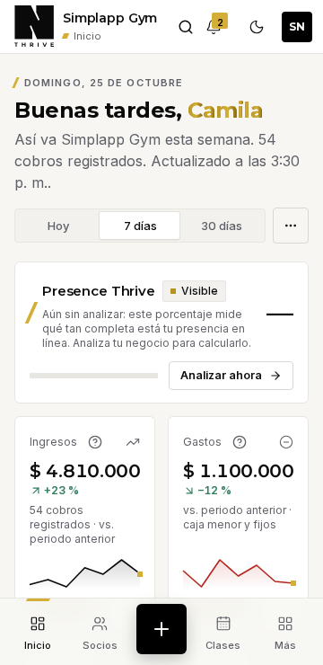
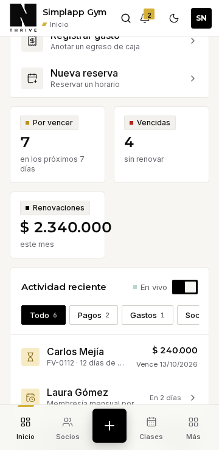
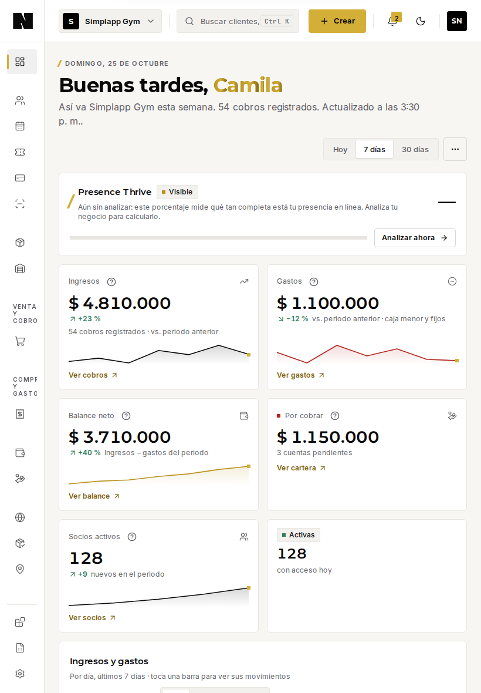

# Historia fiel del dashboard · paso 2

Fecha: 2026-11-02 · Historia: `Páginas/Inicio/Dashboard fiel` (`app/[tenant]/(app)/_components/dashboard-fiel.stories.tsx`) · Sin cambios en la interfaz de producción.

Sustituye como base de pruebas a las historias con marcadores «(muestra)» (`CustomizableDashboard`) y a la maqueta de ancho fijo `Panel completo`, que no se tocan.

## 1. Qué componentes reales se reutilizaron

| Pieza | Origen real |
|---|---|
| Shell completo: navegación lateral, barra superior, barra inferior móvil, paleta, banner de red | `components/templates/tenant-shell.tsx` (`TenantShell`) |
| Campana de notificaciones | `_components/tenant-notifications.tsx` (con `NotificationCenter`) |
| Estructura del Inicio y modo de edición | `CustomizableDashboard`, `DashboardMenu`, `PullToRefresh`, `PageHeader`, `RevealText` |
| Métricas | `KpiCard` (5), `StatTile` (4), `Delta` |
| Gráfica y su detalle | `IncomeChartPanel` → `IncomeChart` + `DayMovementsSheet`; `UrlSegmentedControl`; `CHART_CATALOG` |
| Presencia, primeros pasos, accesos rápidos | `PresenceSummary`, `WelcomeChecklist`, `QuickActions` |
| Movimientos y actividad | `RecentActivity` con sus filtros y registros |
| Estado de carga | `app/[tenant]/(app)/loading.tsx` (se importa el real) |
| Lógica pura | `quickCreateActions`, `computePresence`, `chartBuckets`, `runningBalance`, `comparison`, `cashFlow`, `countLabel`, `percentChange`, `getVerticalTerms`, `formatCurrency` |

No se creó ningún componente nuevo ni se duplicó ninguna implementación de interfaz.

## 2. Qué sigue siendo simulación

| Elemento | Simulación |
|---|---|
| Datos de finanzas, clientes, membresías, cartera y actividad | Fixtures en la historia (semana del 19 al 25 de oct. de 2026 y una cuenta nueva con ceros) |
| Detalle de la gráfica (`loadMovementsAction`) | Mock en `.storybook/mocks/movements-actions.ts` |
| Notificaciones (`loadNotificationsAction`) | Mock en `.storybook/mocks/notifications-actions.ts` |
| Sesión, rol y negocios | Valores fijos (`OWNER`, dos negocios) |
| Presencia | `computePresence` real con datos de muestra; sin escaneo de sitio |

## 3. Diferencias con el dashboard de producción

1. **La composición de widgets está replicada**, no compartida: `page.tsx` es un Server Component asíncrono y no se puede montar en Storybook. Si la página cambia, la historia tiene que cambiar con ella. **Recomendación** (cambio de producción, no hecho): extraer la composición a una vista presentacional que reciba los datos y que usen tanto la página como la historia, para que no puedan divergir.
2. No están `ThemeSync`, `AppEntrySplash` ni la sesión de Clerk (no afectan al diseño responsive).
3. Los datos no incluyen nombres largos, importes de siete cifras ni listas largas: **producción puede ser peor**, no mejor.
4. Los módulos activos son un conjunto fijo de gimnasio; otras verticales y módulos apagados cambian qué widgets aparecen.
5. **No existe un estado de error de ruta**: la ruta no tiene `error.tsx`, así que no hay historia de error del Inicio y no se inventó. Sí existe el error del detalle de la gráfica (`DayMovementsSheet`, con su propia historia).

## 4. Pruebas nuevas

`e2e/responsive.spec.ts` pasa de 100 a **197 pruebas** (9 viewports). Cada viewport ejecuta ahora, sobre la historia fiel:

| Prueba | Detalle |
|---|---|
| Sin desborde horizontal (Con datos, Cuenta nueva, Cargando) | Reflow de la página |
| Importes y textos sin recorte | Distingue **recorte** (se pierde información) de **truncado con puntos suspensivos** (se informa, no falla) e ignora filas con scroll horizontal propio |
| Barra superior sin superposición | Con la campana de producción |
| Objetivos táctiles de 24 px (AA) y de 44 px | La de 44 px lleva `test.fail` (P2-5) |
| Cuenta nueva: primeros pasos y actividad vacía | Estado vacío |
| Cargando: esqueleto dentro del shell | Estado de carga |
| Detalle de la gráfica | Hoja inferior a ancho completo bajo 768 px; panel lateral derecho desde 768 px |

Además, los detectores se afinaron (`medirTexto`, `medirSolapes` solo sobre la barra superior). Verificación: **197 de 197 en verde** y, con las marcas retiradas en una copia temporal, los fallos coinciden con las marcas.

## 5. Problemas responsive que aparecen con la historia fiel

Capturas: [móvil 360 px](con-datos-360.png) · [importe recortado](renovaciones-360.png) · [tablet 820 px](con-datos-820.png) · [escritorio 1280 px](con-datos-1280.png) · [cuenta nueva](cuenta-nueva-360.png) · [cargando](cargando-360.png). Todo medido en Chromium con emulación táctil.

| # | Gravedad | Hallazgo | Medida |
|---|---|---|---|
| **P1-3** | **P1** | **Los importes se recortan con datos realistas hasta 375 px**, no solo a 320 px. La auditoría anterior no lo veía porque su historia traía cifras cortas | 320 px: 5 importes (`$ 4.810.000`, `$ 1.100.000`, `$ 3.710.000`…); 360 y 375 px: «$ 2.340.000» (Renovaciones) se sale 10 px de su tarjeta; 412 px: ninguno |
| **P1-2** (ampliado) | **P1** | Con la campana de producción la barra superior se pisa a 360 px **aunque el negocio se llame «Simplapp Gym»**. La auditoría anterior lo atribuía al nombre largo | 360 px: «Buscar» [187–227] y «Notificaciones» [218–258] se pisan 9 px; 320 px: además chocan con la marca. Desde 375 px, sin solapes |
| **P2-5** | P2 | Los controles del contenido están muy por debajo de 44 px | A 360 px, 23 de 44 controles: selector de periodo (89×30), segmentos de la gráfica (30), filtros de actividad (32), «Analizar ahora» (32), ayudas (24×24), «Ver registro completo» (24). En tablet, 44 de 62. Ninguno baja de 24 px |
| **P2-6** | P2 | Etiquetas de tarjetas truncadas con puntos suspensivos en dos columnas: «Balance neto», «Por cobrar», «Socios activos», y el detalle de mora de la actividad («FV-0112 · 12 días de m…») | Truncados: 11 a 320 px, 6 a 360 px, 5 a 375 px, 1 a 412 px |
| **P2-4** (ampliado) | P2 | Los títulos de grupo de la barra lateral miden 10 px también en la barra **expandida** («General», «Clientes y agenda»…), y en el riel se recortan («VENTA Y COBRO») | 10 px en todos los anchos desde 768 px |
| P3-7 | P3 | Rejilla con huecos en tablet y escritorio: los cuatro tiles de membresías (3 de 12 columnas) dejan espacios vacíos junto a «Accesos rápidos», y «Socios activos» se estira a la altura del gráfico | Observación visual (capturas 820 y 1280 px); sin prueba |
| P3-8 | P3 | Texto con doble punto: «Actualizado a las 3:30 p. m..» | `page.tsx` añade `.` a `updatedLabel()`, que ya termina en punto |

**Dato que corrige la auditoría anterior:** el cambio a barra lateral con etiquetas ocurre a **1200 px** (`tenant-shell.module.css`), no entre 1100 y 1279 px. La decisión aprobada es 1024 px (paso 5).

**Lo que no apareció:** ningún desborde horizontal de página en ninguna de las tres historias y los nueve viewports; la hoja inferior y el panel lateral cambian donde se esperaba (768 px).

| 360 px · Con datos | 360 px · importe recortado | 820 px · Tablet |
|---|---|---|
|  |  |  |

## 6. Limitaciones

- Solo Chromium con emulación táctil; sin Safari, iPhone ni iPad reales: R2, R4 y R5 **no se dan por cumplidos**.
- Sin red lenta ni contraste renderizado.
- Los datos de muestra no cubren nombres largos ni cifras mayores.
- Los modos de edición del Inicio (reordenar, ocultar) y el arrastre no se probaron aquí (ya hay pruebas en `dashboard.spec.ts`).

## 7. Cómo ejecutarlo

```bash
pnpm test:responsive                                                    # los 9 viewports
pnpm exec playwright test --project=responsive -g "Inicio fiel"         # solo la historia fiel (Storybook construido)
pnpm storybook                                                          # y abrir «Páginas/Inicio/Dashboard fiel»
```

## 8. Siguiente

Con esta base, el paso 3 (corregir P1-2 y P1-3) tiene una prueba que hoy falla por el motivo correcto y que obliga a retirar su marca `test.fail` en el mismo PR.
