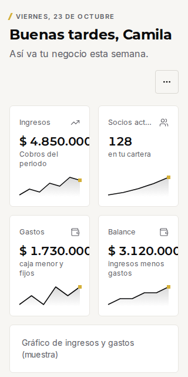
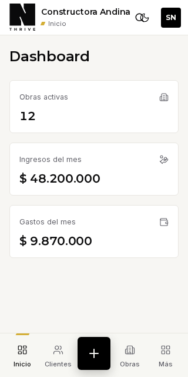
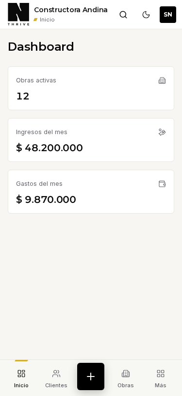
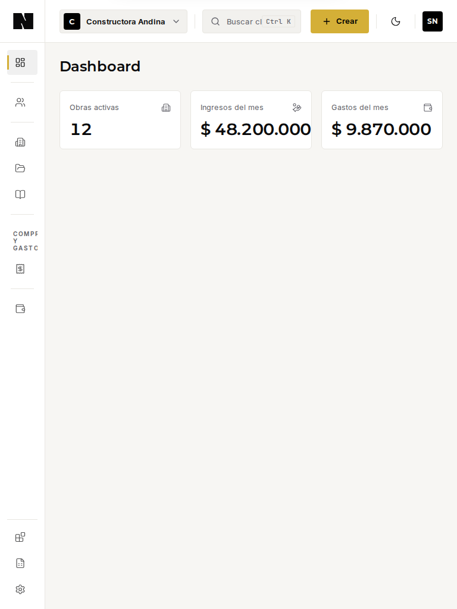

# Auditoría responsive del dashboard · piloto del principio 08

Fecha: 2026-11-02 · base: `main` en `ef1bdeb` · alcance: **solo auditoría**, sin cambios en componentes, tokens ni estilos.
Principio: [Mobile as a First-Class Experience](../../03-sistema/decisiones-nexus-design-system.md#4-principio-transversal-mobile-as-a-first-class-experience) (ratificado, con dos condiciones: resolver 375 frente a 412 px y definir la tablet; no dar R2, R4 ni R5 por cumplidos sin prueba real).

## 1. Resumen

- **El dashboard se comporta bien de 375 px en adelante**: sin desbordamiento de página, sin texto recortado y con la navegación inferior táctil por encima de 44 px.
- **Falla en 320 y 360 px**, que son anchos reales: importes recortados y botones de la barra superior superpuestos. Es el hallazgo más grave (dinero cortado).
- **Tablet (768–1279 px) es la zona menos resuelta**: riel de iconos sin etiquetas, etiqueta de grupo recortada, buscador truncado y atajo `Ctrl K` en una pantalla táctil.
- **Las acciones de cabecera y el cierre de hojas miden 40 px**: cumplen el mínimo AA (24 px) pero no los 44 px que fijamos para las acciones principales.
- **Hay tres referencias de móvil en conflicto**, no dos: 375 px (guía), 412 px (Playwright, Pixel 7) y 320 px (preset `mobile1` de Storybook).
- **Ningún criterio R1–R5 se da por cumplido todavía** (§8).

## 2. Método y alcance

| Aspecto | Qué se hizo |
|---|---|
| Entorno | Storybook estático del repositorio (sin Clerk ni base de datos) servido en local, Chromium con emulación táctil |
| Historias | `Organismos/CustomizableDashboard` (Default y ConGraficos), `Plantillas/TenantShell` (Desktop y WithModal) y `Páginas/Inicio/Panel completo` |
| Viewports | 320 · 360 · 375 · 412 · 768 · 834 · 1024 · 1280 px (capturas y medidas) y una rejilla de 18 anchos entre 320 y 1440 px para los umbrales |
| Medidas | Desbordamiento de página y de elementos, contenedores con scroll horizontal, recorte de texto, solapes entre controles, tamaño de cada control interactivo, tamaño mínimo de texto y de campos |
| Reproducible | [`herramientas/`](herramientas/) (tres scripts y sus resultados en JSON); instrucciones en §10 |

## 3. Viewports de referencia (condición 1)

### 3.1 Qué dicen los datos

| Rango medido | Resultado |
|---|---|
| 375 y 412 px | **Idénticos** en controles, desbordamiento y recorte: la discrepancia entre ambos no cambia ninguna medida |
| 360 px | Aparece un **solape de 8 px** entre «Buscar» y «Modo oscuro» en la barra superior |
| 320 px | **Importes recortados** y tres solapes en la barra superior |
| 768 px | Cambio brusco único: barra inferior → riel de iconos y hoja inferior → modal centrado |
| Entre 1100 y 1279 px | Aparecen las etiquetas de la barra lateral (la rejilla no fija el punto exacto) |

Las diferencias reales están **por debajo de 375 px**, no entre 375 y 412. Diseñar y probar solo a 375 oculta justo los anchos que fallan.

### 3.2 Propuesta

| Referencia | Ancho × alto | Para qué | Justificación |
|---|---|---|---|
| **Móvil mínimo** | 320 × 640 | Reflow (WCAG 1.4.10) | Es el suelo normativo; hoy falla |
| **Móvil estándar de diseño** | **360 × 740** | Referencia de diseño | El Android más común y el ancho más estrecho que ya falla; si funciona a 360, funciona de 375 a 412 |
| **Móvil grande (pruebas automáticas)** | 412 × 915 | Proyecto `movil` de Playwright (Pixel 7) | Se conserva tal cual |
| **Tablet** | **820 × 1180** (vertical) y 1180 × 820 (horizontal) | Referencia de tablet | Ver 3.3 |
| Escritorio | 1280 × 800 | Productividad | Se conserva |

375 px deja de ser una referencia propia (queda cubierto por 360 y 412; las medidas son idénticas entre ambos). La guía de `CLAUDE.md` pasaría de «375 y 1280» a «360, 412, 820 y 1280, y 320 como prueba de reflow». El preset `mobile1` de Storybook (320 × 568) se sustituye por viewports propios con estos valores.

### 3.3 Por qué 820 px para la tablet

- 768 px es **exactamente el umbral** del cambio de diseño: probar ahí no distingue «justo en el límite» de «holgado».
- Un iPad mini vertical mide **744 px**: hoy cae en el diseño de teléfono (barra inferior y hoja a ancho completo, medido a 700 y 767 px). Es un hallazgo en sí mismo (P5).
- 820 px es el ancho del iPad de 10,9" y queda **claramente dentro** del diseño de tablet; 834 px (iPad Pro 11" y preset de Storybook) se cubre dentro del mismo rango, cuyo diseño es idéntico de 768 a 1100 px.
- La tablet horizontal (1024–1180 px) se verifica aparte porque hoy **no tiene etiquetas** en la barra lateral.

## 4. Evidencia por viewport

Capturas en [`capturas/`](capturas/). `Inicio` es el organismo `CustomizableDashboard`; `Shell` es la plantilla `TenantShell` con navegación.

| Viewport | Inicio | Shell | Desborda la página | Controles <44 px (shell) | Texto mínimo |
|---|---|---|---|---|---|
| **320** | [captura](capturas/inicio-320.png): **importes recortados** | [captura](capturas/shell-320.png): **botones superpuestos** | No | 2 de 8 | 11 px |
| **360** | — | [captura](capturas/shell-360.png): solape de 8 px | No | 2 de 8 | 11 px |
| **375** | [captura](capturas/inicio-375.png): correcto | [captura](capturas/shell-375.png): correcto | No | 2 de 8 | 11 px |
| **412** | [captura](capturas/inicio-412.png): correcto | [captura](capturas/shell-412.png): correcto | No | 2 de 8 | 11 px |
| **768** | — | [captura](capturas/shell-768.png): riel de iconos | No | 14 de 16 | **10 px** |
| **834** | [captura](capturas/inicio-834.png) | [captura](capturas/shell-834.png) | No | 14 de 16 | **10 px** |
| **1024** | — | — | No | 14 de 16 | **10 px** |
| **1280** | [captura](capturas/inicio-1280.png): 4 columnas | [captura](capturas/shell-1280.png): lateral con etiquetas | No | 16 de 17 (puntero fino) | **10 px** |

Ningún ancho produjo desbordamiento horizontal de la página ni contenedores con scroll horizontal en estas historias.

| 320 px · Inicio | 320 px · Shell |
|---|---|
|  |  |

| 375 px · Shell | 768 px · Shell |
|---|---|
|  |  |

## 5. Hallazgos comprobados, priorizados

Gravedad: **P1** pierde información o impide usar · **P2** incumple un criterio acordado · **P3** inconsistencia o deuda.

| # | Gravedad | Hallazgo | Evidencia medida | Criterio |
|---|---|---|---|---|
| 1 | **P1** | **Importes recortados a 320 px**: 3 de las 4 tarjetas de métricas cortan el valor (`$ 4.850.000`, `$ 1.730.000`, `$ 3.120.000`) y «Socios activos» se trunca | Texto termina en 157 px y la tarjeta en 153 px (4 px de recorte; 20 px de fuente); el recorte no se ve como desbordamiento de página | R4 (reflow); principio «el dinero no se equivoca» |
| 2 | **P1** | **Botones superpuestos en la barra superior** a 320 y 360 px | 360 px: «Buscar» [234–274] y «Modo oscuro» [266–306] se pisan 8 px. 320 px: también chocan con el bloque de marca (222 px fijos) | R2, R3 |
| 3 | P2 | **Acciones de 40 px** en cabecera y cierre de hojas | «Buscar», «Modo oscuro», «Opciones del inicio» y «Cerrar» de las hojas miden 40 × 40; los ítems del riel de tablet 51 × 42 | R2 (44 px) |
| 4 | P2 | **Riel de tablet sin etiquetas** (768–1279 px) y **etiqueta de grupo recortada** («COMPRAS Y GASTOS» se corta en «COMPR / Y / GAST») a 10 px, por debajo del suelo de 11 px | Ancho del enlace 51 px con solo icono; las etiquetas aparecen a 1280 px | R3, R4; suelo de 11 px |
| 5 | P2 | **Un solo umbral (768 px) para todo**: navegación, hoja o modal. Una tablet vertical de 744 px recibe el diseño de teléfono | Barra inferior hasta 767 px; modal centrado desde 768 px | Principio 08 (tablet) |
| 6 | P2 | **Buscador truncado y atajo de teclado en pantalla táctil** a 768–820 px | Campo de 166 px a 768 px («Buscar cl…») con el atajo `Ctrl K` visible; 218 px a 820 px y 380 px desde 1023 px | R3 |
| 7 | P3 | **Campo de búsqueda a 14 px en tablet** (campos < 16 px: 1 de 1 desde 768 px) | Medido; **el zoom de Safari en iPad no se verificó** | R4 (decisión 1b) |
| 8 | P3 | **Etiquetas de la barra lateral solo desde 1280 px**: la tablet horizontal (1024–1279 px) trabaja con iconos | Ancho 51 px hasta 1100 px y 219 px desde 1279 px | R3 |
| 9 | P3 | **Tres referencias de móvil**: 375 px (guía), 412 px (Playwright), 320 × 568 px (Storybook `mobile1`) | `CLAUDE.md`, `playwright.config.ts`, preset de Storybook | Condición 1 |

**Lo que sí cumple** (medido): la barra inferior móvil (ítems de 72 × 54 px y botón «Crear» de 56 × 56 px) supera los 44 px; el logotipo de 222 × 60 px también. Ninguna historia produjo scroll horizontal ni desbordamiento de página; la hoja inferior a ancho completo y el modal centrado cambian exactamente a 768 px y de forma coherente con `ResponsiveSheet`.

## 6. Comportamientos adaptativos comprobados

Rejilla de 18 anchos (320–1440 px), historias `TenantShell`:

| Ancho | Navegación | Hoja o modal |
|---|---|---|
| 320–767 px | Barra inferior, sin barra lateral | **Hoja inferior** a ancho completo |
| 768–1100 px | **Riel de iconos** de 51 px | Modal centrado de 520 px |
| 1279–1440 px | Barra lateral de 219 px **con etiquetas** | Modal centrado de 520 px |

(El cambio a etiquetas ocurre entre 1100 y 1279 px; la rejilla no distingue el punto exacto, que hay que confirmar en el código antes de decidir.) El cambio de diseño ocurre en un solo punto (768 px); no hay un estado intermedio para tablets pequeñas ni un punto para la tablet horizontal.

## 7. Objetivos táctiles

| Control | Tamaño medido | ¿≥ 24 px (AA)? | ¿≥ 44 px? |
|---|---|---|---|
| Barra inferior: Inicio, Clientes, Obras, Más | 72 × 54 | Sí | **Sí** |
| Barra inferior: «Crear» | 56 × 56 | Sí | **Sí** |
| Logotipo con enlace | 222 × 60 | Sí | **Sí** |
| «Buscar» (móvil) | 40 × 40 | Sí | No |
| «Cambiar a modo oscuro» | 40 × 40 | Sí | No |
| «Opciones del inicio» | 40 × 40 | Sí | No |
| «Cerrar» de hojas y modales | 40 × 40 | Sí | No |
| Riel de tablet (ítems) | 51 × 42 | Sí | No (alto de 42 px) |
| Selector de negocio y «Crear» en tablet | 215 × 40 y 98 × 40 | Sí | No (alto de 40 px) |

**Ninguno baja de 24 px** (cumple el mínimo AA de WCAG 2.2). Lo que no cumple los 44 px es la fila de acciones de cabecera, que **no es la acción principal del flujo**; el criterio R2 exige 44 px a las acciones principales, así que esta medición es una **brecha de coherencia**, no un fallo estricto de R2. Hay que decidir si la cabecera táctil también adopta 44 px.

## 8. Limitaciones de las pruebas (no se dan por probados)

| Limitación | Efecto |
|---|---|
| **Las historias no son el dashboard real**: en `CustomizableDashboard` el gráfico y los movimientos son marcadores «(muestra)», y la historia `ConGraficos` se renderiza **igual que `Default`** en todos los anchos medidos | No se midieron gráficas, actividad reciente, tarjetas de plan ni la lista de acciones rápidas en móvil |
| **`Panel completo` es una maqueta de escritorio de ancho fijo** (margen lateral de 248 px y cuatro columnas) | Bajo 768 px produce 138–228 elementos fuera de pantalla: es un **artefacto de la maqueta**, no un hallazgo del producto; se descartó |
| Solo **Chromium** con emulación táctil, no Safari ni dispositivos reales | El zoom de Safari en iOS/iPad, los gestos, el teclado virtual y el área segura de la barra inferior **no se verificaron** |
| Sin datos reales ni sesión | No se vieron importes grandes, nombres largos ni estados de error y de carga |
| Sin red lenta ni modo sin conexión | R5 **no probado** |
| Contraste no medido sobre capturas | R4 queda parcial |
| Los umbrales se midieron en `TenantShell`, no en la app completa | Hay que confirmarlos con la ruta real |
| Observación visual sin medir | A 768 px el importe `$ 48.200.000` queda ajustado al borde de su tarjeta de tres columnas |

### Estado de los criterios

| Criterio | Estado tras la auditoría |
|---|---|
| R1 Cobertura funcional | **No evaluado**: se auditó solo lectura (el dashboard); falta recorrer flujos de tareas |
| R2 Interacción táctil | **Parcial**: medido en emulación; no se da por cumplido; ver §7 |
| R3 Navegación móvil | **Parcial**: la barra inferior es sólida; el solape y la tablet tienen brechas |
| R4 Accesibilidad | **No cumplido a 320 px** (importes recortados); sin medir contraste renderizado ni zoom |
| R5 Rendimiento y estados | **No probado** |

## 9. Propuesta de implementación (para aprobar antes de tocar código)

Orden de menor a mayor riesgo; cada paso es un PR pequeño, con capturas antes y después en los viewports de §3.2.

| Paso | PR | Contenido | Archivos probables | Verificación |
|---|---|---|---|---|
| 1 | **Infraestructura de pruebas** (sin cambios visuales) | Viewports de referencia en Storybook y proyectos de Playwright `movil-pequeno` (360 × 740) y `tablet` (820 × 1180); prueba de reflow a 320 px y de recorte de texto; prueba de objetivos táctiles que primero **informa** y luego **exige**; sustituir `mobile1` | `.storybook/preview.tsx`, `playwright.config.ts`, `e2e/` | Las pruebas deben **fallar hoy** en los hallazgos 1 y 2 (para demostrar que detectan) |
| 2 | **Historia fiel del Inicio** | Compone `TenantShell` + `CustomizableDashboard` con gráfico y movimientos reales (datos de muestra) en una sola historia responsive; retirar o rotular la maqueta de ancho fijo | historias bajo `app/[tenant]/(app)/_components/` | Reemplaza las limitaciones de §8 por medidas |
| 3 | **Corrección de P1** | Importes que no se cortan a 320 px (tipografía fluida o una columna bajo 360 px en las tarjetas de métricas) y barra superior que no se superpone (el bloque de marca cede ancho; acciones que no se encogen) | `kpi-card`, `app-topbar` | Pruebas del paso 1 en verde; capturas a 320, 360 y 412 |
| 4 | **Táctil** | Acciones de cabecera y cierre de hojas a 44 px **solo con puntero táctil** (`pointer-coarse`), sin cambiar el escritorio | `button-variants`, `app-topbar`, `responsive-sheet` | Prueba de objetivos exigente; **decisión previa:** ¿44 px también en la cabecera? |
| 5 | **Tablet** | Decidir con evidencia: etiqueta de grupo sin recorte; buscador sin atajo `Ctrl K` en táctil; punto de quiebre intermedio (p. ej. etiquetas desde 1024 px) | `app-sidebar`, `navbar-search` | Capturas a 744, 820 y 1180; **decisión previa de diseño** (§9.1) |
| 6 | **Campos a 16 px en móvil** (decisión 1b) | `fieldClasses` con `text-base md:text-sm`, validado en dispositivo | `components/atoms/input.tsx` | Prueba en iPhone/iPad reales |
| 7 | **Piloto de restaurantes** | Repetir esta auditoría sobre comandas, mesas y cocina | — | Informe equivalente |

### 9.1 Decisiones que necesito de ti

1. **Referencias**: ¿apruebas 320 · 360 · 412 · 820 · 1280 (y 1180 × 820 horizontal)?
2. **Táctil en cabecera**: ¿44 px también en las acciones de cabecera o solo en las principales?
3. **Tablet**: ¿riel con etiquetas visibles, riel de iconos con descripciones al enfocar, o cajón? Propongo **etiquetas desde 1024 px** y **riel con descripciones** por debajo, pero no lo implemento sin tu aprobación.
4. ¿Empiezo por el paso 1 (infraestructura de pruebas)? Es el único que no cambia nada visible y deja la verificación lista para los demás.

## 10. Cómo reproducir

```bash
pnpm build-storybook
python3 -m http.server 6117 --bind 127.0.0.1 --directory storybook-static &
export STORYBOOK_URL=http://127.0.0.1:6117 AUDIT_OUT=./salida-auditoria
node packages/brand/docs/06-auditorias/responsive-dashboard-2026-11/herramientas/medir-viewports.mjs   # capturas y medidas por viewport
node packages/brand/docs/06-auditorias/responsive-dashboard-2026-11/herramientas/medir-umbrales.mjs    # navegación y hoja o modal por ancho
node packages/brand/docs/06-auditorias/responsive-dashboard-2026-11/herramientas/medir-reflow-320.mjs  # recorte de texto y solapes
```

Las medidas guardadas de esta auditoría están en [`herramientas/`](herramientas/) (`medidas-viewports.json`, `medidas-umbrales.json`).
